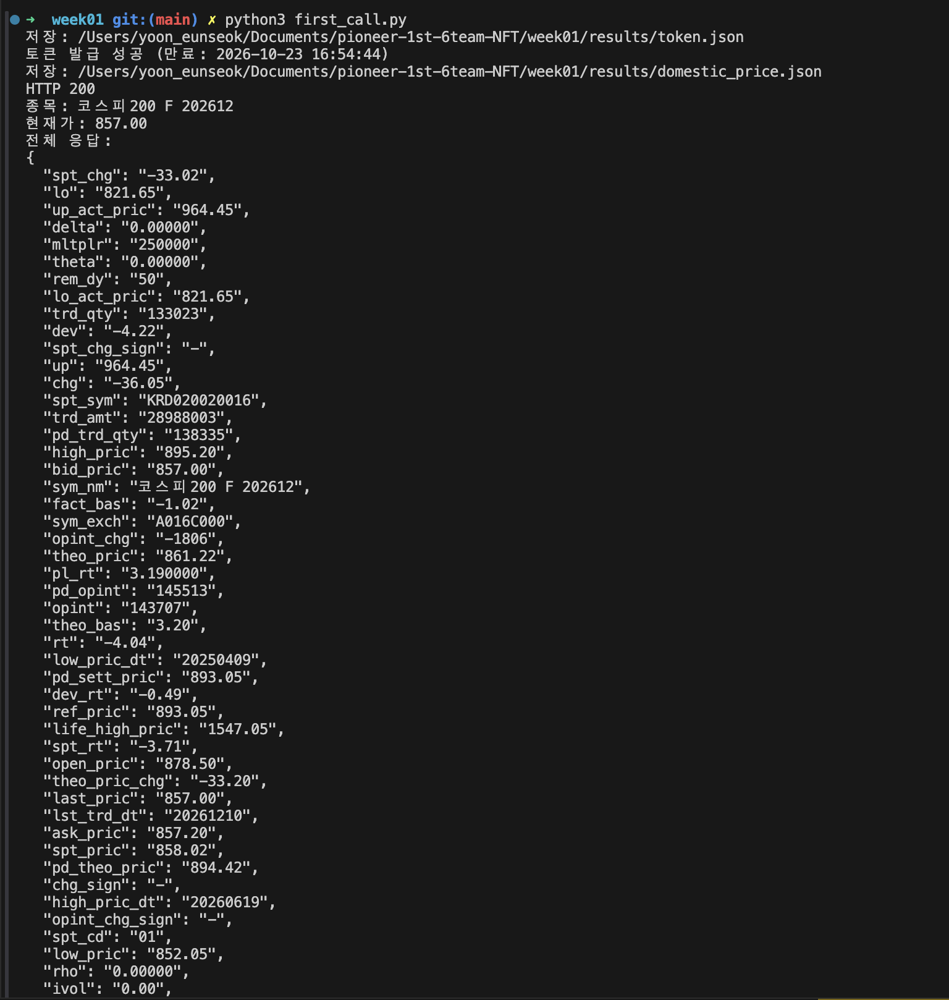

# 1주차 · API 키 발급과 팀 GitHub 준비

**제출일: 2026/10/23(금) 23:59 까지**

API 키를 발급받아 첫 호출을 해 보고, 팀 저장소를 만들어 팀 Discord 방에 링크를 올립니다.

## 제출 체크리스트

- [x] 계좌로 APP Key·Secret Key 발급
- [x] 발급받은 키로 API 한 번 호출해 응답 확인
- [x] 팀 GitHub 저장소 생성
- [x] README에 팀명과 간단한 소개 작성
- [x] 운영진의 저장소 접근 가능 여부 확인
- [ ] 10/23(금) 23:59 까지 팀 Discord 방에 저장소 링크 올리기

## API 첫 호출

| 항목 | 내용 |
| --- | --- |
| 환경 | 실전 서버 `https://api.futures.co.kr` — 시세 조회만, 주문 없음 |
| 호출한 API | ① 접근토큰 발급 `POST /auth-service/v1/token`<br>② 국내 현재가 `POST /trade/v1/domestic/price` |
| 요청 값 | ① `grant_type: client_credentials` (APP Key·Secret은 환경변수로 전달, form-urlencoded)<br>② `sym: A016C000` (코스피200 F 202612) |
| 응답 확인 | ① HTTP 200 · `token_type` Bearer · `expires_in` 86400(24시간)<br>② HTTP 200 · `sym_nm` 코스피200 F 202612 · `last_pric` 857.00 · `chg` -36.05 (`rt` -4.04%) · `bid_pric` 857.00 / `ask_pric` 857.20 · `mltplr` 250000 · `rem_dy` 50 |
| 호출 시각 | 2026-10-22 20:43 (장 마감 후 — 현재가는 당일 마지막 체결가) |
| 실행 근거 | [`results/token.json`](results/token.json) · [`results/domestic_price.json`](results/domestic_price.json) |



### 실행 방법

    pip install requests
    export NH_APP_KEY="발급받은 APP Key"
    export NH_APP_SECRET="발급받은 Secret Key"
    python3 first_call.py


토큰·키 등 인증정보는 이 문서와 캡처에 담지 않습니다.

## Discord에 올린 문구

```text
[Pioneer 1기 · 1주차]
팀명: NFT
GitHub 저장소: https://github.com/NH-REST-API-Pioneer/pioneer-1st-6team-NFT
API 첫 호출: (어떤 API 를 불러 봤는지 한 줄)
```

[전체 일정으로](../README.md)
