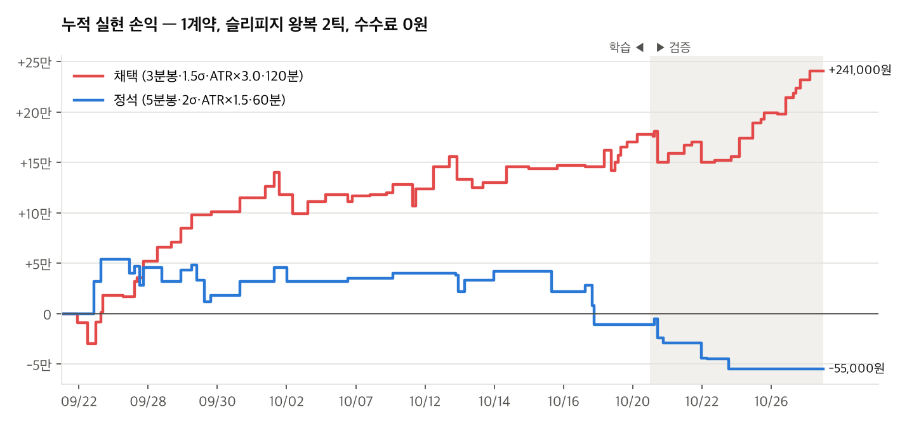
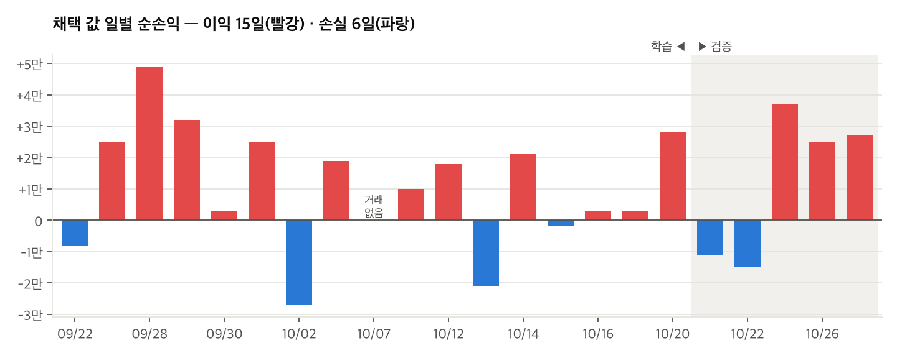

# 2주차 · 국내상품 전략 구현 — (대상 상품) (기준 봉) (전략 이름)

**제출일: 2026/10/30(금) 23:59 까지**

> 이 README 하나가 NFT 팀의 2주차 보고서이며, 수치는 모두 `results/` 의 원본 파일에서 읽은 값입니다.
> 이 실행은 **(앱 시뮬레이션 / 모의계좌)** 입니다. (앱 시뮬레이션이면: 실전 시세로 판정하지만 계좌에 주문을 내지 않았고, 체결은 종이 체결 모형이 계산한 값입니다. **모의계좌 체결이 아닙니다.**)
> 국내 (주간 / 야간) 실행은 (YYYY-MM-DD HH:MM:SS) 에 세워 (HH:MM:SS) 에 (종료 사유) 로 끝났습니다. 이 보고서의 실행 결과는 그 구간의 기록입니다.
> 전략을 그렇게 정한 근거와 최적화 과정은 별첨 [전략 근거 문서](week02-전략-근거.md)에 있습니다. 이 README에는 요약과 링크만 둡니다.

| 항목 | 내용 |
| --- | --- |
| 팀 | NFT (6팀) |
| 전략 이름 | (예: NFT_2주차_코스피200_EMA교차) |
| 전략 버전 id | `(예: nft-w2-k200-ema-YYYYMMDD)` |
| 대상 종목 | (예: 코스피200 선물 2026년 12월물 `A016C000`) |
| 실행 환경 | (앱 시뮬레이션 / 모의계좌) |
| 작성일 | (YYYY-MM-DD) |

## 폴더 구성

| 경로 | 내용 |
| --- | --- |
| `README.md` | 이 보고서 |
| [week02-전략-근거.md](week02-전략-근거.md) | 별첨 — 전략·손절·일일 한도를 정한 근거, 288개 조합 최적화와 학습/검증 결과 |
| [strategy.json](strategy.json) | 앱에 저장한 전략 설정 그대로 |
| [summarize_journal.py](summarize_journal.py) | 실행 기록·백테스트 결과를 표로 바꾸는 스크립트 |
| [results/](results/) | 원본 데이터 — 저장한 전략, 백테스트 답, 실행 상태 JSON, 실행 기록 |
| [screenshots/](screenshots/) | 실제 화면 캡처 |

## 1. 과제 요약

**과제:** NH선물 Open API 로 국내 선물·옵션 상품 하나에 대한 규칙 기반 전략을 구현하고, 실제로 실행한 기록으로 결과를 분석합니다.
수익률은 평가 기준이 아닙니다. 전략 실행, API 작동, 결과 분석, 오류와 개선, 재현성을 봅니다.

| 필수 기능 | 우리 팀이 한 것 | 근거 |
| --- | --- | --- |
| 시세 수신 | (예: 분봉 조회로 준비 봉, WebSocket 으로 실시간 체결·호가 수신) | (이벤트·실행 상태 칸) |
| 신호 판정 | (예: 1분봉 마감에서 EMA(5)·EMA(20) 교차 판정) | [strategy.json](strategy.json) |
| 주문 처리 | (예: 앱 시뮬레이션 종이 체결 / 모의계좌 주문) | (실행 기록의 칸) |
| 위험 관리 | (손절·익절·일일 손실 한도·최대 보유·세션 끝 정리) | [strategy.json](strategy.json) |
| 실행 기록 | (실행 id·시각·종목·설정과 신호·주문·체결·이벤트 기록) | (results/journal_….jsonl) |

| 제출물 | 이 폴더의 위치 |
| --- | --- |
| 소스코드·실행 방법 | `strategy.json`, `summarize_journal.py`, 2절 |
| 보고서 | 이 README |
| 실행 근거 | `results/`, 6절 |
| 화면 캡처 | `screenshots/`, 6절 (인증정보·계좌 식별정보 없음) |

선택 기능 중 한 것: (예: 백테스트와 실행 결과 비교, 주야간 세션 분리, 미체결·부분체결·거부·취소 처리, 호출 제한 대응, 결과 요약 스크립트)

테스트 원칙: 실전 계좌 주문은 하지 않습니다. 시뮬레이션 체결을 모의계좌 체결로 표현하지 않습니다. 주문 접수만 있으면 체결 성공으로 적지 않습니다. 실제로 발생한 오류만 적습니다.

## 2. 실행 방법

### 2-1. 앱 설치

(설치 방법과 APP Key·Secret Key 입력 위치. 키 값은 적지 않습니다.)

### 2-2. 전략 재현

**방법 1. 전략 설정 화면에서 같은 조건을 넣기** — (3절의 값을 넣고 저장 → 백테스트 → 실행을 세우는 순서)

**방법 2. `strategy.json` 을 저장 API 로 넣기**

```bash
curl -X PUT "http://127.0.0.1:(포트)/api/strategy/versions/(전략 버전 id)" \
  -H "Content-Type: application/json" \
  --data-binary @strategy.json
```

(월물이 바뀐 뒤 재현하면 결과가 달라질 수 있다는 점 등 재현 시 주의사항)

### 2-3. 요약 스크립트

`week02/` 폴더에서 실행합니다. (Python 버전, 추가 설치 여부)

```bash
# 실행 기록 요약
python summarize_journal.py --journal results/(journal 파일).jsonl --run (실행 id)

# 백테스트 요약
python summarize_journal.py --backtest results/(backtest 파일).json
```

- (기록 파일은 읽기만 하는지, 손익 계산 방식, 시각 기준(KST) 등)

## 3. 전략과 매매 계획

> 자세한 근거는 [전략 근거 문서](week02-전략-근거.md)를 보세요 — [1절 채택한 전략](week02-전략-근거.md#1-채택한-전략), 2절 손절 라인, 3절 일일 한도, [4절 최적화 과정](week02-전략-근거.md#4-최적화-과정).

### 3-1. 대상 상품

| 항목 | 값 | 출처 |
| --- | --- | --- |
| 종목 | ( ) | ( ) |
| 호가 단위 | ( ) | ( ) |
| 거래승수 | ( ) | ( ) |
| 1틱 가치 | ( ) | 위 두 값으로 계산 |
| 위탁증거금률 / 유지증거금률 | ( ) / ( ) | ( ) |
| 계약당 증거금 | ( ) | ( ) |
| 남은 만기일 수 | ( ) | ( ) |

**이 상품을 고른 까닭**

- (거래량·호가 촘촘함)
- (세션 구성)
- (월물 선택 이유)
- (틱 가치 등 손익 계산 편의)

### 3-2. 전략을 고른 까닭

| 후보 | 필요한 입력·설정 | 판단 |
| --- | --- | --- |
| **(채택한 전략)** | ( ) | ( ) |
| 가격 돌파 | ( ) | ( ) |
| 평균회귀 | ( ) | ( ) |
| 변동성 돌파 | ( ) | ( ) |

**기대한 동작.** (어떤 시장 국면에서 이익/손실이 날 것으로 예상했는지)

### 3-3. 지표와 기간을 정한 까닭

- **지표 선택:** ( )
- **기간 선택:** ( ) — 최적화 여부: ( )
- **기준 봉 선택:** ( )
- **판정 시점:** (봉 마감 / 실시간) 과 그 까닭

### 3-4. 매매 규칙

| 구분 | 조건 |
| --- | --- |
| 기준 봉 / 판정 | ( ) |
| 매수 진입 | ( ) |
| 매도 진입 | ( ) |
| 매수 청산 | ( ) |
| 매도 청산 | ( ) |
| 손절 / 익절 | ( ) / ( ) |
| 세션 끝 정리 | ( ) |
| 주문 | (유형·조건·수량) |
| 최대 보유 | ( ) |
| 일일 손실 한도 | ( ) |
| 증거금 예산 | ( ) |

<!--  -->

### 3-5. 규칙마다 그렇게 정한 까닭

| 규칙 | 값 | 까닭 | 결과에서 확인된 것 |
| --- | --- | --- | --- |
| 손절 | ( ) | ( ) | ( ) |
| 익절 | ( ) | ( ) | ( ) |
| 반대 신호 청산 | ( ) | ( ) | ( ) |
| 세션 끝 정리 | ( ) | ( ) | ( ) |
| 주문 유형 | ( ) | ( ) | ( ) |
| 수량·추가 진입 | ( ) | ( ) | ( ) |
| 일일 손실 한도 | ( ) | ( ) | ( ) |

### 3-6. 미리 알고 있던 약점

- ( )
- ( )

## 4. 사용 API와 프로그램 구조

### 4-1. 구조

```
[NH선물 Open API]
   ├─ REST      : ( )
   └─ WebSocket : ( )
        ↓
[전략 실행 (앱 / 자체 코드)]
   전략 설정 → 백테스트 → 실행
        ↓
[실행 기록 파일]
        ↓
[summarize_journal.py]  기록 → 표
```

### 4-2. 사용 API

| 용도 | API 명 (명세 문서) | 방식 |
| --- | --- | --- |
| 접근 토큰 발급 | ( ) | REST |
| WebSocket 접속키 발급 | ( ) | REST |
| 지난 봉 조회 | ( ) | REST |
| 상품 세부정보 | ( ) | REST |
| 실시간 체결 | ( ) | WebSocket |
| 실시간 호가 | ( ) | WebSocket |
| 주문 (호출했다면) | ( ) | REST |

### 4-3. 기록 형식

| 갈래 | 담긴 것 |
| --- | --- |
| `event` | ( ) |
| `order` | ( ) |
| `fill` | ( ) |
| `trade` | ( ) |

## 5. 실행 환경

| 항목 | 내용 |
| --- | --- |
| 환경 | (앱 시뮬레이션 / 모의계좌) |
| 계좌 주문 | (없음 / 모의계좌) |
| 가상 자금 | ( ) |
| 수수료 | ( ) |
| 실행 id | `( )` — (세운 시각 KST) |
| 실행 종료 | (종료 시각 KST, 종료 사유) |
| 준비 봉 | ( ) |
| 백테스트 | (실행 시각, 체결 모형) |
| 시간대 | 모든 시각은 한국 시간(KST) |

## 6. 실행 결과

### 6-1. 근거 파일 (`results/`)

| 파일 | 내용 |
| --- | --- |
| (strategy_version_saved.json) | 앱이 저장한 전략 전체 |
| (backtest_….json) | 백테스트 답 전체 |
| (run_added_….json) | 실행을 세운 직후의 실행 상태 |
| (snapshot_….json) | 실행 중·종료 시점 스냅샷 |
| (journal_….jsonl) | 실행 기록 줄만 거른 사본 (줄 수·갈래별 수) |

### 6-2. 백테스트 결과 (지난 봉)

| 항목 | 값 |
| --- | --- |
| 체결 모형 | ( ) |
| 봉 범위 | ( ) |
| 슬리피지 / 수수료 | ( ) / ( ) |
| 신호 수 | ( ) |
| 체결 수 | ( ) |
| 거래 수 | ( ) |
| 승 / 패 | ( ) / ( ) |
| 승률 | ( ) |
| 순손익 | ( ) |
| 최대 낙폭 | ( ) |
| 평균 이익 / 평균 손실 | ( ) / ( ) |

청산 까닭별 건수:

| 청산 까닭 | 건수 |
| --- | --- |
| 손절 | ( ) |
| 익절 | ( ) |
| 반대 신호 | ( ) |
| 세션 끝 정리 | ( ) |

거래일별 결과:

| 거래일 | 거래 | 승 | 패 | 순손익 |
| --- | --- | --- | --- | --- |
| ( ) | ( ) | ( ) | ( ) | ( ) |

<details>
<summary>백테스트 가정 전체</summary>

| 뜻 | 키 | 값 |
| --- | --- | --- |
| ( ) | ( ) | ( ) |

</details>

<details>
<summary>백테스트 거래 전체</summary>

| # | 진입 봉 | 청산 봉 | 방향 | 수량 | 진입가 | 청산가 | 청산 까닭 | 총손익 | 수수료 | 순손익 | 보유시간 |
| --- | --- | --- | --- | --- | --- | --- | --- | --- | --- | --- | --- |
| 1 | ( ) | ( ) | ( ) | ( ) | ( ) | ( ) | ( ) | ( ) | ( ) | ( ) | ( ) |

</details>

<!--  -->





차트는 `python3 plot_backtest.py` 로 그렸습니다. 최적화 과정의 그림(밴드 폭 × 손절 히트맵, 학습 vs 검증)은 [전략 근거 4-4 · 4-5](week02-전략-근거.md#4-4-학습-기간에서-찾기)에 있습니다.

### 6-3. 국내 (주간 / 야간) 실행 결과

| 항목 | 값 |
| --- | --- |
| 실행 시작 \~ 종료 | ( ) |
| 신호 / 체결 / 거래 | ( ) / ( ) / ( ) |
| 승 / 패 | ( ) / ( ) |
| 순손익 / 수수료 | ( ) / ( ) |
| 최대 낙폭 | ( ) |
| 청산 까닭별 건수 | ( ) |
| 미체결 · 거부 · 취소 | ( ) · ( ) · ( ) |
| 데이터 공백 · 오류 이벤트 | ( ) |
| 종료 시 보유 · 평가손익 | ( ) |
| 세션 끝 정리 | (작동 여부) |

거래 목록:

| # | 진입 | 청산 | 방향 | 진입가 | 청산가 | 청산 까닭 | 순손익 | 보유시간 |
| --- | --- | --- | --- | --- | --- | --- | --- | --- |
| 1 | ( ) | ( ) | ( ) | ( ) | ( ) | ( ) | ( ) | ( ) |

신호 봉 종가와 진입 체결가:

| # | 신호 시각 | 신호 봉 종가 | 진입 체결가 |
| --- | --- | --- | --- |
| 1 | ( ) | ( ) | ( ) |

<details>
<summary>실행 이벤트 전체</summary>

| 시각 | 갈래 | 글 |
| --- | --- | --- |
| ( ) | ( ) | ( ) |

</details>

<!--  -->

### 6-4. 그 밖의 화면

<!--  -->

(캡처 시각·환경 설명. 인증정보·계좌 식별정보가 보이지 않는지 확인)

## 7. 결과 해석과 한계

### 7-1. 백테스트 결과 해석

> 정석 값 → 288개 조합 → 채택 값의 학습/검증 비교는 [전략 근거 4-5절](week02-전략-근거.md#4-5-고른-조합과-검증)에 있습니다.

**1) ( )**

**2) ( )**

**3) ( )**

### 7-2. 실행 결과 해석

- (백테스트와 비교한 양상)
- (체결가·슬리피지)
- (표본 크기의 한계)

### 7-3. 백테스트 가정과 한계

> 체결 가정은 [전략 근거 4-2절](week02-전략-근거.md#4-2-백테스트-체결-가정-min1-v2), 한계는 [4-6절](week02-전략-근거.md#4-6-한계--보고서에-반드시-적을-것)에 있습니다.

- ( )

### 7-4. 체결 모형 (종이 체결 / 모의계좌) 과 한계

- ( )

## 8. 오류 제보와 개선사항

### 8-1. 오류 제보

> 실제로 발생한 오류만 적습니다.

| 항목 | 내용 |
| --- | --- |
| 발생한 API 오류 | ( ) |
| 데이터 공백 이벤트 | ( ) |
| 기타 이상 동작 | ( ) |

**관찰 1. ( )**

| 항목 | 내용 |
| --- | --- |
| 화면 | ( ) |
| 재현 조건 | ( ) |
| 기대 결과 | ( ) |
| 실제 결과 | ( ) |
| 근거 | ( ) |

### 8-2. 개선사항

| 확인한 문제 | 개선 방향 |
| --- | --- |
| ( ) | ( ) |

## 9. 향후 계획

1. ( )
2. ( )
3. ( )

인증정보와 계좌 식별정보는 이 폴더 어디에도 담지 않았습니다.

[전체 일정으로](../README.md)
