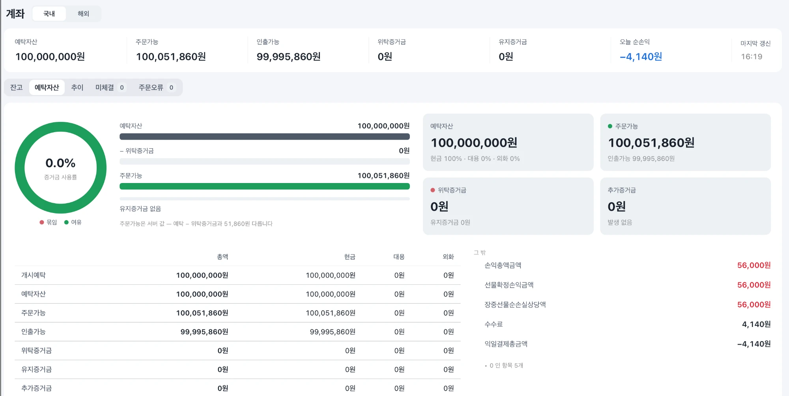

# 2주차 국내상품 전략 구현: 미국달러 선물 5분봉 볼린저 밴드 + RSI 평균회귀

제출일: 2026/10/30(금) 23:59

NFT 팀 2주차 보고서입니다. 보고서에 나오는 숫자는 모두 `results/` 폴더의 원본 파일에서 가져왔습니다.

- 실행 환경은 모의계좌입니다. 모의 서버(`apidemo`)에 모의 키(토큰 scopes `S`)로 접속해서 모의계좌에 시장가 주문을 넣었고, 체결가는 주문내역 API로 확인했습니다.
- 실행은 10/29(09:25:31 ~ 15:31:01)와 10/30(09:24:33 ~ 15:31:01) 두 번 했습니다. 두 번 모두 15:31에 잔고 0계약으로 정상 종료했고, 같은 API 키와 같은 모의계좌를 썼습니다.
- 전략을 정한 과정과 최적화 내용은 [볼린저+RSI 전략 근거](week02-전략-근거-볼린저RSI.md)와 [VWAP 전략 근거](week02-전략-근거-VWAP.md)에 따로 정리했습니다.

| 항목 | 내용 |
| --- | --- |
| 팀 | NFT (6팀), 이상재 · 윤은석 |
| 전략 이름 | NFT_2주차_미국달러_볼린저RSI |
| 대상 종목 | 미국달러 F 202611 (2026년 11월물) `A756B000` |
| 실행 환경 | 모의계좌 (직접 작성한 `runner.py --orders`) |
| 비교 전략 | VWAP 밴드 평균회귀 (백테스트, 같은 이틀 리플레이) |
| 작성일 | 2026-10-30 |

## 폴더 구성

| 경로 | 내용 |
| --- | --- |
| `README.md` | 보고서 |
| [week02-전략-근거-볼린저RSI.md](week02-전략-근거-볼린저RSI.md) | 메인 전략 근거: 손절, 일일 한도, 432개 조합 최적화, 학습/검증 |
| [week02-전략-근거-VWAP.md](week02-전략-근거-VWAP.md) | 비교 전략(VWAP) 근거: 288개 조합 최적화 |
| [nh_client.py](nh_client.py) | NH선물 REST 클라이언트 (토큰, 시세, 계좌, 주문). 모의 서버만 사용, 호출 제한 처리 |
| [strategy_bb.py](strategy_bb.py), [strategy.py](strategy.py) | 전략 규칙 (볼린저+RSI, VWAP). `Params` 기본값이 채택한 값 |
| [backtest_bb.py](backtest_bb.py), [backtest.py](backtest.py) | 백테스트와 최적화 |
| [runner.py](runner.py) | 실행기 (모의계좌 주문, 종이 체결, 리플레이) |
| [summarize_runs.py](summarize_runs.py) | 실행 기록을 6-3절 표로 정리 |
| [fetch_data.py](fetch_data.py) | 1분봉과 상품 정보 받기 |
| [test_strategy_bb.py](test_strategy_bb.py) | 지표 계산과 신호 규칙 테스트 (8개) |
| [plot_backtest_bb.py](plot_backtest_bb.py), [plot_backtest.py](plot_backtest.py) | 백테스트 차트 |
| [results/](results/) | 1분봉, 백테스트 결과, 실행 기록 |
| [screenshots/](screenshots/) | 화면 캡처 |

## 1. 과제 요약

NH선물 Open API로 국내 선물 상품 하나에 규칙 기반 전략을 구현하고, 실제로 실행한 기록을 가지고 결과를 분석하는 과제입니다. 수익률은 평가 기준이 아니고 전략 실행, API 동작, 결과 분석, 오류와 개선, 재현성을 봅니다.

| 필수 기능 | 구현 내용 | 근거 |
| --- | --- | --- |
| 시세 수신 | 시작할 때 차트(분)로 준비 봉 1,499개를 받고, 장중에는 매분 막 끝난 1분봉을 차트(분)로 받음. 현재가는 1초마다 조회 | [runner.py](runner.py) `live()`, 실행 기록의 `준비 봉` |
| 신호 판정 | 1분봉을 5분봉으로 묶어서 봉이 끝날 때 볼린저(20, 1.5σ)와 RSI(14)로 판정 | [strategy_bb.py](strategy_bb.py), 기록 `signal` |
| 주문 처리 | 모의계좌 시장가 1계약(FAS) 주문, 주문내역으로 체결가와 체결 수량 확인, 예수금으로 수수료 확인 | `MockAccountBroker`, 기록 `order`, `fill` |
| 위험 관리 | 손절 ATR×1.5(최소 3틱), 중심선 익절, 120분 시간 청산, 하루 손절 2회 제한, 15:30 전량 청산, 시작 시 남은 잔고 정리, 비정상 종료 시 정리 | [strategy_bb.py](strategy_bb.py), [runner.py](runner.py) |
| 실행 기록 | 이벤트, 신호, 주문, 체결, 거래, 계좌 정보를 jsonl로 한 줄씩 저장하고 종료 시 요약 JSON 저장 | `results/runs/*/journal.jsonl`, `summary.json` |

| 제출물 | 위치 |
| --- | --- |
| 소스코드, 실행 방법 | `*.py`, 2절 |
| 보고서 | README |
| 실행 근거 | `results/`, 6절 |
| 화면 캡처 | `screenshots/`, 6-5절 (계좌번호 등은 화면에 없음) |

선택 기능으로는 백테스트와 최적화(학습/검증 분리), 같은 날 리플레이로 백테스트와 실행 비교, 두 전략 비교, 수수료 반영, 호출 제한 처리(초당 호출 수 제한, 재시도), 체결 미확인과 주문 거부 처리, 결과 요약 스크립트를 했습니다.

테스트할 때 지킨 것:
- 실전 계좌로는 주문하지 않았습니다. 클라이언트가 모의 서버만 쓰고, 토큰 scopes가 서버와 다르면 멈춥니다.
- 종이 체결 결과를 모의계좌 체결이라고 쓰지 않았습니다.
- 주문 접수만으로 체결됐다고 보지 않았습니다. 주문내역 API에서 체결 상태를 확인한 것만 체결로 셉니다.

## 2. 실행 방법

### 2-1. 준비

Python 3.12 이상(3.9에서도 결과 같음), `requests`가 필요하고 차트를 그리려면 `matplotlib`도 필요합니다.

```bash
cd week02
python3 -m pip install -r requirements.txt
```

API 키는 환경 변수 `NH_APP_KEY`, `NH_APP_SECRET`이나 `~/.nh_futures/credentials.env` 파일에 넣습니다. 저장소 밖에 두기 때문에 키 값은 저장소에 없습니다. 토큰은 `~/.nh_futures/token_demo.json`에 저장해 두고 다시 씁니다.

### 2-2. 데이터, 백테스트, 실행

```bash
python3 fetch_data.py                                                   # 1분봉 받기 (results/data/)
python3 -m unittest test_strategy_bb -v                                 # 지표 계산 테스트
python3 backtest_bb.py --optimize --train-end 20261020 --min-trades 15  # 432개 조합 최적화
python3 backtest_bb.py                                                  # 채택 값 백테스트
python3 plot_backtest_bb.py                                             # 차트 (results/charts_bb/)

# 장중 실행. 맥이 잠자기로 들어가지 않게 caffeinate 사용. 09:30 전에 켜면 15:31에 자동 종료
caffeinate -i -s python3 runner.py --strategy bb --orders               # 모의계좌 주문
python3 runner.py --strategy vwap                                       # 종이 체결 (주문 안 냄)

# 지난 날짜 다시 돌리기 (서버 접속 없음, 종이 체결, 수수료 체결당 690원)
python3 runner.py --strategy vwap --replay 20261030 --data results/data/bars_1m_A756B000_20261030.csv
```

- 실행 결과는 `results/runs/<날짜>_<전략>_<orders|paper|replay>/`에 저장됩니다. 같은 날 다시 켜면 기록을 이어서 쓰고, 그날 이미 나온 손절 횟수도 이어서 셉니다.
- 백테스트용 데이터(`bars_1m_A756B000.csv`, 09/22 ~ 10/27)는 그대로 두고, 실행한 이틀을 리플레이하려고 10/30 장 마감 후에 받은 1분봉을 `bars_1m_A756B000_20261030.csv`로 따로 저장했습니다.
- 11/16 만기 이후에 데이터를 다시 받으면 최근월물이 바뀌어서 결과가 달라집니다.

### 2-3. 요약 스크립트

```bash
python3 summarize_runs.py                                  # results/runs/ 전체
python3 summarize_runs.py results/runs/20261030_bb_orders  # 한 번의 실행만
```

기록 파일은 읽기만 합니다. 손익은 체결가 차이(틱) × 1,000원으로 계산하고, 수수료는 기록에 있는 값(모의계좌는 예수금의 수수료 변화)을 쓰고 기록에 없으면 체결당 690원으로 계산합니다. 시각은 모두 한국 시간입니다.

## 3. 전략과 매매 계획

자세한 내용은 [볼린저+RSI 전략 근거](week02-전략-근거-볼린저RSI.md)의 [1절 채택한 전략](week02-전략-근거-볼린저RSI.md#1-채택한-전략), [2절 손절](week02-전략-근거-볼린저RSI.md#2-손절-atr--15-후보-1의-30보다-좁게-둔-이유), [3절 일일 한도](week02-전략-근거-볼린저RSI.md#3-일일-한도-손절-2회-후보-1과-같은-규칙), [4절 최적화](week02-전략-근거-볼린저RSI.md#4-최적화-과정)에 있습니다.

### 3-1. 대상 상품

| 항목 | 값 | 출처 |
| --- | --- | --- |
| 종목 | 미국달러 F 202611 `A756B000` (최근월물) | 선물전체시세 `results/data/usd_futures_all.json` |
| 호가 단위 | 0.1원 | 품목별 세부정보 `cd_val_inf_1` (`product_detail.json`) |
| 거래승수 | 10,000 (US$10,000) | 같은 파일 `mltplr` |
| 1틱 가치 | 1,000원 | 0.1 × 10,000, 같은 파일 `tick_val`과 같음 |
| 위탁증거금률 / 유지증거금률 | 4.86% / 3.24% | 같은 파일 `init_mrgn`, `mtn_mrgn` |
| 계약당 증거금 | 643,026.6원 | 같은 파일 `ctr_init_mrgn` |
| 거래 시간 / 종가 단일가 | 09:00 ~ 15:45 / 15:35 ~ 15:45 | 같은 파일 `cd_val_inf_4`, `cd_val_inf_3` |
| 최종거래일 | 2026-11-16 | 같은 파일 `exp_dt` |

실행기는 시작할 때마다 품목별 세부정보로 틱(0.1)과 틱가치(1,000)를 다시 확인하고, 값이 다르면 실행하지 않습니다.

상품을 고른 이유:
- 코스피200과 국채 선물은 다른 팀이 먼저 골랐습니다. 미국달러 선물은 거래량이 많습니다(11월물이 최근월물이 된 10/13 이후 하루 60만 ~ 87만 계약).
- 1틱이 1,000원이라 손익 계산이 간단하고, 1계약 증거금이 약 64만 원이라 모의계좌 1억 원으로 충분합니다.

### 3-2. 전략을 고른 이유

환율은 하루 중에 큰 추세보다 일정한 값 근처에서 오르내리는 날이 많다고 보고 평균회귀 전략으로 정했습니다. 평균회귀 전략 두 가지를 같은 데이터와 같은 체결 가정으로 비교했습니다.

| 후보 | 기준선과 진입 | 백테스트 22일 (수수료 반영) | 판단 |
| --- | --- | --- | --- |
| 볼린저 + RSI (메인) | SMA(20) ± 1.5σ를 벗어나고 RSI ≤ 35 또는 ≥ 65이면 바로 진입 | 43건, +134,660원, 최대 낙폭 51,000원 | 채택. RSI가 추세 구간의 진입을 줄여 주고, 많이 쓰는 지표라 다른 도구로도 재현하기 쉬움 |
| VWAP 밴드 (비교) | 세션 VWAP ± 1.5σ 밖으로 나갔다가 다시 안으로 들어오면 진입 | 65건, +151,300원, 최대 낙폭 41,000원 | 백테스트는 더 좋았지만 비교용으로 둠. 10/29 실행 전에 메인을 정해야 했고, 은석님이 볼린저로 모의계좌를 먼저 돌림 |
| 가격 돌파, 변동성 돌파 | - | - | 추세를 따라가는 전략이라 이번 가설(가격이 되돌아온다)과 맞지 않음 |

예상한 결과: 밴드 밖으로 많이 밀렸다가 중심선으로 돌아오는 날(박스권)에는 이익, 한 방향으로 계속 가는 날(추세)에는 손절이 납니다. 추세가 나오는 날의 손실은 RSI 조건과 하루 손절 2회 제한으로 줄이려고 했습니다.

### 3-3. 지표와 기간을 정한 이유

- 지표: 볼린저 밴드로 평균에서 얼마나 멀어졌는지 보고, RSI로 최근에 한쪽으로 얼마나 몰렸는지 봅니다. 밴드만 쓰면 추세가 나오는 날 밴드 밖으로 나간 봉마다 진입하게 되어서, RSI로 많이 밀린 경우만 남겼습니다. RSI를 빼면 최대 낙폭이 2배가 됩니다.
- 기간: 볼린저 20, RSI 14, ATR 14는 많이 쓰는 기본값으로 고정했습니다. 밴드 폭, RSI 기준, 판정 봉, 진입 방식, 손절 배수, 시간 청산 6가지는 432개 조합을 돌려서 정했습니다(학습 09/22 ~ 10/20, 검증 10/21 ~ 10/27).
- 기준 봉: 5분봉. 1분봉은 144개 조합 중 142개가 손실이었고(밴드가 잡음에 반응하고 슬리피지 영향이 큼), 15분봉은 거래가 너무 적었습니다.
- 판정 시점: 봉이 끝날 때 한 번 판정합니다. 백테스트와 실행이 같은 봉(차트(분) API)으로 판정하도록 아직 진행 중인 봉은 쓰지 않았습니다. 손절과 익절은 1초마다 현재가로 확인합니다.

### 3-4. 매매 규칙

| 구분 | 조건 |
| --- | --- |
| 기준 봉 / 판정 | 5분봉 / 봉이 끝날 때 (분이 바뀌고 3초 뒤 차트 조회) |
| 매수 진입 | 종가 < 하단(중심선 − 1.5σ) 이고 RSI(14) ≤ 35이면 바로 시장가 매수 |
| 매도 진입 | 종가 > 상단(중심선 + 1.5σ) 이고 RSI(14) ≥ 65이면 바로 시장가 매도 |
| 익절 | 현재가가 중심선(마지막으로 끝난 5분봉의 SMA(20))에 닿으면 |
| 손절 | 진입가에서 ATR(5분봉 14개) × 1.5만큼 불리한 가격, 최소 3틱 |
| 시간 청산 | 진입 후 120분 |
| 장 마감 정리 | 15:30에 보유 전량 시장가 청산, 15:31 실행 종료 |
| 진입 가능 시간 | 09:30 ~ 15:00 |
| 주문 | 시장가, 체결조건 FAS, 1계약 |
| 최대 보유 / 추가 진입 | 1계약 / 없음. 청산 후 1봉 쉬고, 중심선까지 3틱이 안 남았으면 진입하지 않음 |
| 일일 한도 | 그날 손절이 2번 나오면 그날은 더 진입하지 않음 |
| 증거금 | 1계약 약 64만 원 (모의계좌 1억 원의 0.6%) |

### 3-5. 규칙별로 정한 이유

| 규칙 | 값 | 이유 | 실행에서 확인한 것 |
| --- | --- | --- | --- |
| 손절 | ATR × 1.5 | 하루 고저폭이 40 ~ 218틱으로 날마다 달라서 고정 틱은 맞지 않음. 밴드를 벗어나자마자 들어가기 때문에 틀렸을 때 빨리 끊는 게 학습 기간에서 나았음 (×2.0은 +137,000원, ×3.0은 +12,000원) | 실행 손절 폭 13 ~ 21틱. 10/29 손절 2건의 실제 손실은 21, 22틱 (손절 폭 + 1틱) |
| 익절 | 중심선 | 평균회귀라서 평균으로 돌아오면 청산 | 10/30 익절 3건 +17 ~ +21틱 |
| 반대 신호 청산 | 안 씀 | 반대쪽 밴드까지 가기 전에 중심선 익절이 먼저 나옴 | - |
| 장 마감 정리 | 15:30 | 종가 단일가(15:35) 전에 청산해서 체결가를 예측할 수 있게 | 두 날 모두 15:30 전에 포지션이 없었음 |
| 주문 유형 | 시장가 FAS | 1계약이라 체결이 우선. 지정가와 미체결 처리는 6주차에 다룰 예정 | 주문이 모두 1초 안에 전량 체결 |
| 수량 | 1계약, 추가 진입 없음 | 결과를 틱 단위로 바로 볼 수 있게 | - |
| 일일 한도 | 손절 2회 | 손절 폭이 ATR에 따라 바뀌어서 금액으로 정하면 날마다 의미가 달라짐. 횟수로 정해서 두 번 틀린 날은 멈추게 함 | 10/29 13:44 매도 신호에서 진입하지 않음 (그날 손절 2회 이후) |

### 3-6. 미리 알고 있던 약점

- 표본이 작습니다. 백테스트 22일 동안 43건, 검증 5일 동안 7건입니다.
- 평균 손실과 평균 이익이 거의 같습니다(−15,067원 / +15,000원). 승률이 떨어지면 바로 손실이 됩니다.
- 밴드 폭에 민감합니다. 1.5σ를 2.0σ로 바꾸기만 해도 학습 기간 손익이 손실로 바뀝니다.
- 학습 기간 이익 대부분이 이 월물의 거래가 적던 원월물 시기에 났습니다.
- 432개 조합 중에서 고른 것이라 과최적화 위험이 있습니다.

## 4. 사용 API와 프로그램 구조

### 4-1. 구조

```
NH선물 Open API (모의 서버 apidemo.futures.co.kr, REST POST)
  초당 호출 제한: 시세 10, 계좌 10, 주문 5
        |
nh_client.py   토큰 저장, scopes 확인(S=모의), 재시도, 응답의 숫자 문자열을 float로 변환
        |
runner.py      1분봉/현재가 조회 → 전략 객체에 전달 → 신호가 나오면 주문
               → 손절, 익절, 시간 청산, 15:30 정리 확인
        |                         |
strategy_bb.py, strategy.py       MockAccountBroker: 주문 → 주문내역으로 체결 확인 → 예수금으로 수수료 확인
(백테스트와 같은 코드)             PaperBroker: 종이 체결 (±1틱, 수수료 690원)
        |
results/runs/.../journal.jsonl, summary.json  →  summarize_runs.py  →  README 표
```

실행기는 백테스트와 같은 전략 코드를 씁니다. 그래서 같은 날짜를 리플레이하면 실제 실행과 같은 신호가 나와야 하고, 6-3절에서 실제로 비교했습니다.

### 4-2. 사용 API

| 용도 | API 경로 | 사용 시점 |
| --- | --- | --- |
| 접근 토큰 발급 | `/auth-service/v1/token` | 시작할 때 (저장된 토큰이 있으면 재사용) |
| 품목별 세부정보 | `/trade/v1/domestic/product-detail` | 틱, 틱가치 확인 |
| 선물전체시세 | `/trade/v1/domestic/price-all-futures` (prd 75) | 최근월물 선택 (플렉스 선물 제외) |
| 현재가 | `/trade/v1/domestic/price` | 1초마다 손절, 익절 확인 |
| 차트(분) | `/trade/v1/domestic/chart-minute` | 준비 봉 1,499개, 매분 끝난 봉 |
| 예수금 | `/trade/v1/domestic/deposit` | 시작, 체결 직후, 종료 때 수수료와 확정손익 확인 |
| 잔고(미결제약정) | `/trade/v1/domestic/open-interest` | 시작과 종료 잔고, 체결 확인이 안 될 때 실제 보유 확인 |
| 신규 주문 | `/trade/v1/domestic/order` | 시장가 1계약 |
| 주문내역 | `/trade/v1/domestic/order-history` | 체결 상태(6), 체결가, 체결 수량 |

### 4-3. 기록 형식 (`journal.jsonl`, 한 줄에 한 건)

| 종류 | 내용 |
| --- | --- |
| `event` | 서버와 scopes, 종목과 틱, 시작/종료 잔고, 준비 봉 범위, 진입가와 손절가, 오류 |
| `signal` | 5분봉이 끝날 때마다 종가, 중심선, 상단, 하단, RSI, ATR과 판단 결과 (진입 / RSI 조건 미달 / 보유 중 / 한도 / 시간 밖) |
| `order` | 방향, 주문번호, 응답 코드, 접수 여부 |
| `fill` | 체결가, 체결 수량, 거래소 체결 시각, 이번 체결 수수료, 그날 누적 수수료 |
| `trade` | 진입/청산 가격과 시각, 청산 이유, 틱, 손익, 수수료, 수수료 뺀 손익 |
| `account` | 예수금의 수수료, 확정손익, 손익총액, 주문가능금액 (시작, 종료) |

응답에 계좌번호, 계좌명, 접속 IP, 주문자 ID가 들어 있어도 기록하기 전에 지웁니다(`runner.py`의 `scrub`).

## 5. 실행 환경

| 항목 | 내용 |
| --- | --- |
| 서버 | 모의 서버 `apidemo.futures.co.kr`, 토큰 scopes `S`(모의) |
| 주문 | 모의계좌 시장가 (이틀 모두 같은 API 키, 같은 계좌) |
| 가상 자금 | 1억 원 (10/30 시작 주문가능금액 100,000,000원) |
| 수수료 | 체결 1번에 690원 (1계약), 거래 1건(진입+청산)에 1,380원 |
| 수익률 기준 | 1계약 위탁증거금 643,026.6원 대비 (5-1) |
| 실행 1 | 10/29 09:25:31 ~ 15:31:01, 윤은석 노트북 |
| 실행 2 | 10/30 09:24:33 ~ 15:31:01, 이상재 노트북 |
| 준비 봉 | 1,499개 (10/29: 10/23 11:50 ~ 10/29 09:24, 10/30: 10/26 11:49 ~ 10/30 09:23) |
| 백테스트 | 체결 가정 `min1-v2`: 다음 1분봉 시가에 불리한 쪽 1틱 슬리피지, 같은 1분봉에서 손절과 익절이 둘 다 닿으면 손절로 처리 |
| 시간대 | 모든 시각은 한국 시간. 컴퓨터 시간대가 한국이 아니면 실행기가 시작하지 않음 |

### 5-1. 수익률 기준

수익률은 수수료를 뺀 순손익을 1계약 위탁증거금 643,026.6원(`product_detail.json`의 `ctr_init_mrgn`)으로 나눠서 계산했습니다.

- 1계약만 거래했기 때문에 실제로 묶인 돈은 증거금입니다. 계좌 1억 원으로 나누면 이틀 수익률이 0.006%라 비교하기 어렵습니다.
- 증거금률 4.86%만큼 레버리지가 들어간 값입니다. 계약금액(약 1,334만 원)으로 나누면 약 1/20이 됩니다.
- 증거금은 포지션을 들고 있는 동안(거래당 14 ~ 42분)만 묶이지만, 계산은 기간 내내 묶여 있다고 보고 단순 합산했습니다(복리, 연율화 안 함).
- 레버리지 때문에 손실도 같이 커지므로 최대 낙폭도 같은 기준으로 적었습니다.

## 6. 실행 결과

### 6-1. 근거 파일 (`results/`)

| 파일 | 내용 |
| --- | --- |
| `data/bars_1m_A756B000.csv` | 백테스트용 1분봉 8,334개 (09/22 ~ 10/27, 22거래일) |
| `data/bars_1m_A756B000_20261030.csv` | 리플레이용 1분봉 4,000개 (10/19 10:35 ~ 10/30 15:45) |
| `data/product_detail.json` 등 | 상품 정보, 선물 목록, 현재가, 차트 원본 응답 |
| `backtest_bb/` | 볼린저 기본값과 채택 값의 백테스트 거래 전체, 432개 조합 결과, 선택한 조합 |
| `backtest/` | VWAP 백테스트 (288개 조합) |
| `charts_bb/`, `charts/` | 백테스트 차트 |
| `runs/20261029_bb_orders/` | 10/29 모의계좌 실행 기록과 요약 (수수료 기록 기능 추가 전) |
| `runs/20261030_bb_orders/` | 10/30 모의계좌 실행 기록과 요약 (수수료, 계좌 정보 포함) |
| `runs/2026102{9,30}_{bb,vwap}_replay/` | 같은 이틀 리플레이 (종이 체결, 수수료 690원) |

### 6-2. 백테스트 결과 (22거래일: 학습 17일, 검증 5일)

| 항목 | 기본값 (5분, 2σ, RSI 30/70, 복귀 확인, 60분) | 채택 값 |
| --- | --- | --- |
| 체결 가정 | `min1-v2`, 진입과 청산에 각각 슬리피지 1틱 | 같음 |
| 거래 수 | 14 | 43 (학습 36, 검증 7) |
| 승 / 패 | 8 / 6 | 28 / 15 |
| 승률 | 57% | 65% |
| 순손익 (수수료 전) | +48,000 | +194,000 (학습 +143,000, 검증 +51,000) |
| 순손익 (거래당 수수료 1,380원 반영) | +28,680 | +134,660 (학습 +93,320, 검증 +41,340) |
| 증거금 대비 수익률 (수수료 반영) | +4.46% | +20.94% (학습 +14.51%, 검증 +6.43%) |
| 최대 낙폭 (수수료 전) | 47,000 (증거금 대비 7.31%) | 51,000 (증거금 대비 7.93%) |
| 손익비 (PF, 수수료 전) | 1.52 | 1.86 |
| 청산 이유 | 익절 7, 손절 6, 시간 1 | 익절 29, 손절 14 |

- 수수료를 넣고 다시 계산해도 선택한 조합은 바뀌지 않았습니다. 학습 기간 거래가 15건 이상인 290개 조합을 수수료를 뺀 손익으로 다시 정렬하면 채택 조합이 1위입니다(수수료 전에는 3위). 거래 수가 적은 조합이라 수수료 영향을 덜 받았습니다. 손익이 플러스인 조합은 71개에서 40개로 줄었습니다.
- 백테스트 거래 전체와 일별 손익은 [전략 근거 4-5절](week02-전략-근거-볼린저RSI.md#4-5-고른-조합과-검증)과 `results/backtest_bb/adopted_all.json`에 있습니다.


차트는 수수료 반영 전 값입니다(`python3 plot_backtest_bb.py`).

### 6-3. 모의계좌 실행 결과 (10/29, 10/30 주간)

| 항목 | 10/29 | 10/30 | 합계 |
| --- | --- | --- | --- |
| 실행 시간 | 09:25:31 ~ 15:31:01 | 09:24:33 ~ 15:31:01 | |
| 진입 신호 / 주문 / 체결 / 거래 | 2 / 4 / 4 / 2 | 3 / 6 / 6 / 3 | 5 / 10 / 10 / 5 |
| 승 / 패 | 0 / 2 | 3 / 0 | 3 / 2 |
| 순손익 (수수료 전) | −43,000 | +56,000 | +13,000 |
| 수수료 | 2,760 | 4,140 | 6,900 |
| 순손익 (수수료 반영) | −45,760 | +51,860 | +6,100 |
| 증거금 대비 수익률 (수수료 반영) | −7.12% | +8.06% | +0.95% |
| 청산 이유 | 손절 2 | 익절 3 | 익절 3, 손절 2 |
| 미체결 / 거부 / 취소 | 0 / 0 / 0 | 0 / 0 / 0 | |
| 데이터 누락, 오류 | 0 | 0 | |
| 종료 시 보유 | 0계약 | 0계약 | |
| 손절 2회 제한 | 13:44 매도 신호에서 진입 안 함 | 해당 없음 | |

10/30 종료 시점 계좌 정보(`summary.json`의 `account_end`)는 수수료 4,140원, 확정손익 +56,000원, 주문가능금액 100,051,860원(1억 + 56,000 − 4,140)입니다. 실행기가 계산한 값과 계좌 값이 같습니다.

거래 목록 (`python3 summarize_runs.py` 결과):

| # | 날짜 | 방향 | 신호 봉 | 진입 | 청산 | 청산 이유 | 틱 | 손익 | 수수료 | 수수료 반영 | 보유 시간 |
| --- | --- | --- | --- | --- | --- | --- | --- | --- | --- | --- | --- |
| 1 | 10/29 | 매수 | 09:55 (RSI 32) | 10:00, 1334.2 | 10:14, 1332.1 | 손절 | −21 | −21,000 | 1,380 | −22,380 | 14분 |
| 2 | 10/29 | 매수 | 10:15 (RSI 31) | 10:20, 1332.7 | 10:54, 1330.5 | 손절 | −22 | −22,000 | 1,380 | −23,380 | 34분 |
| 3 | 10/30 | 매도 | 09:30 (RSI 72) | 09:35, 1339.7 | 10:17, 1337.6 | 익절 | +21 | +21,000 | 1,380 | +19,620 | 42분 |
| 4 | 10/30 | 매수 | 12:05 (RSI 32) | 12:10, 1334.9 | 12:41, 1336.7 | 익절 | +18 | +18,000 | 1,380 | +16,620 | 31분 |
| 5 | 10/30 | 매수 | 14:20 (RSI 31) | 14:25, 1334.0 | 14:44, 1335.7 | 익절 | +17 | +17,000 | 1,380 | +15,620 | 19분 |

신호 봉 시각은 5분봉이 시작하는 시각입니다. 예를 들어 09:55 봉은 09:55 ~ 09:59 봉이고 10:00:03에 판정했습니다.

신호 봉 종가와 진입 체결가 비교 (불리하면 +):

| # | 신호 봉 종가 | 진입 체결가 | 차이 |
| --- | --- | --- | --- |
| 1 | 1334.0 | 1334.2 | +2틱 |
| 2 | 1332.7 | 1332.7 | 0틱 |
| 3 | 1339.6 | 1339.7 (매도) | −1틱 (유리) |
| 4 | 1334.8 | 1334.9 | +1틱 |
| 5 | 1333.9 | 1334.0 | +1틱 |

평균 +0.6틱으로 백테스트에서 가정한 1틱보다 작았습니다. 손절 2건은 손절가보다 1틱 불리하게 체결됐습니다(1332.2 → 1332.1, 1330.6 → 1330.5).

5분봉마다 판정한 결과:

| 판정 결과 | 10/29 | 10/30 |
| --- | --- | --- |
| 진입 | 2 | 3 |
| 밴드 밖이지만 RSI 조건이 안 맞아 진입 안 함 | 11 | 9 |
| 신호가 나왔지만 이미 보유 중 | 5 | 3 |
| 신호가 나왔지만 청산 직후 1봉 대기 | 1 | 0 |
| 신호가 나왔지만 손절 2회 제한 | 1 | 0 |
| 신호가 나왔지만 진입 시간 밖 | 0 | 1 |

백테스트와 실행 비교: 실행한 이틀을 장 마감 후에 받은 1분봉으로 `--replay` 해서 실제 체결과 비교했습니다.

| | 10/29 | 10/30 |
| --- | --- | --- |
| 모의계좌 실제 | 2건, −43,000 | 3건, +56,000 |
| 리플레이 (종이 체결) | 2건, −43,000 | 3건, +54,000 |

5건 모두 신호 봉, 방향, 청산 이유가 같았습니다. 2,000원 차이는 10/30 실제 시장가 체결이 리플레이 가정(±1틱)보다 1 ~ 2틱 유리하게 나와서 생겼습니다. RSI 조건으로 걸러진 횟수가 다른 것(10/30 9번, 리플레이 12번)은 준비 봉 시작 시점이 달라서 RSI와 ATR 값이 소수점 아래에서 조금 달랐기 때문이고, 진입 여부는 같았습니다.

### 6-4. 비교 전략 VWAP: 같은 이틀 리플레이 (종이 체결, 모의계좌 체결 아님)

VWAP는 모의계좌로 주문하지 않았습니다. 볼린저와 같은 계좌, 같은 종목이라 두 전략의 신호가 겹치면 주문이 섞입니다. 예를 들어 볼린저가 매수 1계약을 들고 있을 때 VWAP가 매도 1계약을 내면 계좌 잔고는 0계약이 되어, 각 전략의 포지션과 손익을 나눌 수 없고 실행기의 잔고 확인도 틀어집니다. 그래서 VWAP는 주문 없이 종이 체결로 비교했고, 장 마감 후에 위에서 볼린저 리플레이가 실제 체결과 맞는 것을 확인한 같은 방법으로 돌렸습니다.

| # | 날짜 | 방향 | 진입 | 청산 | 청산 이유 | 틱 | 손익 | 수수료 반영 |
| --- | --- | --- | --- | --- | --- | --- | --- | --- |
| 1 | 10/29 | 매수 | 09:45, 1336.0 | 10:11, 1332.7 | 손절 | −33 | −33,000 | −34,380 |
| 2 | 10/29 | 매수 | 10:24, 1332.9 | 12:24, 1333.7 | 시간 청산 | +8 | +8,000 | +6,620 |
| 3 | 10/30 | 매도 | 09:39, 1338.8 | 09:40, 1338.0 | 익절 | +8 | +8,000 | +6,620 |
| 4 | 10/30 | 매수 | 10:30, 1337.2 | 10:52, 1337.8 | 익절 | +6 | +6,000 | +4,620 |
| 5 | 10/30 | 매수 | 11:09, 1336.8 | 11:19, 1337.7 | 익절 | +9 | +9,000 | +7,620 |
| 6 | 10/30 | 매수 | 12:36, 1336.1 | 14:24, 1333.8 | 손절 | −23 | −23,000 | −24,380 |
| 7 | 10/30 | 매수 | 14:36, 1335.3 | 15:18, 1333.2 | 손절 | −21 | −21,000 | −22,380 |

| 10/29 + 10/30 | 거래 | 익절 / 손절 / 시간 | 수수료 전 | 수수료 | 수수료 반영 | 증거금 대비 |
| --- | --- | --- | --- | --- | --- | --- |
| 볼린저 + RSI (모의계좌 실제 체결) | 5 | 3 / 2 / 0 | +13,000 | 6,900 | +6,100 | +0.95% |
| VWAP (리플레이, 종이 체결) | 7 | 3 / 3 / 1 | −46,000 | 9,660 | −55,660 | −8.66% |

### 6-5. 화면

10/30 장 마감 후 모의계좌 화면 (16:19, 국내 예탁자산 탭):



- 수수료 4,140원, 선물확정손익 56,000원, 주문가능 100,051,860원으로 실행기 기록(`summary.json`의 `account_end`)과 같습니다.
- 위탁증거금 0원, 미체결 0, 주문오류 0이라 보유 없이 끝났고 거부된 주문도 없었습니다.
- 예탁자산은 100,000,000원 그대로이고 인출가능금액은 99,995,860원(1억 − 수수료 4,140)입니다. 확정손익은 다음 영업일에 예탁자산에 반영되는 것으로 보입니다.
- 화면에 계좌번호와 계좌명은 나오지 않습니다.

10/30 실행기 시작 화면 (터미널 출력):

```
[09:24:33] event  서버 demo · 토큰 scopes S · 주문 모의계좌 {}
[09:24:38] event  종목 A756B000 · 틱 0.1 · 틱가치 1000 {}
[09:24:38] event  시작 잔고 A756B000 +0계약 {}
[092438] account 계좌 · 시작 (수수료·확정손익은 하루 누적) {'fee': 0.0, 'fut_cls_pl_amt': 0.0, 'pl_tot_pric': 0.0, 'ord_psb_tot_amt': 100000000.0}
[09:24:39] event  준비 봉 1499개 (20261026 114900 ~ 20261030 092300) {}
```

`account` 줄의 시각이 `[092438]`로 나온 건 출력 형식 버그였고, 실행이 끝난 뒤 고쳤습니다. 기록 파일 값에는 영향이 없습니다.

체결별 주문번호, 체결가, 거래소 체결 시각은 주문내역 API로 확인해서 실행 기록의 `fill` 줄에 남겼습니다. 6-3절 거래 목록은 이 기록에서 나온 것입니다.

## 7. 결과 해석과 한계

### 7-1. 백테스트 결과 해석

1. 기본값으로는 신호가 너무 적었습니다. 2σ, RSI 30/70, 복귀 확인을 모두 만족해야 해서 22일 동안 14건, 검증 5일 동안은 0건이었습니다. 밴드를 1.5σ로 좁히고 밴드를 벗어나자마자 진입하도록 바꾼 게 가장 큰 차이였습니다.
2. RSI는 이익을 늘리기보다 손실을 줄이는 역할을 했습니다. 채택 조합에서 RSI를 빼면 학습 기간 손익은 비슷하지만(+157,000 / +143,000) 거래가 70건에서 36건으로, 최대 낙폭이 102,000원에서 51,000원으로 줄었습니다. 수수료를 넣으면 거래가 적은 쪽이 유리해져서 순위가 3위에서 1위로 올라갔습니다.
3. 수수료 영향이 작지 않았습니다. 거래당 1,380원은 평균 이익(15,000원)의 9%입니다. 1분봉처럼 거래가 많은 조합일수록 많이 줄었고, 손익이 플러스인 조합이 71개에서 40개로 줄었습니다.
4. 백테스트만 보면 VWAP가 더 좋았습니다(수수료 반영 +151,300 / +134,660). 하지만 두 전략 모두 학습 기간 이익 대부분이 원월물 시기에 났고 표본도 작아서, 이 차이로 어느 쪽이 낫다고 말하기는 어렵습니다.

### 7-2. 실행 결과 해석

- 이틀 결과가 반대로 나왔습니다. 10/29는 오전에 환율이 계속 내려가서 하단 이탈 매수 2번이 모두 손절됐고, 손절 2회 제한에 걸려 오후 매도 신호는 진입하지 않았습니다. 10/30은 오전 상단 이탈 매도와 오후 하단 이탈 매수 2번이 모두 중심선까지 돌아와서 익절했습니다. 박스권에서는 이익, 추세가 나오면 손절이라는 예상과 같았습니다.
- 손절 2회 제한이 10/29 13:44에 실제로 작동했습니다. 그 신호가 매도라서 손실을 막았는지는 알 수 없지만, 규칙대로 진입하지 않은 것은 기록으로 확인됩니다.
- 밴드를 벗어난 경우 중 20번은 RSI 조건 때문에 진입하지 않았습니다. 실제로 진입한 5번은 RSI가 31 ~ 32, 72로 한쪽으로 많이 몰린 상태였습니다.
- VWAP와 결과가 갈린 건 10/30 오후입니다. VWAP는 그날 09:00부터 누적해서 계산하기 때문에 기준선이 천천히 움직이고, 오후에 환율이 계속 내려가는 동안 12:36(1336.1)과 14:36(1335.3)에 매수해서 두 번 손절됐습니다. 볼린저는 최근 20봉으로 계산해서 중심선도 같이 내려왔고, 밴드 밖이면서 RSI가 32, 31이 될 때까지 기다려서 12:10(1334.9)과 14:25(1334.0)에 더 낮은 가격에 매수해 둘 다 익절했습니다.
- 체결가는 백테스트 가정과 비슷했습니다. 시장가 진입은 신호 봉 종가보다 평균 0.6틱 불리했고, 손절은 손절가보다 1틱 불리했습니다. 리플레이와 실제 결과 차이는 이틀 합쳐 2,000원입니다.
- 거래가 5건뿐이라 백테스트 기대치(하루 약 2건, 거래당 수수료 반영 약 +3,100원)와 비교하기에는 부족합니다. 이틀 합계가 플러스인 것도 운일 수 있습니다.

### 7-3. 백테스트 가정과 한계

체결 가정은 [전략 근거 4-2절](week02-전략-근거-볼린저RSI.md#4-2-백테스트-체결-가정-min1-v2-후보-1과-같음), 한계는 [4-6절](week02-전략-근거-볼린저RSI.md#4-6-한계)에 있습니다.

- 1분봉 안에서 가격이 어떤 순서로 움직였는지 모르기 때문에, 같은 1분봉에서 손절과 익절이 둘 다 닿으면 손절로 처리했습니다.
- 슬리피지를 1틱으로 고정했습니다. 이틀 실행에서는 0 ~ 2틱이었습니다.
- 모의 서버 시세라서 실제 시장과 가격이 다를 수 있습니다.
- 432개 조합에서 골랐기 때문에 과최적화 위험이 있고, 원월물 시기 데이터 비중이 큽니다.

### 7-4. 모의계좌 체결의 한계

- 시장가 1계약은 모두 1초 안에 전량 체결됐습니다. 모의 서버가 실제 호가 잔량을 얼마나 반영하는지 모르기 때문에, 수량을 늘렸을 때 어떻게 체결될지는 이 결과로 알 수 없습니다.
- 손절과 익절은 1초마다 조회한 현재가로 판단하고 그다음에 시장가 주문을 내기 때문에, 가격이 빠르게 움직이면 판단한 가격과 체결가가 벌어질 수 있습니다(이번에는 최대 1틱).
- VWAP 결과는 종이 체결 리플레이이고 모의계좌 체결이 아닙니다.

## 8. 향후 계획

1. WebSocket 실시간 체결 데이터로 바꿔서 1초 조회 방식의 지연과 호출 수를 줄이기
2. 노트북을 계속 켜 두지 않아도 되도록 서버에서 실행하기

API 키, 토큰, 계좌번호 등 개인정보는 이 폴더에 넣지 않았습니다.

[전체 일정으로](../README.md)
