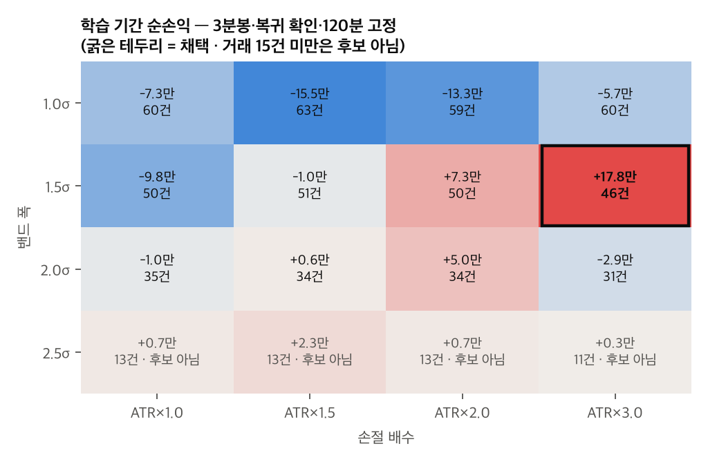
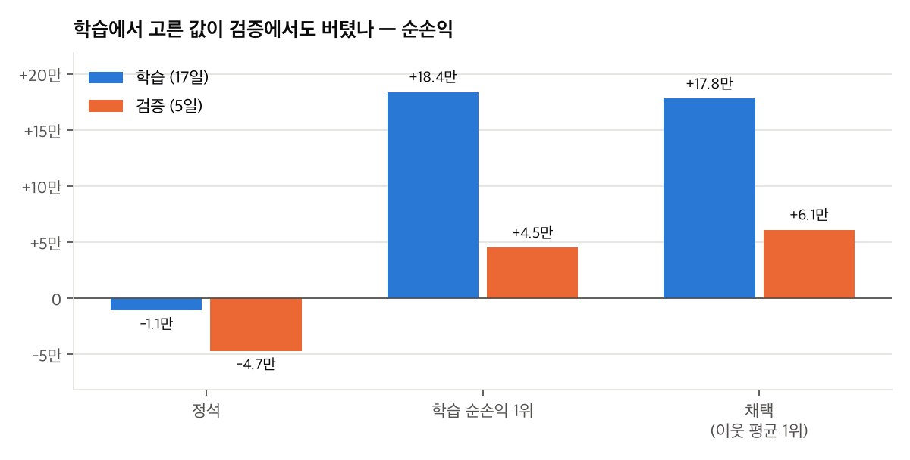

# 2주차 전략 근거: VWAP 밴드 평균회귀 (미국달러 F 202611)

NFT 팀 2주차 [보고서](README.md)의 비교 전략(후보 1) 근거 문서입니다. 2026-10-27에 작성했습니다. 메인 전략(후보 2)은 [볼린저 밴드 + RSI](week02-전략-근거-볼린저RSI.md)입니다.

- 코드: `strategy.py`(규칙, `Params` 기본값이 채택 값), `backtest.py`(백테스트와 최적화, `STANDARD`가 기본값)
- 결과: `results/backtest/`, 차트: `results/charts/`
- 이 문서의 손익은 수수료 반영 전입니다. 수수료(거래당 1,380원)를 반영한 값과 10/29, 10/30 리플레이 결과는 [README 6-4절](README.md#6-4-비교-전략-vwap-같은-이틀-리플레이-종이-체결-모의계좌-체결-아님)에 있습니다.

## 1. 채택한 전략

| 구분 | 값 | 정한 방법 |
| --- | --- | --- |
| 대상 | 미국달러 F 202611 `A756B000` (1틱 0.1원 = 1,000원) | 최근월물, 만기 11/16 |
| 기준선 | 세션 VWAP. 매일 09:00부터 1분봉 (고가+저가+종가)/3 × 거래량을 누적 | 전략 정의 |
| 밴드 | VWAP ± 1.5σ (σ는 거래량 가중 표준편차) | 최적화 |
| 판정 봉 | 3분봉, 봉이 끝날 때 한 번 판정 | 최적화 |
| 진입 | 복귀 확인. 앞 봉 종가가 밴드 밖이고 이번 봉 종가가 밴드 안이면 VWAP 방향으로 진입 | 최적화 |
| 익절 | 가격이 VWAP에 닿으면 | 전략 정의 |
| 손절 | 진입가에서 ATR(3분봉 14개) × 3.0만큼 불리한 가격, 최소 3틱 | 최적화 (2절) |
| 시간 청산 | 진입 후 120분 | 최적화 |
| 일일 한도 | 그날 손절이 2번 나오면 그날은 더 진입하지 않음 | 3절 |
| 진입 시간 / 장 마감 정리 | 09:30 ~ 15:00 / 15:30 전량 청산 | |
| 기타 | 1계약, 보유 중 추가 진입 없음, 청산 후 1봉 대기, VWAP까지 3틱이 안 남으면 진입하지 않음 | |

## 2. 손절: ATR 기준, 3.0배

변동성 기준으로 정한 이유: 달러 선물은 날마다 움직이는 폭이 많이 다릅니다. 이번 데이터에서 하루 고저폭은 41틱(10/27)부터 218틱(09/22)까지였습니다. 손절을 고정 틱으로 두면 조용한 날에는 너무 넓고, 크게 움직이는 날에는 평소 흔들림에도 손절됩니다. ATR은 최근 봉들의 평균 움직임이라 손절 폭이 그날 시장에 맞춰 늘고 줄어듭니다.

3.0배를 고른 과정: 1.0, 1.5, 2.0, 3.0배를 학습 기간에서 비교했고(4절), 채택 조합에서는 3.0배가 가장 좋았습니다. 평균회귀는 멀어졌다가 돌아오는 것을 노리는 전략이라, 돌아오기 전에 한 번 더 밀리는 움직임을 버틸 여유가 필요하다고 해석했습니다.

실제 손절 폭 (채택 값, 22일, 손절 횟수 제한 없이 돌린 68건):

| | 틱 | 금액 (슬리피지 1틱 포함) |
| --- | --- | --- |
| 최소 | 11 | 12,000원 |
| 중앙값 | 24 | 25,000원 |
| 상위 10% | 33 | 34,000원 |
| 최대 | 45 | 46,000원 |

최소 3틱: 1분봉 하나의 움직임이 중앙값 2틱, 상위 25% 4틱이라 손절이 이보다 좁으면 평소 흔들림에도 손절됩니다. 그래서 ATR이 아무리 작아도 3틱보다 좁히지 않았습니다. 288개 조합 14,169건 전체에서 실제로 적용된 적은 없습니다(ATR 계산값이 항상 3틱 이상).

손절 폭별로 보면 좁을수록 손절이 많았습니다. 손절 폭 3 ~ 5틱 거래는 45%, 6 ~ 10틱은 50%가 손절로 끝났고, 11틱 이상은 24%였습니다.

## 3. 일일 한도: 금액 대신 손절 2회

그날 손절로 끝난 거래가 2건이 되면 그 뒤 신호에서는 진입하지 않습니다. 시간 청산이나 장 마감 정리로 생긴 손실은 세지 않습니다.

금액 대신 횟수로 정한 이유: 손절 폭이 ATR에 따라 바뀌어서 손절 1번의 금액이 1.2만 ~ 4.6만 원으로 날마다 다릅니다. 금액 한도(예: 7만 원)로 정하면 문제가 있습니다.

- 손절 폭이 넓은 날은 1번 만에 한도에 가까워지고, 좁은 날은 3 ~ 4번까지 허용되어 "손절 2번"의 의미가 날마다 달라집니다.
- 금액을 정하려면 손절 폭의 대표값(중앙값, 상위 10% 등)을 골라야 하는데, 그것도 임의로 정하는 값이 됩니다.

횟수로 정하면 손절 폭과 상관없이 항상 "두 번 틀린 날은 멈춘다"는 같은 의미가 됩니다. 하루 최대 손실은 손절 폭에 따라 달라지지만, 그 손절 폭 자체가 그날 시장 변동에 맞춰 정해진 값입니다.

2회로 정한 이유: 1회면 한 번의 흔들림에 하루가 끝나고, 횟수를 늘리면 추세가 이어지는 날(평균회귀가 계속 틀리는 날) 손실이 쌓입니다. 제한 없이 돌렸을 때 손절이 하루 1회인 날이 6일, 5회인 날이 1일(그날 −82,000원) 있었습니다. 2회 제한은 이런 날만 막습니다.

손절 횟수 제한만 바꾼 결과 (채택 조합, 22일):

| 제한 | 순손익 | 거래 | 가장 나쁜 날 |
| --- | --- | --- | --- |
| 손절 1회 | +180,000 | 56 | −30,000 |
| 손절 2회 (채택) | +241,000 | 65 | −27,000 |
| 손절 3회 | +224,000 | 66 | −44,000 |
| 제한 없음 | +186,000 | 68 | −82,000 |

횟수는 결과를 보고 고른 게 아니라 처음 정한 "손절 2번까지" 기준을 그대로 쓴 것입니다. 결과도 2회가 가장 좋았지만 22일짜리 표본이라 이 차이를 근거로 삼지는 않았습니다.

## 4. 최적화 과정

### 4-1. 데이터와 기간 나누기

- 모의 서버 차트(분) API로 받은 미국달러 F 202611 1분봉 8,334개(`results/data/bars_1m_A756B000.csv`)를 썼습니다.
- 하루 봉이 250개 미만인 날(거래가 적던 원월물 시기)은 빼서 22거래일(09/22 ~ 10/27)입니다.
- 학습 09/22 ~ 10/20 (17일), 검증 10/21 ~ 10/27 (5일). 날짜 순서대로 나눠서 학습할 때 이후 데이터를 보지 않게 했습니다.
- 주의할 점: 이 월물은 10/13 이후에야 최근월물이 되어 거래가 늘었습니다(하루 거래량 2만 ~ 9만 계약에서 60만 ~ 87만 계약으로). 학습 기간 대부분이 원월물 시기입니다.

### 4-2. 백테스트 체결 가정 (`min1-v2`)

- 판정 봉이 끝나면 다음 1분봉 시가에 시장가로 진입하고, 불리한 쪽으로 슬리피지 1틱을 줍니다.
- 보유 중에는 1분봉마다 손절과 익절을 확인합니다. 익절가는 직전 1분봉까지의 VWAP을 불리한 쪽 호가로 맞춘 값입니다(매수는 올림, 매도는 내림). 같은 1분봉에서 손절과 익절이 둘 다 닿으면 손절로 처리합니다.
- 모든 청산에 슬리피지 1틱을 줘서 체결가는 모두 0.1원 단위입니다. 수수료는 0원(모의계좌 수수료 확인 전), 1계약입니다.
- 처음에 쓴 `min1-v1`은 익절가를 호가 단위로 맞추지 않아서, 손익이 반 틱 경계에 걸리면 파이썬 버전마다 1틱씩 달라졌습니다(이슈 #1). 이 문서의 숫자는 모두 `min1-v2`로 다시 계산한 값이고, Python 3.9, 3.12, 3.14에서 결과 파일이 같게 나옵니다.
- 일일 한도(손절 2회)는 모든 조합에 똑같이 적용했습니다.

### 4-3. 기본값으로 시작

많이 쓰는 값으로 먼저 돌렸습니다: 5분봉, 2σ, 복귀 확인 후 진입, 손절 ATR×1.5, 시간 청산 60분.

| | 학습 | 검증 | 전체 22일 |
| --- | --- | --- | --- |
| 기본값 | −11,000 (26건, 승률 54%) | −47,000 (4건, 승률 0%) | −55,000 (32건) |

학습과 검증 모두 손실이었습니다.

### 4-4. 학습 기간에서 조합 찾기

5가지 값을 바꿔서 288개 조합을 학습 기간에 모두 돌렸습니다.

| 값 | 후보 |
| --- | --- |
| 판정 봉 | 3, 5, 10분 |
| 밴드 폭 | 1.0, 1.5, 2.0, 2.5σ |
| 진입 방식 | 복귀 확인, 바로 진입 |
| 손절 | ATR × 1.0, 1.5, 2.0, 3.0 |
| 시간 청산 | 30, 60, 120분 |

- 학습 기간 거래가 15건 이상인 조합만 후보로 봤습니다(거래가 너무 적어서 운으로 좋게 나온 조합을 빼기 위해). 216개이고, 그중 학습 순손익이 플러스인 조합은 68개입니다.
- 기준 1: 학습 순손익
- 기준 2: 이웃 평균. 값 하나를 한 칸씩 옆으로 바꾼 조합들의 평균 순손익입니다. 혼자만 좋게 나온 조합을 거르기 위해 썼습니다.

학습 순손익 상위 5:

| 순위 | 판정 봉 | 밴드 | 진입 | 손절 | 시간 | 학습 | 이웃 평균 | 검증 |
| --- | --- | --- | --- | --- | --- | --- | --- | --- |
| 1 | 3분 | 1.5σ | 바로 | ATR×3.0 | 120분 | +184,000 (58건) | +52,500 | +45,000 (17건) |
| 2 (채택) | 3분 | 1.5σ | 복귀 확인 | ATR×3.0 | 120분 | +178,000 (46건) | +68,833 | +61,000 (18건) |
| 3 | 10분 | 1.5σ | 바로 | ATR×1.5 | 60분 | +155,000 (43건) | +51,750 | +43,000 (11건) |
| 4 | 10분 | 1.5σ | 바로 | ATR×1.0 | 60분 | +148,000 (42건) | +37,857 | +29,000 (10건) |
| 5 | 10분 | 1.5σ | 바로 | ATR×1.5 | 120분 | +144,000 (41건) | +53,714 | +39,000 (10건) |

이웃 평균 상위 5:

| 순위 | 판정 봉 | 밴드 | 진입 | 손절 | 시간 | 학습 | 이웃 평균 | 검증 |
| --- | --- | --- | --- | --- | --- | --- | --- | --- |
| 1 (채택) | 3분 | 1.5σ | 복귀 확인 | ATR×3.0 | 120분 | +178,000 (46건) | +68,833 | +61,000 (18건) |
| 2 | 10분 | 1.5σ | 복귀 확인 | ATR×1.5 | 60분 | +119,000 (35건) | +63,000 | +9,000 (11건) |
| 3 | 3분 | 1.5σ | 복귀 확인 | ATR×3.0 | 60분 | +102,000 (48건) | +59,857 | +38,000 (20건) |
| 4 | 10분 | 1.5σ | 바로 | ATR×1.5 | 120분 | +144,000 (41건) | +53,714 | +39,000 (10건) |
| 5 | 3분 | 1.5σ | 바로 | ATR×3.0 | 120분 | +184,000 (58건) | +52,500 | +45,000 (17건) |

학습 순손익이 플러스인 68개 조합의 분포:

| 값 | 분포 | 해석 |
| --- | --- | --- |
| 밴드 폭 | 1.5σ 51개, 2.0σ 13개, 1.0σ 4개, 2.5σ 0개 | 1.5σ가 가장 많음. 기본값 2σ보다 좁게 |
| 시간 청산 | 60분 28, 120분 27, 30분 13 | 30분은 짧음 |
| 판정 봉 | 10분 27, 3분 24, 5분 17 | 뚜렷한 차이 없음 |
| 진입 방식 | 복귀 확인 34, 바로 34 | 차이 없음 |
| 손절 | ATR×3.0 19, 1.0 17, 2.0 16, 1.5 16 | 차이 작음 |



채택 값에서 나머지 세 값(3분봉, 복귀 확인, 120분)을 고정하고 밴드 폭과 손절 배수만 바꾼 결과입니다. 1.5σ 줄이 대체로 좋은 것은 보입니다. 하지만 이 그림에서는 채택 칸(+17.8만 원)이 주변 칸(−5.7만, +7.3만, −2.9만 원)보다 혼자 높습니다. 이웃 평균은 다섯 값 모두를 한 칸씩 바꾼 평균이라 이 그림과 맞지 않는 건 아니지만, 4-6절의 과최적화 위험과 같이 봐야 합니다.

### 4-5. 고른 조합과 검증

3분봉, 1.5σ, 복귀 확인, ATR×3.0, 120분. 216개 중 이웃 평균 1위, 학습 순손익 2위입니다.

선택 기준은 학습 기간 결과만 보는 "거래 15건 이상 중 이웃 평균 1위"입니다.

| | 학습 (17일) | 검증 (5일) | 전체 22일 |
| --- | --- | --- | --- |
| 거래 | 46 | 18 | 65 |
| 승률 | 70% | 83% | 72% |
| 순손익 | +178,000 | +61,000 | +241,000 |
| 손익비 (PF) | 2.16 | 2.09 | 2.16 |
| 최대 낙폭 | 41,000 | 35,000 | 41,000 |
| 청산 이유 (검증) | | 익절 13, 손절 2, 시간 2, 마감 1 | |




그림은 `python3 plot_backtest.py`로 `results/backtest/`의 JSON에서 다시 그릴 수 있습니다(4-7절).

이 조합을 고른 이유:
1. 이웃 평균 1위입니다. 값을 하나씩 바꿔도 결과가 크게 나빠지지 않습니다. 학습 1위(바로 진입)와 순손익 차이는 6,000원뿐인데 이웃 평균은 +68,833 / +52,500으로 더 안정적입니다.
2. 학습 기간 최대 낙폭이 41,000원으로 상위 조합 중 작은 편입니다(학습 1위는 89,000원).
3. 플러스 조합에서 가장 많이 보인 값(1.5σ)과 같습니다.
4. 원월물과 최근월물 시기 모두 이익이었습니다. 학습 기간을 나누면 원월물 시기(09/22 ~ 10/12) +146,000원(30건), 최근월물 시기(10/13 ~ 10/20) +31,000원(16건)입니다.

복귀 확인을 고른 이유 (학습 1위와 다른 유일한 값):
- 평균회귀 전략에서 가장 위험한 경우는 추세가 계속 이어지는 날입니다. 밴드를 벗어나자마자 진입하면 가격이 계속 밀릴 때 일찍 들어가서 손절되기 쉽습니다.
- 복귀 확인은 가격이 꺾이는 걸 보고 들어가기 때문에 그런 날을 일부 걸러 줍니다. 대신 진입가가 조금 불리하고 진입 자체를 놓치는 경우도 있습니다.
- 학습 기간 결과도 이 설명과 맞습니다. 나머지 값이 같을 때 순손익은 비슷하지만(+178,000 / +184,000), 최대 낙폭은 41,000원 / 89,000원으로 절반 이하이고 이웃 평균도 높습니다(+68,833 / +52,500).
- 플러스 조합 68개 전체로 보면 복귀 확인 34개, 바로 진입 34개로 차이가 없습니다. 복귀 확인이 항상 낫다는 게 아니라, 이 조합에서는 같은 이익을 더 작은 낙폭으로 냈다는 뜻입니다.

### 4-6. 한계

- 표본이 작습니다. 검증 18건, 전체 65건으로 몇 건에 따라 결과의 부호가 바뀔 수 있습니다.
- 평균 손실이 평균 이익보다 큽니다(전체 −11,556원 / +9,553원). 손익분기 승률이 약 55%라 승률이 조금만 떨어져도 손실이 됩니다.
- 학습 기간 이익 대부분이 원월물 시기에 났습니다(+178,000원 중 최근월물 시기는 +31,000원).
- 288개 조합에서 고른 것이라 과최적화 위험이 있습니다.
- 모의 서버 데이터라 가격이 실제 시장과 다를 수 있습니다(6월 약 1,532원에서 10월 약 1,324원).
- 체결 가정: 같은 1분봉에서 손절과 익절이 둘 다 닿으면 손절, 익절가는 불리한 쪽 호가로 맞춤, 수수료 0원.

### 4-7. 재현

```bash
cd week02
python3 fetch_data.py                                                # 데이터 (모의 서버)
python3 backtest.py --standard                                       # 기본값
python3 backtest.py                                                  # 채택 값
python3 backtest.py --optimize --train-end 20261020 --min-trades 15  # 288개 조합 최적화
python3 plot_backtest.py                                             # 차트 (results/charts/)
```
