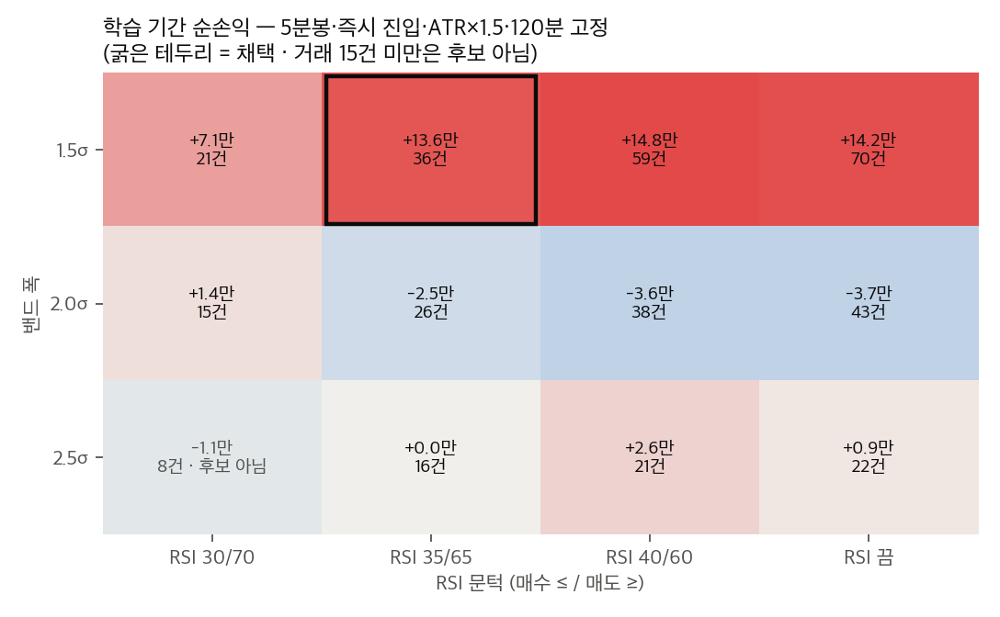
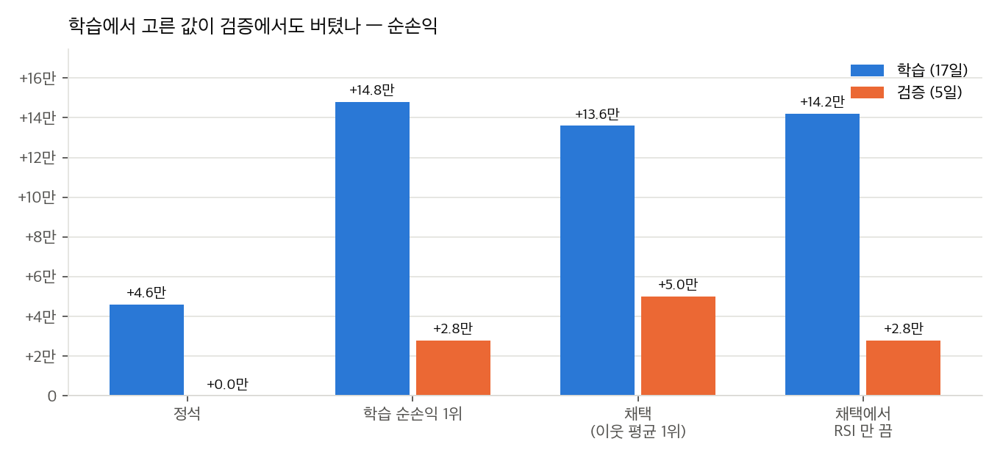
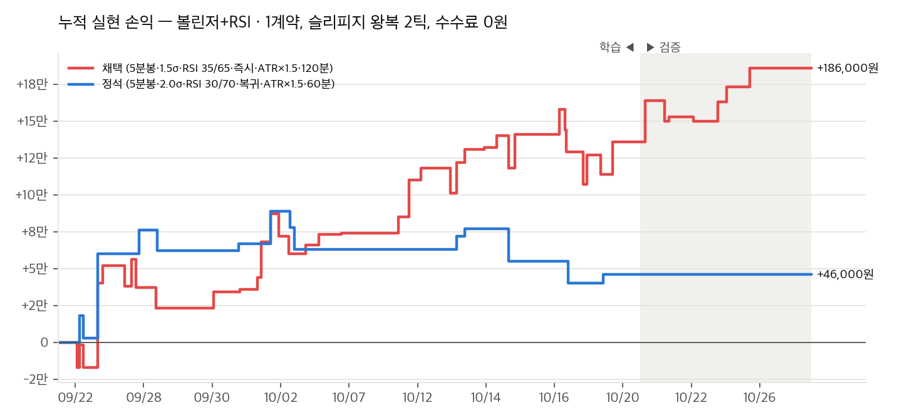
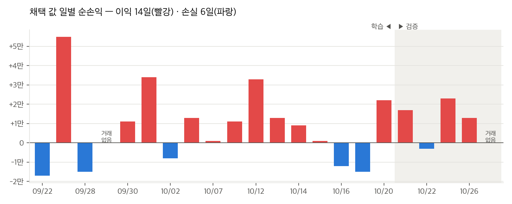
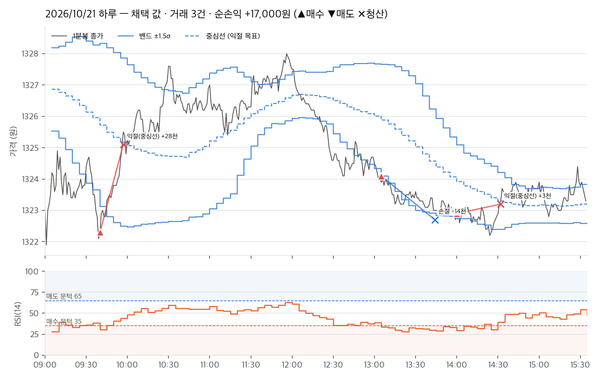

# 2주차 전략 근거 — 볼린저 밴드 + RSI 평균회귀 (미국달러 F 202611)

> 팀 NFT 2주차 보고서([README](README.md))의 별첨 문서, **후보 2** 입니다 (2026-10-27). 후보 1 은 [VWAP 밴드 평균회귀](week02-전략-근거.md)이고, 두 후보는 **같은 데이터·같은 체결 모형** 으로 쟀습니다 (5절에서 나란히 비교).
> 코드: `week02/strategy_bb.py`(규칙, `Params` 기본값 = 채택 값), `week02/backtest_bb.py`(백테스트·최적화, `STANDARD` = 정석 값), `week02/plot_backtest_bb.py`(차트), `week02/test_strategy_bb.py`(지표 식이 NH 앱과 같은지 검사). 결과 원본: `week02/results/backtest_bb/`, 그림: `week02/results/charts_bb/`.

## 1. 채택한 전략

| 구분 | 값 | 정한 방법 |
| --- | --- | --- |
| 대상 | 미국달러 F 202611 `A756B000` (1틱 0.1원 = 1,000원) | 최근월물, 만기 11/16 (후보 1 과 같음) |
| 기준선 | 판정 봉 종가의 **SMA(20)** = 볼린저 중심선 | 전략 정의 (정석 기간, 고정) |
| 밴드 | 중심선 ± **1.5σ** (σ = 20봉 모집단 표준편차) | 최적화 |
| 보조 지표 | **RSI(14)**, Wilder 평활 | 전략 정의 (정석 기간, 고정) |
| 판정 봉 | **5분봉**, 봉 마감 때 한 번 | 최적화 — 앱 기준 봉 목록(1·5·15·30·60분봉·일봉) 안의 값만 후보로 둠 |
| 진입 | **이탈 즉시** — 이번 봉 종가가 하단 밖 **그리고 RSI ≤ 35** 면 매수, 상단 밖 **그리고 RSI ≥ 65** 면 매도 | 최적화 |
| 익절 | 가격이 **중심선** 에 닿음 (마지막으로 닫힌 판정 봉의 중심선) | 전략 정의 |
| 손절 | 진입가에서 **ATR(5분봉 14개) × 1.5** 불리한 곳, 최소 3틱 | 최적화 (2절) |
| 시간 청산 | 진입 뒤 **120분** | 최적화 |
| 일일 한도 | **그날 손절 2회가 나면 그날은 더 진입하지 않음** | 규칙 (3절, 후보 1 과 같음) |
| 진입 시간 / 장 마감 정리 | 09:30\~15:00 / 15:30 전량 청산 | 정한 값 (후보 1 과 같음) |
| 그 밖 | 1계약, 보유 중 추가 진입 없음, 청산 뒤 1봉 대기, 중심선까지 3틱 미만이면 진입 안 함 | 정한 값 |
| 지표 계산 | 밴드·RSI·ATR 은 **날을 넘겨 이어** 셈, 지표 기간 × 2 = **40봉(200분)** 이 쌓이기 전에는 판단 안 함 | NH 앱 `indicators.py` 와 같은 방식 |

**볼린저 밴드에 RSI 를 더한 까닭.** 볼린저 밴드만 쓰면 밴드 밖으로 나간 봉마다 신호가 서서, 추세가 이어지는 날에는 연속으로 손절을 맞습니다. RSI 는 최근 14봉의 상승 폭과 하락 폭의 비율을 0\~100 으로 나타낸 값이라, 밴드 밖이면서 RSI 까지 과매도(과매수)일 때만 들어가면 많이 밀린 자리만 남습니다. 채택 조합에서 RSI 를 끄면 거래가 70건으로 두 배, 최대 낙폭도 10.2만원으로 두 배입니다 (4-4절).

**RSI 문턱을 35/65 로 둔 까닭.** 교과서 값 30/70 은 5분봉에서 너무 드물어 학습 17일 동안 21건뿐이고(순손익 +7.1만), 40/60 은 59건으로 많지만 최대 낙폭이 8.3만원입니다. 35/65 는 그 사이에서 이웃 평균 1위였습니다 (4-5절).

## 2. 손절 라인 — ATR × 1.5, 후보 1(× 3.0)보다 좁게 둔 까닭

**변동 폭으로 둔 까닭.** 후보 1 과 같습니다. 이번 데이터에서 하루 고저폭은 40틱(10/07)부터 218틱(09/22)까지라, 손절을 고정 틱으로 두면 조용한 날에는 너무 넓고 크게 움직이는 날에는 잡음에 털립니다.

**1.5배를 고른 과정.** 1.5·2.0·3.0 배를 학습 기간에 비교했고(4절), 채택 조합에서 나머지 값을 고정하면 아래와 같습니다.

| 손절 | 학습 순손익 | 거래 | 최대 낙폭 | 이웃 평균 |
| --- | --- | --- | --- | --- |
| **ATR × 1.5 (채택)** | **+136,000** | 36 | **51,000** | **+61,625** |
| ATR × 2.0 | +129,000 | 37 | 66,000 | +36,667 |
| ATR × 3.0 | +4,000 | 37 | 98,000 | +1,375 |

후보 1 은 3.0 배가 가장 나았는데 여기서는 반대입니다. 진입 방식이 다르기 때문으로 봅니다. 후보 1 은 복귀를 확인한 뒤 들어가므로 한 번 더 밀리는 움직임을 견딜 여유가 필요했고, 이 후보는 이탈 즉시 들어가므로 틀렸을 때는 밴드 밖으로 계속 밀리는 날이라 빨리 끊는 편이 낫습니다. 실제로 학습 기간에서 손절을 넓히면 평균 손실만 1.6만 → 2.0만 → 2.5만원으로 커지고 승률은 64\~68% 로 비슷했습니다.

**실제 손절 폭 (채택 값, 22일, 한도 없이 돌린 거래 50건):**

| | 틱 | 금액 (슬리피지 1틱 포함) |
| --- | --- | --- |
| 가장 좁을 때 | 7 | 8,000원 |
| 중앙값 | 14.5 | 15,500원 |
| 상위 10% (90% 분위) | 21 | 22,000원 |
| 가장 넓을 때 | 27 | 28,000원 |

**최소 3틱 (안전장치).** 1분봉 하나의 평소 움직임(고저폭)이 중앙값 3틱, 상위 25% 4틱이라 손절이 이보다 좁으면 잡음에 털립니다. 이 바닥이 작동한 적은 없습니다 — ATR × 1.5 는 진입한 거래에서 7틱 이상, 신호가 선 봉 전체로 봐도 6틱 이상이었습니다.

손절로 끝난 14건의 손절 폭은 10\~21틱이었고, 실제 손실은 12\~22틱(갭·슬리피지 포함)이었습니다.

## 3. 일일 한도 — 손절 2회 (후보 1 과 같은 규칙)

**규칙과 까닭.** 그날 손절로 끝난 거래가 2건이 되면 그 뒤 신호는 모두 진입하지 않습니다. 금액이 아니라 횟수로 두는 까닭(손절 폭이 ATR 로 변해 금액 한도의 뜻이 날마다 달라짐)은 [후보 1 의 3절](week02-전략-근거.md#3-일일-한도--금액이-아니라-손절-2회)과 같습니다. 두 후보가 같은 규칙을 쓰면 5절의 비교도 공정합니다.

**손절 횟수 제한만 바꿔 본 결과 (채택 조합, 22일):**

| 제한 | 순손익 | 거래 | 최악의 하루 |
| --- | --- | --- | --- |
| 손절 1회 | +164,000 | 32 | −22,000 |
| **손절 2회 (채택)** | **+186,000** | **43** | **−17,000** |
| 손절 3회 | +158,000 | 48 | −29,000 |
| 제한 없음 | +130,000 | 50 | −48,000 |

한도 없이 돌리면 손절이 하루 1회인 날 4일, 2회 1일, 3회 3일, **5회 1일**(10/02, 그날 −48,000원)이었습니다. 2회 제한은 이렇게 추세가 이어져 평균회귀가 계속 틀리는 날만 막습니다. 결과로도 2회가 가장 나았지만 후보 1 과 마찬가지로 22일 표본이라 이 차이를 근거로 내세우지는 않습니다.

## 4. 최적화 과정

### 4-1. 데이터와 기간 나누기

- 후보 1 과 **같은 파일**: 모의 서버 차트(분)로 받은 미국달러 F 202611 1분봉 8,334개 (`results/data/bars_1m_A756B000.csv`). 하루 봉이 250개 미만인 날을 뺀 **22거래일** (09/22\~10/27).
- **학습 09/22\~10/20 (17일) · 검증 10/21\~10/27 (5일)** — 후보 1 과 같은 경계.
- **후보 1 과 다른 점.** 밴드·RSI·ATR 이 날을 넘겨 이어지는 지표라, 검증 구간만 따로 돌리면 검증 첫날(10/21)의 거래가 달라집니다 — 준비 봉 40개가 차는 오전(09:00\~12:20)에는 판단하지 않고, 그 뒤로도 한동안 Wilder 평활의 시작값이 달라 지표값이 조금 다릅니다. 실제로 따로 돌리면 10/21 의 거래가 3건(09:40·13:05·14:00 진입)에서 1건(13:15 진입)으로 바뀌고 나머지 4일은 같습니다. 그래서 **전체를 한 번에 이어서 돌린 뒤 거래를 진입일로 학습/검증으로 나눴습니다.** 보유는 날을 넘기지 않으므로(15:30 정리) 학습 + 검증 = 전체이고, 학습 쪽 값은 따로 돌린 것과 같습니다. 첫날(09/22)은 준비 봉이 차는 200분 동안 판단하지 않습니다.
- 주의(후보 1 과 같음): 이 월물은 10/13 이후에야 최근월물이 되어 거래가 몰렸습니다. 학습 기간 대부분이 원월물 시절입니다.

### 4-2. 백테스트 체결 가정 (`min1-v1`, 후보 1 과 같음)

- 판정 봉이 닫히면 다음 1분봉 시가에 시장가 진입, 불리한 쪽 슬리피지 1틱.
- 보유 중에는 1분봉마다 손절·익절 확인. 익절 목표는 **마지막으로 닫힌 5분봉의 중심선**. 같은 1분봉에서 둘 다 닿으면 손절로 셈(보수적).
- 모든 청산에 슬리피지 1틱. 수수료 0원(모의계좌 수수료 확인 전). 1계약.
- 일일 한도(손절 2회)는 모든 조합에 똑같이 적용.
- 데이터 읽기·요약·출력은 후보 1 의 `backtest.py` 함수를 그대로 가져다 써서, 두 후보가 다른 자로 재지 않았음을 코드로 보입니다.

### 4-3. 정석 값으로 출발

널리 쓰는 값으로 먼저 돌렸습니다: **5분봉 · BB(20, 2σ) · RSI(14) 30/70 · 복귀 확인 · 손절 ATR×1.5 · 시간 청산 60분**.

| | 학습 | 검증 | 전체 22일 |
| --- | --- | --- | --- |
| 정석 | +46,000 (14건, 승률 57%) | 0건 | +46,000 (14건, 최대 낙폭 49,000) |

손실은 아니지만 **신호가 너무 드뭅니다.** 2σ 밖 + RSI 30/70 + 복귀 확인 셋을 다 요구하면 22일 동안 14번, 검증 5일 동안은 한 번도 들어가지 않았습니다. 실행 기간이 며칠뿐인 2주차 과제에서는 거래가 있어야 분석할 것이 생기므로, 이 값은 출발점으로만 썼습니다.

### 4-4. 학습 기간에서 찾기

여섯 가지 값을 바꿔 **432개 조합**을 학습 기간에서 모두 돌렸습니다. 판정 봉 후보는 앱에서 그대로 세울 수 있게 앱의 기준 봉 목록(1·5·15·30·60분봉과 일봉) 안에서 골랐습니다.

| 값 | 후보 |
| --- | --- |
| 판정 봉 | 1 · 5 · 15분 |
| 밴드 폭 | 1.5 · 2.0 · 2.5σ |
| RSI 문턱 (매수 ≤ / 매도 ≥) | 30/70 · 35/65 · 40/60 · **끔**(볼린저만) |
| 진입 방식 | 복귀 확인 · 이탈 즉시 |
| 손절 | ATR × 1.5 · 2.0 · 3.0 |
| 시간 청산 | 60 · 120분 |

- **조건:** 학습 기간 거래 15건 이상인 조합만 후보 → 290개, 그중 학습 순손익 양수 **68개**.
- **기준 1 — 학습 순손익.**
- **기준 2 — 이웃 평균.** 값 하나를 한 칸씩 옆으로 바꾼 조합들의 평균 순손익 (후보 1 과 같은 식). RSI 문턱은 30 → 35 → 40 → 끔 차례로 이웃을 봅니다.

**학습 순손익 상위 5:**

| 순위 | 판정 봉 | 밴드 | RSI | 진입 | 손절 | 시간 | 학습 | 이웃 평균 | 최대 낙폭 |
| --- | --- | --- | --- | --- | --- | --- | --- | --- | --- |
| 1 | 5분 | 1.5σ | 40/60 | 즉시 | ATR×1.5 | 120분 | +148,000 (59건) | +57,500 | 83,000 |
| 2 | 5분 | 1.5σ | 끔 | 즉시 | ATR×1.5 | 120분 | +142,000 (70건) | +23,714 | 102,000 |
| **3** | **5분** | **1.5σ** | **35/65** | **즉시** | **ATR×1.5** | **120분** | **+136,000 (36건)** | **+61,625** | **51,000** |
| 4 | 5분 | 1.5σ | 35/65 | 즉시 | ATR×2.0 | 120분 | +129,000 (37건) | +36,667 | 66,000 |
| 5 | 5분 | 1.5σ | 40/60 | 즉시 | ATR×1.5 | 60분 | +128,000 (61건) | +46,125 | 83,000 |

**이웃 평균 상위 5:**

| 순위 | 판정 봉 | 밴드 | RSI | 진입 | 손절 | 시간 | 학습 | 이웃 평균 | 최대 낙폭 |
| --- | --- | --- | --- | --- | --- | --- | --- | --- | --- |
| **1** | **5분** | **1.5σ** | **35/65** | **즉시** | **ATR×1.5** | **120분** | **+136,000 (36건)** | **+61,625** | **51,000** |
| 2 | 5분 | 1.5σ | 40/60 | 즉시 | ATR×1.5 | 120분 | +148,000 (59건) | +57,500 | 83,000 |
| 3 | 5분 | 1.5σ | 40/60 | 즉시 | ATR×2.0 | 120분 | +96,000 (58건) | +55,889 | 93,000 |
| 4 | 5분 | 1.5σ | 40/60 | 즉시 | ATR×1.5 | 60분 | +128,000 (61건) | +46,125 | 83,000 |
| 5 | 5분 | 1.5σ | 35/65 | 즉시 | ATR×1.5 | 60분 | +96,000 (37건) | +45,625 | 51,000 |

**학습 순손익이 양수인 68개 조합의 경향 (양수 / 후보):**

| 값 | 분포 | 경향 |
| --- | --- | --- |
| 판정 봉 | 1분 **0/144** · 5분 58/114 · 15분 10/32 | **1분봉은 144개 전부 손실**(평균 −12.4만). 20분짜리 밴드는 잡음이고, 왕복 2틱 슬리피지에 먹힘 |
| 밴드 폭 | 1.5σ 49/120 · 2.0σ 15/88 · 2.5σ 4/82 | **1.5σ 가 가장 뚜렷** — 후보 1 의 VWAP 밴드와 같은 경향. 정석 2σ 는 이 상품에서 너무 넓음 |
| RSI 문턱 | 30 8/44 · 35 19/76 · 40 21/84 · 끔 20/86 | 30/70 은 거래가 적어 후보에서 많이 탈락. 켜고 끈 차이는 아래에서 따로 봄 |
| 진입 방식 | 복귀 확인 36/138 · 즉시 32/152 | 차이 없음 |
| 손절 | ATR×1.5 30/99 · 2.0 23/97 · 3.0 15/94 | 좁은 쪽이 나음 (2절) |
| 시간 청산 | 60분 35/146 · 120분 33/144 | 차이 없음 |



채택값의 나머지 네 값(5분봉 · 즉시 · ATR×1.5 · 120분)을 고정하고 밴드 폭과 RSI 문턱만 바꾼 단면입니다. **1.5σ 줄만 양수**이고 2.0σ 줄은 RSI 를 어떻게 두어도 손실입니다. 채택 칸(+13.6만)은 옆 칸(+7.1만 · +14.8만)과 이어져 있어 혼자 튀는 값은 아니지만, 아래 줄(2.0σ)로 한 칸만 내려가면 −2.5만이라 **밴드 폭에는 민감합니다.** 4-6 의 과최적화 위험과 함께 읽어야 합니다.

**RSI 를 끈 조합과 켠 조합의 비교 (나머지 다섯 값이 같은 108쌍씩):**

| RSI 문턱 | 끈 것보다 순손익이 나은 쌍 | 순손익 차 평균 | 최대 낙폭 차 평균 |
| --- | --- | --- | --- |
| 30/70 | 63 / 108 | +28,250 | −51,019 |
| 35/65 | 64 / 108 | +26,259 | −24,519 |
| 40/60 | 73 / 108 | +21,870 | −18,046 |

5분봉만 보면 순손익 차이는 반반입니다 (30: 15/36, 35: 15/36, 40: 25/36). 채택 조합의 나머지를 고정하고 RSI 문턱만 바꾸면:

| RSI | 학습 순손익 | 거래 | 승률 | PF | 최대 낙폭 | 이웃 평균 |
| --- | --- | --- | --- | --- | --- | --- |
| 30/70 | +71,000 | 21 | 52% | 1.44 | 49,000 | +34,571 |
| **35/65 (채택)** | **+136,000** | **36** | **64%** | **1.65** | **51,000** | **+61,625** |
| 40/60 | +148,000 | 59 | 64% | 1.45 | 83,000 | +57,500 |
| 끔 | +142,000 | 70 | 67% | 1.39 | 102,000 | +23,714 |

RSI 를 켜도 순손익은 거의 그대로입니다(+14.2만 → +13.6만). 대신 거래가 70건에서 36건으로 줄고 최대 낙폭이 10.2만에서 5.1만원으로 줄었으며, 이웃 평균은 2.6배가 됐습니다. RSI 는 이익을 더하는 것이 아니라 손실 거래를 거르는 역할입니다. 거래가 적은 만큼 실행 기간에는 신호도 덜 나와서, 2주차 실행에서는 하루 1\~2건을 예상합니다 (22일 동안 43건, 거래 없는 날 2일).

### 4-5. 고른 조합과 검증

**5분봉 · 1.5σ · RSI 35/65 · 이탈 즉시 · ATR×1.5 · 120분** — **이웃 평균 1위**, 학습 순손익 3위 (290개 중).

선택 규칙은 후보 1 과 같은 「학습 기간 거래 15건 이상 중 이웃 평균 1위」입니다. 검증 결과를 보고 고른 것이 아닙니다.

| | 학습 (17일) | 검증 (5일) | 전체 22일 |
| --- | --- | --- | --- |
| 거래 | 36 | 7 | 43 |
| 승률 | 64% | 71% | 65% |
| 순손익 | +136,000 | +50,000 | +186,000 |
| 손익비 (PF) | 1.65 | 3.94 | 1.82 |
| 최대 낙폭 | 51,000 | 14,000 | 51,000 |
| 청산 까닭 | 익절 23 · 손절 13 | 익절 6 · 손절 1 | 익절 29 · 손절 14 |









마지막 그림은 검증 기간에서 거래가 가장 많았던 10/21 하루입니다. 09:40 매수(09:35 봉 종가가 하단 밖, RSI 30) → 09:57 중심선 익절 +28틱, 13:05 매수(RSI 34) → 13:44 손절 −14틱, 14:00 매수(RSI 29) → 14:32 익절 +3틱. 둘째 거래처럼 하단 밖에서 RSI 가 35 아래로 내려갔는데도 가격이 계속 내려가면 손절을 맞습니다. 그림은 `python3 plot_backtest_bb.py` 로 `results/backtest_bb/` 의 JSON 에서 다시 그릴 수 있습니다 (4-7).

**검증 거래 7건 전체:**

| # | 진입 | 청산 | 방향 | 진입가 | 청산가 | 목표(중심선) | 손절 폭 | 청산 까닭 | 손익 | 보유 |
| --- | --- | --- | --- | --- | --- | --- | --- | --- | --- | --- |
| 1 | 10/21 09:40 | 09:57 | 매수 | 1322.3 | 1325.1 | 1325.72 | 19틱 | 익절(중심선) | +28,000 | 17분 |
| 2 | 10/21 13:05 | 13:44 | 매수 | 1324.1 | 1322.7 | 1325.88 | 13틱 | 손절 | −14,000 | 39분 |
| 3 | 10/21 14:00 | 14:32 | 매수 | 1322.9 | 1323.2 | 1323.92 | 11틱 | 익절(중심선) | +3,000 | 32분 |
| 4 | 10/22 11:15 | 12:43 | 매수 | 1323.0 | 1322.7 | 1324.96 | 14틱 | 익절(중심선) | −3,000 | 88분 |
| 5 | 10/23 09:45 | 10:51 | 매수 | 1320.8 | 1322.1 | 1323.17 | 17틱 | 익절(중심선) | +13,000 | 66분 |
| 6 | 10/23 11:30 | 12:30 | 매도 | 1324.4 | 1323.4 | 1321.85 | 15틱 | 익절(중심선) | +10,000 | 60분 |
| 7 | 10/26 10:00 | 10:21 | 매수 | 1321.1 | 1322.4 | 1323.19 | 15틱 | 익절(중심선) | +13,000 | 21분 |

**고른 까닭:**
1. **이웃 평균 1위** (+61,625) — 학습 1위(RSI 40/60, +148,000)와 순손익 차이는 12,000원인데 이웃 평균은 +61,625 대 +57,500 이고, **최대 낙폭은 51,000 대 83,000원**으로 훨씬 작습니다.
2. 양수 조합들의 가장 뚜렷한 경향(5분봉 · 1.5σ · ATR×1.5)과 맞습니다.
3. **원월물·최근월물 양쪽에서 이익:** 학습 기간을 나누면 원월물 시절(09/22\~10/12) +118,000원(22건), 최근월물(10/13\~10/20) +18,000원(14건). 다만 최근월물 구간의 이익은 작습니다.
4. 22일 중 거래 없는 날 2일, 이익 14일 · 손실 6일. 최악의 하루 −17,000원.

**진입을 이탈 즉시로 둔 까닭** (후보 1 과 다른 값):

- 채택 조합의 나머지를 고정하면 복귀 확인 +62,000(26건, 승률 65%, 낙폭 49,000) 대 즉시 +136,000(36건, 승률 64%, 낙폭 51,000). 승률과 낙폭은 같고 **거래 수와 이익만 다릅니다.**
- 후보 1 에서 복귀 확인은 꺾이는 것을 본 뒤 들어가 추세 날을 거르는 역할이었습니다. 이 후보에서는 그 역할을 RSI 가 하므로, 복귀까지 더 기다리면 진입가만 나빠집니다. 밴드 반폭이 판정 봉 전체에서 중앙값 13틱(신호가 선 봉만 보면 14틱)이라 복귀한 봉의 종가는 이미 중심선에 가깝습니다.
- 양수 68개 조합 전체로는 복귀 36 · 즉시 32 로 차이가 없습니다. 즉시 진입이 늘 낫다는 뜻이 아니라, RSI 와 같이 쓸 때는 복귀 확인이 겹친다는 뜻입니다.

**시간 청산 120분은 한 번도 작동하지 않았습니다.** 43건의 보유 시간은 최소 5분, 중앙값 32분, 90% 분위 65분, 최대 88분입니다. 중심선이 가격 쪽으로 따라오므로 익절이나 손절이 먼저 옵니다. 60분으로 두면 몇 건이 시간 청산으로 바뀌어 +96,000 이 되지만, 120분은 안전장치일 뿐 결과를 가르는 값이 아닙니다.

### 4-6. 한계 — 보고서에 반드시 적을 것

- **표본이 작습니다.** 검증 7건, 전체 43건. 한두 건으로 검증 부호가 바뀌는 크기입니다. 후보 1(65건)보다도 적습니다.
- **평균 손실과 평균 이익이 거의 같습니다** (−15,067원 / +14,714원). 본전 승률 50.6% 라 지금 승률 65% 에서 여유는 있지만, 손절(ATR×1.5)이 좁은 만큼 손절 건수(14건, 33%)가 후보 1(8건, 12%)보다 많습니다.
- **밴드 폭에 민감합니다.** 1.5σ 줄만 양수이고 2.0σ 는 손실입니다 (히트맵). σ 는 20봉 표준편차라 변동이 급히 바뀌는 날 밴드가 늦게 따라옵니다.
- **중심선이 움직입니다.** 익절 목표가 중심선이라 익절로 끝나도 손실인 거래가 있습니다. 익절 29건 중 −3틱 1건(검증 #4), +1\~+3틱 4건입니다. 목표가 진입가 쪽으로 내려오면 이익 없이 나갑니다.
- **1분봉은 144개 조합이 모두 손실입니다.** 슬리피지 가정(왕복 2틱)에 결과가 그만큼 민감합니다. 5분봉 결과도 실제 체결에서 슬리피지가 2틱을 넘으면 그만큼 깎입니다.
- **학습 이익의 대부분이 원월물 시절**(+118,000 중 최근월물 구간 +18,000)에서 나왔고, **432개 조합을 찾은 것 자체가 과최적화 위험**입니다.
- **모의 서버 데이터**라 가격 수준이 실제와 다를 수 있습니다 (후보 1 과 같음).
- **체결 가정:** 같은 1분봉에서 손절·익절이 함께 닿으면 손절, 수수료 0원.
- **앱에서 재현할 때의 차이.** 앱의 익절 칸은 진입가에서 틱 거리로만 둘 수 있어 「중심선에 닿음」을 그대로 적을 수 없고, 청산 규칙으로 「고가(또는 종가) ≥ 중심선」(`high gte bbMiddle`)을 적어야 합니다. 앱의 규칙 판정은 봉이 닫힐 때(「마감」) 또는 체결마다 진행 중인 봉까지 넣어서(「틱」) 하는데, 어느 쪽이든 체결은 그 뒤의 값이고 「틱」이면 중심선 자체가 진행 중인 봉을 포함해 움직이므로 이 백테스트(마지막으로 닫힌 봉의 중심선)와 조금 다릅니다. 진입은 앱 피연산자(`close`·`bbLower`·`bbUpper`·`rsi`)로 그대로 표현됩니다 — 볼린저 기간 20·배수 1.5, RSI 기간 14, 5분봉 모두 앱이 받는 범위 안입니다.

### 4-7. 재현

```bash
cd week02
python3 fetch_data.py                                                   # 데이터 (모의 서버, 후보 1 과 공용)
python3 -m unittest test_strategy_bb -v                                 # 지표 식·신호 규칙 검사 (8개)
python3 backtest_bb.py --standard                                       # 정석 값
python3 backtest_bb.py                                                  # 채택 값
python3 backtest_bb.py --optimize --train-end 20261020 --min-trades 15  # 432개 조합 최적화
python3 plot_backtest_bb.py                                             # 차트 → results/charts_bb/
```

차트에는 `matplotlib` 이 필요합니다 (`python3 -m pip install matplotlib`). 그 밖에는 표준 라이브러리만 씁니다.

## 5. 후보 1(VWAP)과 나란히 — 같은 데이터 · 같은 체결 모형 · 같은 기간 나누기

| | 후보 1 VWAP 밴드 | 후보 2 볼린저 + RSI |
| --- | --- | --- |
| 판정 봉 | 3분봉 | 5분봉 |
| 진입 | 1.5σ 밖 → 안 복귀 확인 | 1.5σ 밖 + RSI 35/65, 즉시 |
| 익절 / 손절 / 시간 | VWAP / ATR×3.0 / 120분 | 중심선 / ATR×1.5 / 120분 |
| **전체 22일** 거래 · 승률 · 순손익 | 65 · 72% · **+227,000** | 43 · 65% · +186,000 |
| PF · 평균 이익/손실 · 최대 낙폭 | 2.09 · +9,255/−11,556 · **41,000** | 1.82 · +14,714/−15,067 · 51,000 |
| 학습 17일 | 46건 · +169,000 | 36건 · +136,000 |
| 검증 5일 | 19건 · +58,000 · PF 2.07 | 7건 · +50,000 · PF 3.94 |
| 청산 까닭 (전체) | 익절 46 · 손절 8 · 시간 8 · 마감 3 | 익절 29 · 손절 14 |
| 하루 평균 거래 | 3.0건 | 2.0건 |

(후보 1 의 검증 값은 [후보 1 문서](week02-전략-근거.md#4-5-고른-조합과-검증)의 18건 +56,000 과 조금 다릅니다. 그 문서는 검증 구간을 따로 돌렸고, 이 표는 두 후보 모두 4-1 의 방식(이어서 돌린 뒤 진입일로 나눔)으로 다시 센 값입니다. 전체 22일 값은 같습니다.)

- 후보 1 이 거래가 많고 승률·손익비·낙폭 모두 낫습니다. 후보 2 는 거래당 이익이 크지만(+14,714 vs +9,255) 손실도 큽니다.
- **둘 다 손실인 날이 3일**(09/22 · 10/02 · 10/22) 있고 10/02 는 합산 −35,000원입니다. 같은 상품의 평균회귀라 추세 날에는 같이 틀리므로, 둘을 함께 돌려도 손실이 서로 가려지지는 않습니다.
- **앱 재현.** 앱의 기준 봉 목록은 1·5·15·30·60분봉과 일봉이라 후보 2(5분봉)는 앱 전략 설정으로 그대로 옮길 수 있고, 후보 1(3분봉)은 자체 코드로 실행해야 합니다. 어느 쪽으로 실행하느냐에 따라 보고서 4절(프로그램 구조)이 달라집니다.
- 수익률은 과제 평가 기준이 아니므로, 둘 중 무엇을 README 에 올릴지는 실행에서 거래가 나올 가능성, 재현 방법, 분석할 거리로 정합니다. 두 후보의 코드와 결과는 모두 `week02/` 에 남겨 둡니다.
