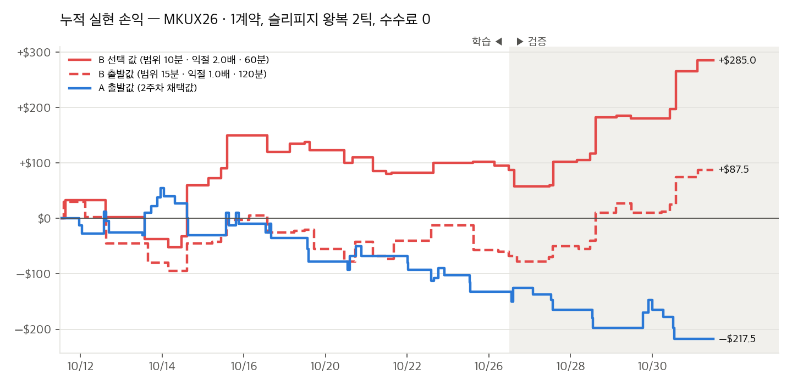

# 3주차 해외상품 전략 구현: SGX 미니 원달러(MKU) — KRX→MKU 연계 + 서울 개장 돌파

제출일: 2026/11/06(금) 23:59

NFT 팀 3주차 보고서입니다. 숫자는 전부 `results/`, `leadlag/results/` 폴더에 있는 원본 파일에서 가져왔습니다.

이번 주는 돈을 버는 것보다 새로 해 보는 데 더 신경을 썼습니다. 해외 상품은 처음이었고, 2주차 전략을 그대로 옮겨 오는 것만으로는 배울 게 별로 없을 것 같았습니다. 그래서 두 가지를 해 봤습니다.

- 국내 시세를 보고 해외 상품을 거래했습니다. 국내 KRX 미국달러 선물이랑 SGX MKU는 둘 다 원달러 상품인데, 거래는 국내 쪽이 훨씬 많습니다. 그러면 국내 가격이 먼저 움직이고 MKU가 조금 늦게 따라오지 않을까 싶어서, 국내 가격이 움직이는 걸 보고 MKU를 사고팔게 했습니다.
- 웹소켓으로 실시간 시세를 받아서 돌렸고, 이걸 위해 서버를 따로 만들었습니다. 위 움직임이 초 단위라 1초 조회로는 안 됐습니다. 웹소켓은 장중 내내 끊기지 않고 받아야 하는데 노트북은 잠자기나 와이파이 때문에 자꾸 끊겨서, 클라우드 서버를 구축하고 매일 자동으로 실행되게 설정했습니다.

- 상품은 SGX 미니 원달러 선물 `MKUX26`(11월물) 하나고, 여기에 전략 두 개를 돌렸습니다.
  - 연계 전략 (이상재): KRX가 먼저 크게 움직였는데 MKU가 덜 따라왔으면 KRX 쪽으로 들어갑니다. 웹소켓 초 단위, 해외 모의계좌로 실제 주문을 냅니다.
  - 후보 B 서울 개장 돌파 (윤은석): 09:00부터 10분 동안의 범위를 벗어나면 그쪽으로 들어갑니다. 1분봉 REST로 돌리고 종이 체결만 합니다. 연계 전략과 같은 계좌, 같은 종목이라 주문을 내면 포지션이 섞이기 때문입니다 (2주차 VWAP도 같은 이유로 종이로만 했습니다).
- 모의 서버(`apidemo`)와 모의 키만 썼고, 실전 계좌로는 주문하지 않았습니다.
- 전략을 어떻게 정했는지는 [연계 전략 근거](leadlag/week03-전략-근거-연계.md), [전략 설계(볼린저+RSI vs 개장 돌파)](week03-전략-설계.md)에 따로 적었습니다.

| 항목 | 내용 |
| --- | --- |
| 팀 | NFT (6팀), 이상재 · 윤은석 |
| 전략 이름 | NFT_3주차_MKU_KRX연계 / NFT_3주차_MKU_서울개장돌파 |
| 대상 종목 | SGX Mini KRW/USD 2026년 11월물 `MKUX26` (거래소코드 `FSGX`). 연계 신호: KRX 미국달러 F 202611 `A756B000` |
| 실행 환경 | 연계: 해외 모의계좌 시장가 주문 (`leadlag/ws_trader.py --orders`) · 개장 돌파: 종이 체결 (`runner.py`) |
| 비교 | 후보 A 볼린저+RSI (2주차 이식) — 백테스트로만 비교, 실행 안 함 (종이매매도 안 함) |
| 작성일 | 2026-11-06 |

## 폴더 구성

| 경로 | 내용 |
| --- | --- |
| `README.md` | 보고서 |
| [week03-전략-설계.md](week03-전략-설계.md) | 후보 A(볼린저+RSI)·후보 B(개장 돌파) 설계, 최적화, 앞쪽 기간 확인, 종이매매 기록 (12절) |
| [leadlag/week03-전략-근거-연계.md](leadlag/week03-전략-근거-연계.md) | 연계 전략 근거: 시간대별 거래량, 1분 선행, 1분봉 백테스트, 실시간 기록, 고친 것, 서버 실행 기록 (6-6절) |
| [nh_client.py](nh_client.py), [leadlag/nh_client.py](leadlag/nh_client.py) | NH선물 REST 클라이언트 (해외·국내 profile, 토큰 저장, 호출 제한). 모의 서버만 사용 |
| [common.py](common.py), [strategy_bb.py](strategy_bb.py), [strategy_orb.py](strategy_orb.py) | MKU 상품 정보와 후보 A·B 규칙 |
| [backtest.py](backtest.py), [plot_backtest.py](plot_backtest.py), [fetch_data.py](fetch_data.py) | 후보 A·B 백테스트·최적화·차트, 1분봉 받기 |
| [runner.py](runner.py) | 후보 B 실행기 (2주차 `runner.py`와 같은 방식, 종이 체결, 리플레이) |
| [leadlag/ws_trader.py](leadlag/ws_trader.py) | 연계 전략 실행기 (웹소켓 KRX 체결 + MKU 호가, 해외 모의 주문) |
| `leadlag/` 나머지 `*.py` | 연계 전략 분석 (`leadlag.py`, `analyze_volume.py`, `strategy_link.py`, `backtest_link.py`, `analyze_live.py`, `replay_live.py`, `fee_test.py`, `ws_probe.py`) |
| `test_*.py`, `leadlag/test_ws_trader.py` | 테스트 (후보 A·B 23개, 실행기 6개, 연계 실행기 15개) |
| [results/](results/), [leadlag/results/](leadlag/results/) | 1분봉, 백테스트 결과, 실시간 기록, 실행 기록 |

## 1. 과제 요약

해외 선물 상품 하나에 규칙 기반 전략을 짜서 NH선물 Open API로 돌려 보고, 그 기록으로 결과를 분석하는 과제입니다. 우리 팀 주제는 통화였고, 과제 글에 있던 "시장 시간대 특성 활용"에서 두 전략 다 출발했습니다.

### 1-1. 이번 주에 시도한 것

| # | 시도 | 왜 | 해 보니 | 다음 |
| --- | --- | --- | --- | --- |
| 1 | **국내 시세로 해외 상품 거래** (KRX 달러선물 → SGX MKU) | 같은 원달러인데 거래는 KRX가 훨씬 많아서, KRX가 먼저 움직이고 MKU가 늦게 따라올 거라고 봄 | 1분봉으로는 선행이 보였지만(1분 지연 상관 0.18, 반대 방향 0) 1분봉 백테스트 검증은 −$167. 초 단위로 받아 보니 MKU는 **1초 안에** 따라감 → 분 단위가 아니라 초 단위 문제였음 | 이 1초 안의 몫을 주문으로 잡을 수 있는지 지연·체결가를 쌓아서 판단 |
| 2 | **REST 조회 → 웹소켓 초 단위 실행** | 1초 안의 움직임은 1초 조회로는 볼 수 없음 (2주차 향후 계획 1번) | 국내·해외 두 연결로 KRX 체결과 MKU 호가를 받는 실행기를 만듦. 운영해 보니 끊김 감지, 끊긴 뒤 가짜 신호, 재접속 과다(NH 권고), 구독 실패를 하나씩 겪고 고침 (7절) | 연결 상태와 구독 상태를 따로 감시 |
| 3 | **시장 시간대 특성: 개장 돌파** | 원달러는 시장이 열릴 때 크게 움직임 (과제 글) | 서울·런던·뉴욕 세 개장은 수수료를 못 넘었고, 서울만 백테스트 플러스. 하지만 앞쪽 기간에서는 손실 | 종이 체결로 계속 돌려 백테스트와 비교 |
| 4 | **2주차 전략을 그대로 옮기기** (볼린저+RSI) | 같은 원달러라 통할지 확인 | 16일 −$413.5, 432개 조합 중 학습 플러스 2개 → 실행하지 않음. 같은 기초자산이라도 거래소·유동성이 다르면 성격이 다름 | 비교 기준으로만 둠 |
| 5 | **서버 구축과 자동 실행** | 웹소켓은 장중 내내 끊기지 않고 데이터를 받아야 해서 노트북(잠자기·와이파이 끊김)보다 서버가 안정적일 거라고 봄 (2주차 향후 계획 2번) | 11/04부터 클라우드 서버에서 cron으로 매일 두 실행기를 자동 실행. 11/05 NH 쪽 일시 오류 때 사람이 없으면 하루가 그냥 날아간다는 걸 겪고, 스스로 다시 시도하게 고침. 그런데 끊김 0인 날에도 KRX 시세만 수십 분씩 조용히 안 들어온 구간이 있었음 (6-3절) | 시세별로 조용해진 걸 잡고, 이상이 생기면 알림 보내기 |

| 필수 기능 | 구현 내용 | 근거 |
| --- | --- | --- |
| 시세 수신 | 연계: 웹소켓으로 KRX 체결(`KA`)과 MKU 체결·호가(`FA`·`FB`)를 초 단위로 받음. pingpong 응답, 끊김 감지, 재접속 간격 늘리기, 구독 실패 시 재구독 · 개장 돌파: 매분 차트(분)로 끝난 1분봉, 1초마다 현재가 | `ws_trader.py` `stream()`, `runner.py` `live()` |
| 신호 판정 | 연계: 최근 45초 KRX 움직임 ≥ 0.8원 이고 MKU 반영률 < 0.5 · 개장 돌파: 1분봉 종가가 09:00\~09:09 범위를 벗어남 | `ws_trader.Engine`, `strategy_orb.py` |
| 주문 처리 | 연계: 해외 모의계좌 시장가 1계약, 주문내역으로 체결가 확인, 시작 시 잔고가 있으면 실행 안 함 · 개장 돌파: 종이 체결 (±1틱, 체결당 $2) | `ws_trader.act()`, `runner.PaperBroker` |
| 위험 관리 | 연계: 손절 5틱, 300초 시간 청산, 하루 손절 3회, 15:40 정리, 시세 20초 공백 뒤 값 버림 · 개장 돌파: 범위 반대편 손절, 범위×2 익절, 60분 시간 청산, 하루 손절 2회 | 3-4절 |
| 실행 기록 | 연계: `events.csv`(신호·주문·체결·끊김), `raw.jsonl.gz`(받은 메시지 전부), `summary.json` · 개장 돌파: `journal.jsonl`, `summary.json` | `leadlag/results/live/`, `results/runs/` |

| 제출물 | 위치 |
| --- | --- |
| 소스코드, 실행 방법 | `*.py`, `leadlag/*.py`, 2절 |
| 보고서 | README (근거 문서 2개 별첨) |
| 실행 근거 | `leadlag/results/live/`, `results/runs/`, 6절 |
| 화면 캡처 | 따로 안 찍음. 체결 근거는 `events.csv`에 있는 주문내역 체결가랑 거래소 체결 시각 |

선택 기능: 백테스트와 최적화(학습/검증 분리, 이웃 평균), 앞쪽 기간으로 다시 확인, 웹소켓 실시간 기록과 초 단위 분석, 실시간 기록 재현(`replay_live.py`), 리플레이로 실행기=백테스트 확인, 수수료 실측(모의 1계약 왕복), 서버 cron 자동 실행, 재접속·재구독 처리.

테스트할 때 지킨 것:
- 실전 계좌로는 주문하지 않았습니다. 클라이언트가 모의 서버만 씁니다.
- 종이 체결 결과(개장 돌파, 11/03 연계 기록)를 모의계좌 체결이라고 쓰지 않았습니다.
- 주문 접수만으로 체결됐다고 보지 않았습니다. 주문내역에서 체결가가 확인된 것만 체결로 셉니다.
- 주문번호·접속 IP가 들어 있는 원본 응답(`leadlag/results/fee_test/`)은 저장소에 올리지 않았습니다.

## 2. 실행 방법

### 2-1. 준비

Python 3.12, `requests`, `websockets`(연계), 차트는 `matplotlib`. API 키는 저장소 밖 `~/.nh_futures/credentials_overseas.env`(해외 모의 키)와 `credentials.env`(국내 모의 키, KRX 시세용)에 둡니다. 토큰은 `~/.nh_futures/token_*.json`에 저장해 두고 다시 씁니다.

### 2-2. 후보 A·B 백테스트와 개장 돌파 실행

```bash
cd week03
python3 fetch_data.py                       # MKU 1분봉 (results/data/)
python3 -m unittest test_strategy_orb test_strategy_bb test_runner -v
python3 backtest.py --optimize              # 후보 A 432개, 후보 B 216개 × (세 개장, 서울만)
python3 plot_backtest.py                    # results/charts/

TZ=Asia/Seoul python3 runner.py             # 장중 실행 (종이 체결). 08:55 전에 켜면 11:15에 끝남
python3 runner.py --replay 20261104         # 받아 둔 1분봉으로 그날 다시 돌리기
```

### 2-3. 연계 전략

```bash
cd week03/leadlag
python3 -m unittest test_ws_trader -v
TZ=Asia/Seoul python3 ws_trader.py --orders --start-at 084000   # 해외 모의 주문, 15:45에 끝남
python3 replay_live.py --day 20261103                                 # 실시간 기록 재현 (충격 기준별)
python3 analyze_live.py --day 20261103                                # 초 단위 지연 분석
```

### 2-4. 서버 자동 실행 (11/04\~)

팀원이랑 같이 쓰는 클라우드 서버(Ubuntu 22.04, 시계는 KST)에 cron으로 걸어 뒀습니다. 노트북을 꺼도 돌아갑니다. 같은 키로 노트북에서 동시에 켜면 꼬여서, 서버에서 돌 때는 노트북에선 안 켭니다.

```
35 8 * * 1-5  ... leadlag && python ws_trader.py --start-at 084000 --orders  >> ws_trader.log
50 8 * * 1-5  ... week03  && python runner.py                                >> orb_runner.log
```

## 3. 전략과 매매 계획

### 3-1. 대상 상품

| 항목 | 값 | 출처 |
| --- | --- | --- |
| 종목 | `MKUX26` (만기 2026-11-16, 현금결제). 11/03 거래량 16,082계약으로 12월물의 5배 | 해외 만기일조회, 현재가 |
| 호가 | 원화 1,000원당 미국 달러 (환율의 역수). **환율이 오르면 MKU는 내림** | SGX 규정 |
| 틱 / 틱가치 | 0.0001 / US$2.50 (환율로 약 0.18원) | 해외 품목별세부정보 |
| 계약 크기 | 25,000,000원 (약 US$18,600) | 같은 곳 |
| 거래시간 (KST) | 08:25\~20:35, 20:50\~익일 06:15 | 해외 장운영정보 |
| 수수료 | 편도 US$2, 왕복 $4 (1.6틱) — 11/02 모의 1계약 사고팔아 예수금 변화로 확인 | `leadlag/fee_test.py` |
| 주문증거금 | 1계약 약 US$535 | 같은 확인 |

자세한 사양과 국내 달러선물과의 비교는 [설계 문서 1절](week03-전략-설계.md)에 있습니다.

### 3-2. 시간대 특성: 서울 주간장에만 거래

MKU 1분봉 거래량을 시간대별로 나눠 보니(10/15\~10/30, 12세션) 서울 주간장 7시간에 하루 거래량의 39.7%가 몰려 있었습니다. 제일 많은 건 09\~10시랑 15시였고, 1분봉 변동폭도 09시가 제일 컸습니다. 두 전략 다 서울 주간장에만 거래하는 건 이것 때문입니다. 표는 [연계 근거 3절](leadlag/week03-전략-근거-연계.md)에 있습니다.

### 3-3. 전략을 고른 이유

| 후보 | 아이디어 | 결과 | 판단 |
| --- | --- | --- | --- |
| 연계 | KRX 달러선물이 MKU보다 먼저 움직인다 (같은 원달러, 거래는 KRX가 훨씬 많음) | 1분봉: KRX→MKU 1분 지연 상관 0.18, 역방향 0 → 선행은 있음. 1분봉 백테스트 검증 −$167 → **1분봉으로는 불성립**. 실시간 기록: MKU는 **1초 안에** 따라감 | 초 단위로 실행해 보고 실제 체결 비용을 재려고 모의 주문으로 실행 |
| 후보 B 개장 돌파 (서울만) | 개장 직후 범위를 벗어나면 그쪽으로 더 간다 | 16일 +$187.5 (15건, 학습 +$58.5 · 검증 +$129.0). 앞쪽 15일은 −$115.0 | 학습·검증 모두 플러스인 유일한 경우라 실행. 종이 체결 |
| 후보 A 볼린저+RSI | 2주차 평균회귀 이식 | 16일 −$413.5, 432개 중 학습 플러스 2개 | 실행하지 않음, 비교 기준 |
| 후보 B 세 개장 (서울·런던·뉴욕) | | 216개 조합 모두 학습 마이너스 | 런던·뉴욕은 범위가 좁아 수수료를 못 넘음 |

### 3-4. 매매 규칙

| 구분 | 연계 (`ws_trader.py`) | 개장 돌파 (`runner.py`) |
| --- | --- | --- |
| 데이터 | 웹소켓 KRX 체결 + MKU 호가 (초 단위) | 차트(분) 1분봉 + 1초 현재가 (REST) |
| 진입 | 45초 동안 KRX ≥ 0.8원 움직이고 MKU 반영률 < 0.5, 호가 차이 ≤ 2틱이면 KRX 방향(상승 → MKU 매도)으로 시장가 1계약 | 09:00\~09:09 범위 위/아래로 1분봉 종가가 나가면 매수/매도. 범위 4\~30틱일 때만, 09:10\~10:10 |
| 손절 | 청산 쪽 호가 기준 5틱 | 범위 반대편 끝 (손절 폭 40틱 상한) |
| 익절 | 없음 | 진입가 ± 범위 폭 × 2.0 |
| 시간 청산 | 300초 | 60분 |
| 일일 한도 | 손절 3회, 청산 뒤 60초 대기 | 손절 2회, 개장당 1번 |
| 진입 시간 / 정리 | 09:00\~15:20 / 15:40 | 09:10\~10:10 / 11:15 종료 |
| 체결 | 해외 모의계좌 시장가, 주문내역으로 체결가 | 종이: 현재가 ±1틱(불리한 쪽), 체결당 $2 |

### 3-5. 미리 알고 있던 약점

- 연계: MKU가 1초 안에 따라와 버려서, 45초 동안 쌓인 걸 보고 들어가는 이 규칙은 애초에 늦게 들어가는 구조입니다. 0.8원도 하루치 기록을 다시 돌려 본 결과(1건, +$18.5)로 고른 거라 근거라고 하기엔 많이 부족합니다. 모의 주문은 돈을 벌려는 것보다 실제로 얼마에, 얼마나 걸려서 체결되는지 보려고 낸 겁니다.
- 개장 돌파: 하루에 많아야 1건입니다. 백테스트도 15건뿐이고, 그 앞 기간에서는 손실이 났습니다.
- MKUX26이 근월물이 된 지 2\~3주밖에 안 돼서 데이터 자체가 짧습니다.

## 4. 사용 API와 프로그램 구조

### 4-1. 구조

```
NH선물 Open API (모의 서버 apidemo.futures.co.kr)
  REST: 토큰, 시세, 차트, 주문, 주문내역, 잔고, 예수금
  WebSocket: 접속키 → session_init → 구독(A)/해제(D), 서버 pingpong 30초마다 → 그대로 반송
        |
 ┌──────┴──────────────────────────────┐
 ws_trader.py (연계)                    runner.py (개장 돌파)
  국내 연결: KA  A756B000              매분 +3초 차트(분) → strategy_orb
  해외 연결: FA·FB MKUX26              1초마다 현재가 → 손절·익절·시간
  Engine(판단) → 해외 시장가 주문        PaperBroker (±1틱, $2)
  → 주문내역으로 체결가                  journal.jsonl, summary.json
  events.csv, raw.jsonl.gz
```

실행기는 두 개 다 백테스트나 재현할 때랑 같은 판단 코드를 씁니다(`ws_trader.Engine` ↔ `replay_live.py`, `strategy_orb` ↔ `backtest.py`). 후보 B는 리플레이를 돌려 보니 백테스트랑 거래 15건이 진입가, 청산가, 손익까지 똑같이 나왔고, 이건 시험(`ReplayMatchesBacktestTest`)으로도 넣어 뒀습니다.

### 4-2. 사용 API

| 용도 | API 경로 | 사용 |
| --- | --- | --- |
| 접근 토큰 | `/auth-service/v1/token` | 해외·국내 키 각각 (저장 토큰 재사용) |
| 웹소켓 접속키 | `/permission/v1/web-socket-key` | 연결할 때 1번 |
| 해외 품목별세부정보 / 장운영정보 / 만기일 | `/trade/v1/overseas/product-detail`, `market-operations`, `product-expiry` | 틱·틱가치, 거래시간, 월물 |
| 해외 현재가 | `/trade/v1/overseas/price` | 개장 돌파 1초마다 |
| 해외 차트(분) | `/trade/v1/overseas/chart-minute` | 1분봉 (백테스트, 개장 돌파 매분) |
| 해외 주문 / 주문내역 | `/trade/v1/overseas/order`, `order-history` | 연계 시장가 1계약, 체결가 확인 |
| 해외 잔고 / 예수금 | `/trade/v1/overseas/open-interest`, `deposit` | 시작 잔고 확인, 수수료 실측 |
| 국내 차트(분) / 현재가 | `/trade/v1/domestic/chart-minute`, `price` | KRX 1분봉 (선행 분석) |
| 실시간 | `wss://…/trade/ws-stream` `KA`, `FA`, `FB` | 연계 실행기 |

웹소켓 쓰다가 헷갈렸던 것도 적어 둡니다. 구독 응답은 `rt_cd`가 아니라 `code`(`RT_INIT`/`RT_FAIL`)로 옵니다. 해외 실시간의 `exch_tm`은 싱가포르 시간이라 한국 시간인 `ko_exec_tm`을 써야 했고, 그런데 해외 차트(분)의 `exch_tm`은 또 한국 시간이었습니다.

## 5. 실행 환경

| 항목 | 내용 |
| --- | --- |
| 서버 | 모의 서버 `apidemo.futures.co.kr`, 해외·국내 모의 키 |
| 실행 위치 | 11/03: 이상재 노트북 (주문 끔) · 11/04\~: 클라우드 서버 cron |
| 주문 | 연계만 해외 모의계좌 시장가 1계약. 개장 돌파는 종이 체결 |
| 수수료 | 편도 $2, 왕복 $4 (백테스트·종이 체결·실행 손익 모두 반영) |
| 백테스트 | 후보 A·B `min1-mku-v1`: 다음 1분봉 시가 + 불리한 쪽 1틱, 같은 봉에서 손절·익절 둘 다면 손절. 연계 1분봉: 다음 분 시가, 왕복 3.6틱 |
| 시간대 | 모든 시각 KST. 실행기는 컴퓨터 시간대가 KST가 아니면 시작하지 않음 |

## 6. 실행 결과

### 6-1. 근거 파일

| 파일 | 내용 |
| --- | --- |
| `results/data/bars_1m_MKUX26.csv` | MKU 1분봉 (백테스트) |
| `results/backtest_{bb,orb,orb_seoul}/` | 후보 A, 후보 B 세 개장, 서울만 최적화 결과 |
| `results/runs/YYYYMMDD_orb_{paper,replay}/` | 개장 돌파 실행·리플레이 기록 |
| `leadlag/results/analysis/`, `backtest_link/` | 거래량, 1분 선행, 1분봉 백테스트 |
| `leadlag/results/live/20261103/` | 실시간 기록 (주문 끔): `raw.jsonl.gz`, `events.csv`, `analysis.json` |
| `leadlag/results/live/2026110{4,5,6}/` | 서버 모의 주문 실행 기록: `raw.jsonl.gz`, `events.csv`(모의 주문번호 칸 있음), `summary.json` |
| `results/runs/2026110{5,6}_orb_paper/` | 서버 개장 돌파 종이 체결 기록 |

### 6-2. 백테스트 결과 (10/12\~11/02, 16거래일, 수수료 반영)

| | 학습 (11일) | 검증 (5일) | 전체 | 앞쪽 15일 (9/21\~10/09) |
| --- | --- | --- | --- | --- |
| **후보 B 서울만 (선택 값)** | +$58.5 (11건) | +$129.0 (4건) | **+$187.5** (15건, PF 2.12, 최대 낙폭 $78) | −$115.0 (10건) |
| 후보 B 세 개장 (같은 값) | −$12.5 (25건) | +$153.5 (11건) | +$141.0 (36건) | −$178.5 (19건) |
| 후보 A 출발값 (2주차 값) | −$276.5 (36건) | −$137.0 (13건) | −$413.5 (49건) | +$167.5 (35건) |
| 연계 1분봉 (고른 조합) | 학습 플러스 9% | −$167 | | |



기간을 앞으로 옮기면 두 후보 순위가 뒤집힙니다([설계 9절](week03-전략-설계.md)). 어느 쪽이 낫다고 하기는 어렵습니다.

### 6-3. 연계 전략 실행 (해외 모의계좌, 서버)

11/03에는 노트북에서 주문은 끄고 KRX와 MKU를 초 단위로 받아서 얼마나 늦게 따라오는지만 봤습니다. 생각보다 훨씬 빨랐습니다. MKU가 0\~1초 안에 따라왔고(상관 0초 −0.30, 1초 −0.12, 2초부터는 0), 기준을 바꿔 가며 다시 돌려 보니 원래 정했던 0.5원은 4건 −$21.0, 0.8원은 1건 +$18.5였습니다. 그래서 0.8원으로 올렸습니다([연계 근거 6절](leadlag/week03-전략-근거-연계.md)).

| 항목 | 11/04 | 11/05 | 11/06 |
| --- | --- | --- | --- |
| 실행 | 08:40\~15:45, 서버 | 08:40\~12:26 해외 구독 실패, 12:26\~15:45 다시 켬 | 08:40\~15:45, 서버 |
| 끊김 (재접속) | 0 | 0 | 0 |
| 두 시세가 다 들어온 시간 (진입 시간 09:00\~15:20, 380분 중) | 264분 | 73분 | 355분 |
| 진입 신호 / 주문 / 체결 / 거래 | 1 / 2 / 2 / 1 | 0 / 0 / 0 / 0 | 1 / 2 / 2 / 1 |
| 순손익 (수수료 반영) | +$1.0 | $0 | −$1.5 |
| 종료 시 보유 | 0계약 | 0계약 | 0계약 |

거래 2건:

| 날짜 | 방향 | 신호 (KRX 45초 변화, 반영률) | 신호 시 호가 | 진입 체결 | 청산 | 이유 | 틱 (비용 전 / 뒤) | 손익 |
| --- | --- | --- | --- | --- | --- | --- | --- | --- |
| 11/04 | 매수 | 09:15:03.9 (−0.8원, 0.34) | 0.7432 / 0.7433 | 0.7433 (거래소 09:15:04) | 09:20:05, 0.7435 | 시간 (301초) | +2.0 / +0.4 | +$1.0 |
| 11/06 | 매도 | 09:05:42.0 (+0.8원, 0.46) | 0.7377 / 0.7379 | 0.7377 (거래소 09:05:42) | 09:10:43, 0.7376 | 시간 (301초) | +1.0 / −0.6 | −$1.5 |

- 체결 네 번(진입 2, 청산 2)이 전부 신호 순간 호가 그대로 됐습니다. 슬리피지 0틱, 신호에서 체결 기록까지는 네 번 다 1.3초쯤 걸렸습니다. 네 번뿐이라 늘 이럴지는 모르겠습니다.
- 방향은 두 건 다 맞았습니다. 호가 중간값으로 보면 둘 다 5분 동안 3틱쯤 유리하게 갔는데, 11/04는 호가 차이가 1틱이라 사고팔면서 1틱만 내줬고 11/06은 2틱 벌어져 있을 때 들어가서 2틱을 내줬습니다. 거기서 수수료 1.6틱을 빼니까 하나는 +0.4틱, 하나는 −0.6틱이 됐습니다. 지금은 호가 차이 2틱까지 들어가게 해 놨는데 1틱일 때만 들어가게 바꿔 볼까 싶습니다.
- 11/05 오후(12:26\~15:45)는 신호가 하나도 없었습니다. 아래 KRX 공백 때문에 실제로 볼 수 있었던 건 14:07\~15:20 73분뿐이었습니다.

그리고 끊김이 0이었다고 시세가 다 들어온 것도 아니었습니다. 장 끝나고 원본(`raw.jsonl.gz`)을 다시 보니, 국내 연결에서 pingpong은 30초마다 꼬박꼬박 오는데 KRX 체결(`KA`)만 수십 분씩 안 들어온 구간이 있었습니다.

| 날짜 | KRX 체결이 안 온 구간 | 그동안 실제 KRX 거래 (국내 1분봉) |
| --- | --- | --- |
| 11/04 | 13:15\~13:34, 13:35\~13:45, 13:53\~14:18, **14:18 뒤로 장 끝까지 0건** | 14:18\~15:45에만 176,312계약, 2.0원 움직임 |
| 11/05 | 11:40\~14:06 (12:26에 새로 접속해도 안 옴) | 147,587계약, 2.8원 |
| 11/06 | 10:17\~10:42 | 78,772계약, 2.6원 |

표에서 보듯 그 시간에도 KRX는 계속 거래되고 있었습니다. 실행기가 KRX 값이 20초 넘게 안 오면 신호를 안 내게(`stale_s`) 돼 있어서 엉뚱하게 들어가진 않았는데, 그 시간 동안은 신호 자체를 못 봤습니다. 사흘 진입 시간 1,140분 중 두 시세가 다 들어온 건 692분(61%)입니다. 11/03 오후에도 구독 성공 뒤 데이터가 안 온 적이 있었는데, 그때는 pingpong까지 안 와서 실행기가 계속 다시 접속했고 끊김으로 잡혔습니다. 이번에는 pingpong이 꼬박꼬박 와서 실행기가 연결이 멀쩡하다고 보고 아무것도 안 했고, `events.csv`에도 아무것도 안 남았습니다.

### 6-4. 개장 돌파 실행 (종이 체결)

| 날짜 | 결과 | 비고 |
| --- | --- | --- |
| 11/03 | 매수 1건, −$24 (리플레이) | 실시간 실행기 완성 전, 장 뒤 1분봉으로 리플레이 |
| 11/04 | 0건 (리플레이) | 범위 0.7424\~0.7445를 벗어나지 않음 |
| 11/05 | 실행 실패, 0건 | 08:50:01 첫 차트(분) 조회가 NH `ETR029`로 실패해 종료 (7-1절). 진입 시간대가 지나 다시 켜지 않음 |
| 11/06 | 0건 (서버, 종이 체결) | 범위 약 0.7361\~0.7381 (20틱, 4\~30틱 조건 안). 09:10\~10:10 동안 1분봉 종가가 범위를 한 번도 벗어나지 않음. 범위는 그날 웹소켓 체결로 1분봉을 다시 그려 확인 |

서버에서 처음부터 끝까지 제대로 돈 건 11/06 하루인데 그날은 신호가 없었습니다. 그래서 개장 돌파는 이번 주에 실시간으로 거래해 본 게 한 번도 없습니다.

## 7. 오류와 개선

### 7-1. 실행 중 생긴 문제와 고친 것

| 날짜 | 문제 | 원인 | 고친 것 |
| --- | --- | --- | --- |
| 11/03 12:21 | 인터넷이 끊긴 뒤 51분 동안 실행기가 멈춰 있음 | 소켓이 닫히지 않고 조용해지기만 함 | 60초 동안 메시지(pingpong 포함)가 없으면 다시 접속 |
| 11/03 14:47 | 국내 시세가 다시 들어올 때 끊기기 전 가격과 비교해 1.9원 충격으로 보고 진입 (−$9, 종이) | 공백 전 값을 그대로 씀 | 시세가 20초 넘게 끊겼다 오면 그 전 값을 버림 (`stale_s`) |
| 11/03 14:02\~15:27 | 국내 구독 성공(`RT_INIT`) 뒤 체결·pingpong이 안 옴. 우리 실행기는 약 1분 45초마다 접속키 발급·재접속 (하루 접속 67, 끊김 126) | 데이터가 안 온 원인은 NH에 문의 중. **NH 답변(11/04): 재접속이 너무 잦아 IP 차단 위험** | 재접속 간격 10초→30초→1분→2분→5분, 연속 6회면 그날 중단. 메시지를 받으며 2분 넘게 버틴 연결이어야 간격을 처음으로 되돌림. 11/04 서버 실행은 끊김 0 |
| 11/05 08:40 | 해외 MKU 구독(`FA`·`FB`)이 `RT_FAIL` "해당 종목에 대한 종목정보를 찾을 수 없습니다 [MKUX26]". pingpong은 계속 와서 연결이 살아 있다고 보고 그대로 둠 → **12:26까지 MKU 시세 0건** | NH 쪽 일시 오류로 봄 (같은 시각 후보 B의 REST 조회도 같은 문구, 12:14 다시 조회하니 정상) | `RT_FAIL`이면 연결은 그대로 두고 같은 연결에서 구독만 다시 (30초→1분→2분→5분, 새 접속키 없음). 12:26 새 코드로 다시 켬 |
| 11/05 08:50 | 후보 B 실행기가 첫 차트(분) 조회 `ETR029`로 바로 종료 | 장중 루프에는 재시도가 있었지만 시작할 때 첫 조회에는 없었음 | 끝 시각까지 15초마다 다시 시도 |
| 11/04\~11/06 | 국내 연결로 pingpong은 30초마다 오는데 KRX 체결(`KA`)만 한 번에 10분\~2시간 반씩 안 옴 (사흘간 5번). 재접속이 일어나지 않아서 `events.csv`에는 아무것도 안 남고, 원본 `raw.jsonl.gz`를 봐야 보임 (6-3절) | 모름. 11/03과 비슷하지만 그때는 pingpong까지 끊겼음. 국내 1분봉으로는 그 시간에도 분마다 48계약 넘게 거래됨 | **아직 안 고침.** 장중에 KRX 체결이 2분 넘게 없으면 같은 연결에서 구독을 다시 거는 걸 넣을 생각. 다만 11/05 12:26에 아예 새로 접속했을 때도 14:06까지 안 와서, 이걸로 살아날지는 모름 |

고칠 때마다 그 상황을 흉내 낸 시험도 하나씩 넣었습니다(`test_stale_krx_gap_no_fake_shock`, `StreamTest`, `test_rt_fail_resubscribes_on_same_connection`, `StartRetryTest`). 같은 문제가 다시 생기면 바로 걸리게 하려고 넣었습니다.

### 7-2. 웹소켓을 쓰며 배운 것

- 접속키는 연결할 때 한 번 쓰는 키입니다. 끊길 때마다 새로 받아서 다시 붙는 식으로 짜 놨더니 NH에서 너무 자주 붙는다고 연락이 왔습니다. 지금은 NH가 말한 대로 연결은 한 번만 하고, 종목은 같은 연결 안에서 구독을 걸었다 풀었다 하는 식으로 바꿨습니다.
- pingpong이 계속 온다고 구독까지 살아 있는 건 아니었습니다. 11/05엔 구독이 처음부터 실패했고(`RT_FAIL`), 11/04\~06엔 구독은 성공해 놓고 중간에 시세만 끊겼습니다. 연결이 살아 있는지, 구독이 됐는지, 시세가 실제로 오는지 다 따로 봐야 했습니다. 끊김 횟수만 보고 잘 돌았다고 넘어갈 뻔했습니다.

## 8. 시도에서 알게 된 것과 한계

### 8-1. 알게 된 것

- KRX가 먼저 움직인다는 건 맞았습니다. 근데 1분이 아니라 1초 안의 일이었습니다. 1분봉 백테스트가 안 됐던 것도 규칙이 틀려서라기보다 데이터를 너무 굵게 봐서였던 것 같고, 이건 실시간으로 받아 보고 나서야 알았습니다. 모의 주문은 네 번 다 1.3초 안에 신호 순간 호가 그대로 체결돼서, 주문이 느려서 손해 본 건 아직 없었습니다. 문제는 45초 동안 쌓인 걸 보고 들어가니까 신호가 늦다는 거랑, 호가 차이에 수수료까지 합치면 2.6\~3.6틱인데 5분 동안 먹은 게 3틱 정도라 거의 비긴다는 거였습니다. 두 건 가지고 하는 얘기라 더 봐야 합니다.
- 같은 원달러인데도 상품이 다르니 성격이 달랐습니다. 2주차 국내 달러선물에서 됐던 평균회귀가 MKU 16일에서는 안 됐습니다. 그런데 그 앞 기간에서는 또 됐어서, 상품 차이인지 기간 차이인지는 솔직히 아직 모르겠습니다.
- 서버에 맡겨 두려면 오류가 났을 때 알아서 다시 해 보는 것까지 있어야 했습니다. 11/05에 NH 쪽 오류 한 번 때문에 연계 전략은 오전 내내 MKU 시세 없이 돌았고, 개장 돌파는 켜지자마자 꺼졌습니다. 그리고 오류 없이 조용히 시세만 안 오는 경우도 있어서, 사흘 동안 연계 전략이 제대로 볼 수 있었던 시간은 61%였습니다.

### 8-2. 손익

- 연계 모의 주문(해외 모의계좌, 11/04\~11/06): 2건, +$1.0과 −$1.5, 합계 **−$0.5**. 수수료 $8 포함.
- 개장 돌파(종이 체결): 11/03 리플레이 −$24, 11/04 리플레이 0건, 11/05 실행 실패, 11/06 서버 실행 0건. 실시간 거래는 0건입니다.
- 하루 0\~1건이라 이 숫자로 뭘 말하긴 어렵습니다. 이번 주에는 체결가와 지연을 재 보고, 실행기가 하루를 버티는지 보는 게 더 중요했습니다.

### 8-3. 한계

- 시각은 우리가 받은 시각이라 서버에서 PC까지 오는 시간이 섞여 있습니다. 국내랑 해외 연결의 지연이 다르면 0\~1초 차이 정도는 흔들릴 수 있습니다.
- 개장 돌파 값은 백테스트 15건으로 고른 거고, 그 앞 기간에서는 손실이었습니다.
- 모의 주문 체결 4번은 모의 서버 체결입니다. 실제 MKU 호가 잔량이 모의에서도 그대로 반영되는지는 모릅니다.
- 연계 전략은 KRX 시세가 빈 시간(사흘 중 39%) 동안 신호를 못 봤습니다. 그 시간에 신호가 있었다면 결과가 달랐을 수 있습니다.

[전체 일정으로](../README.md)
