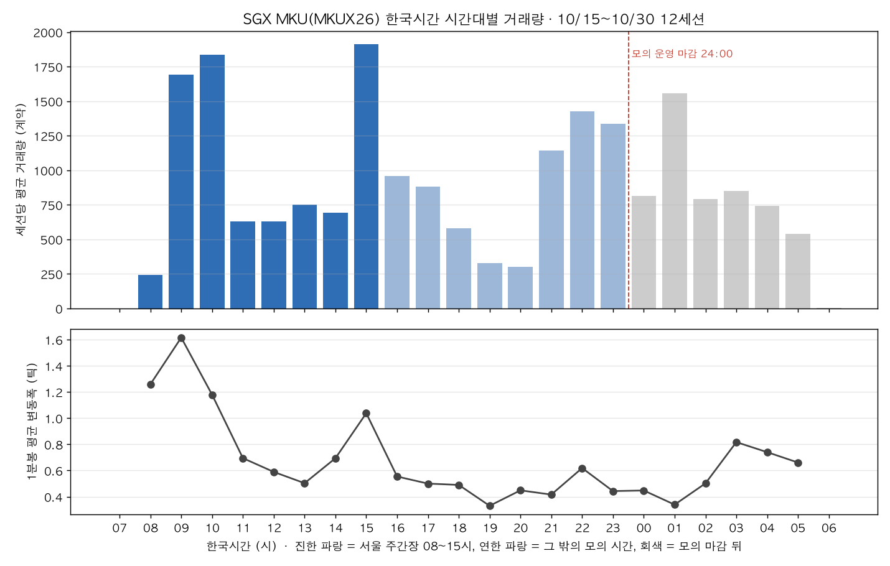
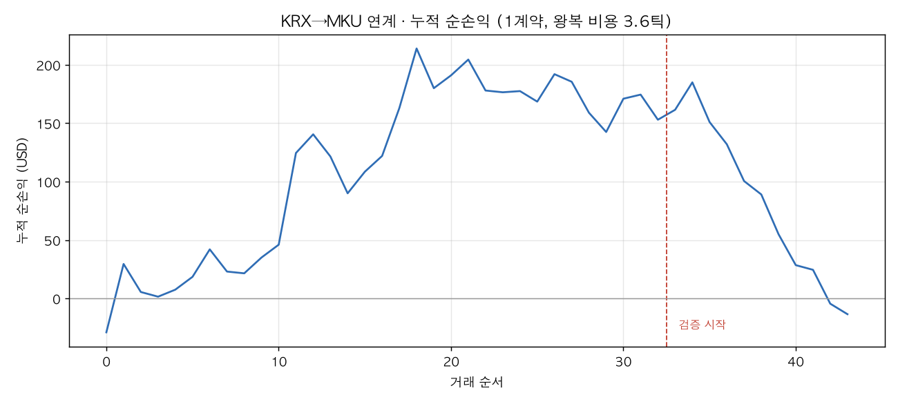

# 3주차 전략 근거: KRX 달러선물 → SGX MKU 연계 (서울 주간장)

NFT 팀 3주차 연계 전략 근거 문서입니다. 2026-11-02\~11-03에 작성했습니다. 같은 상품(SGX MKU)의 다른 후보(볼린저+RSI, 세션 개장 돌파)는 [전략 설계 문서](../week03-전략-설계.md)에 있습니다.

- 대상: SGX 미니 원달러 선물 `MKUX26` (거래소코드 `FSGX`, 11월물, 1틱 0.0001 = $2.50). 신호: KRX 미국달러 선물 `A756B000` (11월물)
- 실행 환경: NH선물 **모의계좌**. 해외 키로 MKU 시세·주문을, 국내 모의 키로 KRX 시세를 받습니다.
- 코드: `nh_client.py`(`profile="overseas"/"domestic"`), `fetch_data.py`(1분봉), `analyze_volume.py`(시간대별 거래량), `leadlag.py`(1분 선행 검증), `hold_experiment.py`(보유 시간 실험), `strategy_link.py` + `backtest_link.py`(1분봉 백테스트), `hold_backtest.py`, `fee_test.py`(수수료 확인), `ws_probe.py`(실시간 구독 확인), `ws_trader.py`(실행기), `analyze_live.py`(초 단위 분석), `replay_live.py`(실시간 기록 재현), `test_ws_trader.py`(실행기 판단 시험)
- 결과: `results/analysis/`, `results/backtest_link/`, `results/live/`, 차트 `results/charts/`
- 손익은 USD, 수수료 편도 $2(5절)를 반영한 값입니다.

## 1. 채택한 전략

| 구분 | 값 | 정한 방법 |
| --- | --- | --- |
| 거래 시간 | 서울 주간장만. 진입 09:00\~15:20, 15:40 전량 청산 | 시간대별 거래량·변동폭 (3절), KRX 신호가 있는 시간 |
| 신호 | 최근 **45초** 동안 KRX가 **0.8원** 이상 움직임 | 실시간 기록 재현으로 0.5원 → 0.8원 (7-4절) |
| 미반영 조건 | 같은 45초 동안 MKU 호가 중간값이 KRX 움직임의 **절반도 안 따라옴** (반영률 < 0.5) | 1분봉 검증 (4절) |
| 호가 조건 | MKU 매수·매도 호가 차이 2틱 이하 | 비용 (5절) |
| 진입 | KRX 상승 → MKU **매도**, KRX 하락 → MKU **매수**. 시장가 1계약 | MKU 가격은 1,000원당 USD라 방향이 반대 |
| 손절 | 청산 쪽 호가 기준 5틱 불리 | 출발값 |
| 시간 청산 | 진입 후 300초 | 출발값, 모의 주문 결과로 다시 정함 |
| 익절 | 없음 (시간 청산까지 보유) | 1분봉 백테스트에서 고른 조합도 익절 없음 (6-2절) |
| 일일 한도 | 그날 손절 3번이면 진입 중단. 청산 뒤 60초 대기 | week02와 같은 "횟수" 방식 |
| 시세 공백 | 시세가 20초 넘게 끊겼다 오면 그 전 값은 버림. 60초 동안 메시지가 없으면 다시 접속 | 11/03 실시간 기록에서 생긴 문제 (7-5절) |
| 저녁 (15:45 이후) | 이 전략은 매매하지 않음 | KRX 신호가 없음 |

**지금 판단:** 선행 관계는 실재하지만 **1초 안에 끝나서**(7-2절) 이 규칙으로 꾸준히 이길 근거는 아직 없습니다. 0.8원은 수익 전략으로 확정한 값이 아니라, 11/04 모의 주문으로 **실제 체결가·슬리피지를 재기 위한 설정**입니다.

## 2. 왜 이 전략을 하려고 했나

**같은 원/달러를 거래하는 두 시장 중 거래가 많은 KRX가 먼저 움직이고 MKU가 늦게 따라간다면, KRX가 크게 움직인 직후 아직 덜 따라온 MKU를 KRX 방향으로 잡아서 따라잡는 몫을 먹는다.**

- **가격 발견은 큰 시장에서 먼저 일어납니다.** 같은 기초자산이 여러 시장에서 거래되면 유동성이 큰 시장이 먼저 움직이고 작은 시장이 따라갑니다(정보 점유율, Hasbrouck 방식). 원/달러는 역내(현물·KRX 선물)와 역외(NDF·SGX) 사이에서 가격 발견이 나뉜다는 연구가 있습니다 — 이원섭(2016), 「선물연구」 24(2). [링크](https://www.emerald.com/jdqs/article/24/2/339/194745/Evidences-for-Price-Discovery-between-On-and-Off)
- **원화를 움직이는 정보는 역내에 먼저 들어옵니다.** 원화는 외국인 주식 자금과 역내 수급으로 움직인다는 해석이 증권사 코멘트에서 반복됩니다. 서울 주간장에는 KRX 달러선물이 MKU보다 거래가 훨씬 많습니다.
- **week02와 다른 시도를 하고 싶었습니다.** week02는 한 상품 안의 평균회귀였습니다. 이번 주제가 "해외 선물"이라 국내 상품과 해외 상품을 같이 쓰는 전략이 주제에 맞고, 우리 팀이 국내·해외 키를 둘 다 갖고 있어서 두 시장 시세를 동시에 받을 수 있었습니다.
- **분 단위로 KRX→SGX 선행을 직접 잰 공개 연구는 찾지 못했습니다.** 그래서 선행이 실제로 있는지부터 우리 데이터로 확인했습니다(4절).

> MKU 가격은 **1,000원당 USD**라서 방향이 반대입니다. KRX 달러선물이 오르면(원화 약세) MKU는 내립니다. 비교할 때는 MKU를 `원/달러 = 1000 ÷ MKU 가격`으로 바꿔 씁니다. MKU 1틱(0.0001)은 원/달러로 약 0.18원(가격 0.7454 기준)으로, KRX 1틱(0.1원)의 약 1.8배입니다.

## 3. 상품 특성: 시간대별 거래량 (`analyze_volume.py`, 10/15\~10/30 12세션)

MKU 1분봉 거래량과 변동폭을 한국시간 시간대별로 평균 냈습니다.

| 구간 (한국시간) | 거래량 비중 | 시간당 비중 | 1분봉 평균 변동폭 |
| --- | --- | --- | --- |
| 서울 주간장 08:45\~15:45 | 39.7% | **5.7%** (최대) | 0.5\~1.6틱 (09시 최대) |
| 15:45\~24:00 | 34.6% | 4.2% | 0.3\~0.6틱 |
| 00:00\~06:15 (모의 마감 뒤) | 25.7% | 4.1% | 0.3\~0.8틱 |



- 서울 주간장은 시간당 거래량과 변동폭이 가장 크고, **KRX 신호를 쓸 수 있는 유일한 시간대**입니다. 그래서 이 전략은 주간장에만 씁니다.
- 거래 봉우리는 09\~10시(역내 개장)와 15시(역내 마감 무렵)입니다. 역내 시장의 움직임이 MKU 거래를 끌어낸다는 2절의 생각과 맞습니다.
- 다만 11\~14시는 21\~23시보다 거래가 적어서, "거래가 주간장에 몰린다"는 부분적으로만 맞습니다.

## 4. 1분봉으로 확인한 선행 관계 (`leadlag.py`, 10/13\~10/30 14세션, 09:00\~15:30)

### 4-1. KRX가 1분 먼저 움직인다

1분 로그수익률 상관(MKU는 원/달러로 환산). lag +k는 「KRX k분 전 수익률 ↔ MKU 이번 분 수익률」입니다.

| lag | −1 | 0 | **+1** | +2 |
| --- | --- | --- | --- | --- |
| 빈 분을 직전 종가로 채움 | −0.003 | +0.652 | **+0.200** | +0.052 |
| MKU 체결이 있는 분만 | −0.019 | +0.762 | **+0.181** | +0.017 |

- 같은 분 상관이 0.65\~0.76으로, 두 시장은 같은 것을 거래합니다.
- **KRX→MKU 1분 지연 상관은 0.18인데 반대 방향은 0입니다.** 비대칭이라 KRX가 선행한다는 가설과 맞습니다.
- MKU 체결이 없는 분을 빼도 남으므로 **비동시 거래 착시가 아닙니다.** 해외 차트도 국내처럼 봉 시각이 "분 시작·한국시간"임을 확인해서(MKU 15:38:35 체결이 `153800` 봉) 시각 차이 착시도 아닙니다.

### 4-2. MKU가 덜 따라왔을 때만 남는 몫이 있다

KRX 충격 뒤 MKU 움직임 (MKU 틱, KRX 방향을 +로)

| 조건 | 건수 (하루) | 1분 뒤 | 2분 뒤 | 3분 뒤 | 5분 뒤 |
| --- | --- | --- | --- | --- | --- |
| KRX 1분 ≥ 0.3원 | 1,085 (77) | +0.57 | +0.73 | +0.84 | +0.77 |
| KRX 1분 ≥ 0.5원 | 561 (40) | +0.64 | +0.76 | +0.97 | +0.88 |
| ≥ 0.3원 **+ 반영률 < 0.5** | 448 (32) | +1.09 | +1.48 | +1.77 | +1.81 |
| ≥ 0.5원 **+ 반영률 < 0.5** | 167 (12) | +1.36 | +1.71 | **+2.43** | +2.39 |

(모두 t > 7. 반영률 = 충격 분 동안 MKU가 따라온 틱 ÷ KRX 움직임을 MKU 틱으로 바꾼 값)

- KRX 충격만으로는 뒤에 남는 몫이 1틱도 안 됩니다. **MKU가 덜 따라온 경우만 고르면 2\~3분 뒤 1.5\~2.4틱**으로 커집니다. 그래서 "미반영" 조건을 전략의 핵심으로 두었습니다.
- 주의: 마지막 체결가 기준이라 호가 튐(약 1틱)이 섞여 있을 수 있습니다. 그래서 백테스트는 다음 봉 시가 + 슬리피지로 보수적으로 체결했고(6절), 결국 호가를 실시간으로 기록해 확인했습니다(7절).

## 5. 비용: 수수료 확인 (`fee_test.py --go`, 2026-11-02 16:04, 모의계좌)

| 단계 | 체결가 | 수수료 변화 | 실현손익 변화 |
| --- | --- | --- | --- |
| 시장가 매수 1계약 (호가 0.74440 / 0.74460) | 0.7447 | **+$2.00** | 0 |
| 시장가 매도 1계약 | 0.7445 | **+$2.00** | −$5.00 (−2틱) |

- **MKU 수수료는 편도 $2**, 왕복 $4 = **1.6틱**입니다(NH 수수료표의 E-micro 등급과 같음).
- 호가 차이가 1\~2틱이라 시장가 왕복 비용은 **2.6\~3.6틱**입니다. 4-2절의 몫(1.5\~2.4틱)은 비용과 비슷하거나 작아서, 1분 단위로 짧게 먹기는 어렵다는 걸 여기서 알았습니다.
- 1계약 주문증거금은 약 $535였습니다.

## 6. 1분봉 백테스트

### 6-1. 보유 시간 실험 (`hold_experiment.py`, 14세션)

비용을 넘기 위해 보유를 늘려 봤습니다. 신호는 4-2절의 가장 좋은 조건(KRX 1분 ≥ 0.5원 + 반영률 < 0.5), 수수료 편도 $2 + 호가 1틱 = 왕복 2.6틱.

| 보유 | 거래 | 비용 전 평균 (t) | 순평균 | 14일 순손익 |
| --- | --- | --- | --- | --- |
| 3분 | 134 | +2.28틱 (8.3) | −0.32틱 | −$108 |
| 10분 | 110 | +2.88틱 (5.8) | +0.28틱 | +$78 |
| 30분 | 77 | +3.92틱 (3.5) | +1.32틱 | +$255 |
| 60분 | 52 | +3.71틱 (1.9) | +1.11틱 | +$144 |
| 120분 | 37 | +4.59틱 (1.6) | +1.99틱 | +$185 |

- 보유를 늘리면 비용 전 몫은 커지지만, 30분이 지나면 t가 2 아래로 떨어져서 늘어난 몫의 상당 부분은 운으로 봤습니다.
- 비교용으로 KRX 30분 추세·MKU 자기 30분 추세를 신호로 쓰면 모든 보유에서 손실이었습니다. **우위는 추세가 아니라 "덜 따라온 MKU의 따라잡기"에 있습니다.**
- 학습·검증을 나누지 않은 실험이라 6-2절 백테스트로 다시 확인했습니다.

### 6-2. 학습·검증 백테스트 (`strategy_link.py` + `backtest_link.py`)

- 학습 10/13\~10/27 (11일), 검증 10/28\~11/02 (4일). 봉이 끝나면 판정 → **다음 분 MKU 시가**에 체결. 수수료 + 슬리피지 편도 1틱 = 왕복 3.6틱.
- 조합: 충격 창 1/2/3분 × 충격 0.3/0.5/0.7원 × 반영률 0.3/0.5 × 보유 10/20/30분 × 익절 없음/4/6틱 × 손절 3/5/8틱 = 486개.

| | 거래 | 비용 전 평균 | 순손익 | 승률 |
| --- | --- | --- | --- | --- |
| 출발값, 학습 | 66 | +1.62틱 | −$327 | 36% |
| 고른 조합, 학습 | 33 | +5.46틱 | +$153 | 55% |
| **고른 조합, 검증** | 11 | **−2.46틱** | **−$167** | 18% |
| 무작위 진입 기준선, 검증 | | | 평균 −$104 | |

고른 조합: 충격 창 3분, 0.7원, 반영률 < 0.3, 30분 보유, 익절 없음, 손절 8틱.



| 편도 슬리피지 | 왕복 비용 | 학습 플러스 조합 | 고른 조합 검증 |
| --- | --- | --- | --- |
| 1틱 | 3.6틱 | 9% | −$167 |
| 0.5틱 | 2.6틱 | 24% | −$139 |
| 0틱 | 1.6틱 | 46% | −$112 |

- **슬리피지를 0으로 둬도 검증은 손실이고, 무작위 진입보다도 나쁩니다.**
- 출발값의 비용 전 몫(+1.6틱)이 4-2절(+2.4틱)보다 작습니다. 따라잡기가 **신호가 나온 그 1분 안에 대부분 끝나서**, 봉이 끝난 뒤 다음 분에 들어가면 늦는다고 봤습니다.
- 보유를 10\~180분으로 늘린 백테스트(`hold_backtest.py`)도 검증이 모두 −$170\~+$20이었습니다. 120분 넘게 들고 가면 "따라잡기"가 아니라 그날 오후 원/달러 방향에 거는 매매가 됩니다.

**판정: 1분봉으로 실행하면 성립하지 않습니다.** 먹을 수 있는지 보려면 KRX 체결과 MKU 호가를 **초 단위로** 받아야 해서, 웹소켓으로 실시간 기록을 했습니다(7절).

## 7. 실시간 기록으로 확인 (2026-11-03, 웹소켓)

### 7-1. 기록한 것

| 항목 | 내용 |
| --- | --- |
| 시간 | 09:24\~15:45, 주문 끔 (신호와 종이 체결만 기록) |
| 국내 키 | `KA` 체결 (A756B000) |
| 해외 키 | `FB` 호가 5단계 (MKUX26) |
| 시각 | 두 연결 모두 이 PC가 받은 시각(`recv_ts`). 같은 시계라 지연 비교에 쓸 수 있음 |
| 결과 | `results/live/20261103/` — `raw.jsonl.gz`(받은 메시지 전부), `events.csv`(신호·체결·끊김), `analysis.json` |

데이터 공백이 두 번 있었습니다.

| 시간 | 원인 |
| --- | --- |
| 12:21\~13:12 | PC 인터넷 끊김. 소켓이 끊긴 걸 실행기가 알아채지 못함 |
| 14:02\~15:27 | 국내 모의 서버가 구독 성공(`RT_INIT`) 뒤 체결·pingpong을 보내지 않음. 해외는 정상, 다시 접속해도 같음 (NH에 문의) |

공백과 그 뒤 5분을 빼면 **깨끗한 구간은 212분**입니다.

### 7-2. MKU는 몇 초 늦게 따라가나 (`analyze_live.py`)

KRX 1초 변화와 MKU 호가 중간값 1초 변화의 상관 (MKU를 k초 늦춰 비교)

| MKU 지연 | −1초 | **0초** | **1초** | 2초 | 3초 | 5\~30초 |
| --- | --- | --- | --- | --- | --- | --- |
| 상관 | −0.06 | **−0.30** | **−0.12** | 0.00 | 0.00 | −0.01\~+0.02 |

(음수 = KRX 상승 때 MKU 하락. 방향이 반대인 게 맞습니다.)

- **MKU는 KRX를 따라가지만 1초 안에 끝납니다.** 2초부터는 상관이 0입니다.
- 4-1절의 "1분 지연 상관 0.18"은 이 1초 지연이 1분봉 경계에 걸린 몫으로 설명됩니다. 분 단위로 늦게 따라가는 게 아닙니다. 6-2절에서 다음 분에 들어가면 늦었던 이유도 이것입니다.
- 개인이 REST로 내는 주문은 신호 판정·전송·체결을 1초 안에 끝내기 어렵습니다. **따라잡기 몫 자체를 먹는 건 이 구조로는 어렵습니다.**

### 7-3. 큰 충격 뒤 MKU가 덜 따라왔을 때

45초 동안 KRX가 기준 이상 움직였는데 MKU 반영률이 0.5 미만인 순간에 KRX 방향으로 잡았다면 (틱, 비용 전 평균)

| KRX 충격 | 충격 수 | 조건 맞은 수 | 1초 뒤 | 10초 뒤 | 60초 뒤 | 300초 뒤 | 300초 비용 뺀 값 |
| --- | --- | --- | --- | --- | --- | --- | --- |
| 0.3원 | 97 | 6 | +0.4 | 0.0 | +0.8 | −0.8 | **−3.6** |
| 0.5원 | 66 | 2 | +1.8 | +1.0 | +1.0 | +2.5 | −0.1 |
| 0.7원 | 25 | 1 | +3.0 | +1.0 | +2.0 | +8.0 | +5.4 |
| 1.0원 | 6 | 0 | | | | | |

- 작은 충격(0.3원)은 MKU가 덜 따라온 채로 끝나고 비용만 냅니다.
- 0.5원 이상은 비용 전 몫이 플러스지만 하루 1\~2건이라 판단 근거로는 부족합니다.

### 7-4. 실행기 규칙 그대로 재현 (`replay_live.py`)

기록을 실행기 판단 코드(`Engine`)에 그대로 다시 흘렸습니다. 체결은 신호 순간의 반대 호가, 손절 5틱, 보유 300초.

| 충격 기준 | 거래 | 승 | 틱 합 (비용 전) | 순손익 |
| --- | --- | --- | --- | --- |
| 0.5원 (원안, 실행한 값) | 4 | 1 | −2 | −$21.0 |
| 0.6원 | 3 | 1 | −1 | −$14.5 |
| 0.7원 | 2 | 1 | +4 | +$2.0 |
| **0.8원 (채택)** | **1** | **1** | **+9** | **+$18.5** |
| 1.0원 | 0 | | | |

- 기준을 올리면 작은 충격에서 나던 손절이 빠집니다. 0.8원의 한 건은 09:40 매도, +9틱입니다.
- **원안(0.5원)은 기각하고 0.8원으로 바꿨습니다.** 하지만 하루 1건이라 우위가 있다고 말할 수는 없습니다(1절 "지금 판단").

### 7-5. 기록하며 고친 것

| 문제 | 증상 | 고친 것 |
| --- | --- | --- |
| 끊긴 소켓을 모름 | 12:21 인터넷이 끊긴 뒤 51분 동안 멈춰 있었음 | 60초 동안 아무 메시지(pingpong 포함)도 없으면 다시 접속 |
| 끊긴 뒤 가짜 충격 | 14:47 국내 시세가 다시 들어올 때 끊기기 전 가격과 비교해 1.9원 충격으로 보고 진입 (−$9) | 시세가 20초 넘게 끊겼다 오면 그 전 값을 버림 (`stale_s`). 시험 `test_stale_krx_gap_no_fake_shock` 추가 |
| 재시작하면 기록이 덮임 | | 기록 파일을 이어 쓰기로 열어 하루에 여러 번 켜도 한 폴더에 쌓임 |

7-4절 표는 고친 뒤의 재현입니다.

## 8. 한계

- **표본이 짧습니다.** MKUX26이 근월물로 거래된 기간이 2\~3주라 1분봉 백테스트 검증이 4일·11건이고, 실시간 기록은 하루(깨끗한 구간 212분)입니다.
- **종이 체결은 실제보다 유리합니다.** 신호 순간 호가 그대로 체결된다고 봤습니다. 11/04 모의 주문으로 차이를 잽니다.
- **모의 체결은 실제와 다를 수 있습니다.** 모의 서버가 MKU 호가 잔량을 실제처럼 반영하는지 알 수 없습니다.
- **받은 시각에는 서버→PC 지연이 섞여 있습니다.** 국내·해외 서버 지연이 다르면 0\~1초 차이는 그만큼 흔들릴 수 있습니다.
- **국내 모의 웹소켓이 조용해지면 신호가 없습니다.** 그 구간은 진입하지 않습니다(`stale_s`).
- **만기:** `MKUX26` 만기 전에 `MKUZ26`으로 넘어가야 합니다.

## 9. 재현

```bash
cd week03/leadlag
python3 fetch_data.py                                  # MKU 1분봉 (해외 키)
python3 fetch_data.py --krx A756B000                   # KRX 1분봉 (국내 키)
python3 analyze_volume.py                              # 3절 시간대별 거래량
python3 leadlag.py                                     # 4절 1분 선행 검증
python3 hold_experiment.py                             # 6-1절
python3 backtest_link.py                               # 6-2절
python3 -m unittest test_ws_trader -v                  # 실행기 판단 시험 (8개)
python3 analyze_live.py --day 20261103                 # 7-2·7-3절
python3 replay_live.py --day 20261103 -v               # 7-4절
caffeinate -i python3 ws_trader.py --orders --start-at 084000 --until 154500   # 모의 주문 실행
```

차트는 `matplotlib`, 실시간은 `websockets`가 필요합니다. 키는 `~/.nh_futures/credentials.env`(국내), `credentials_overseas.env`(해외)에서 읽습니다.
