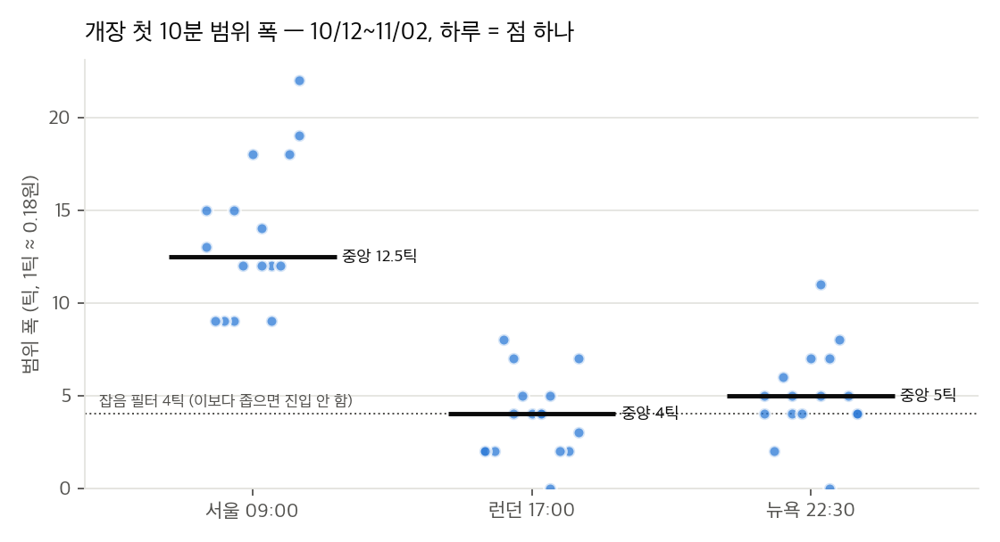
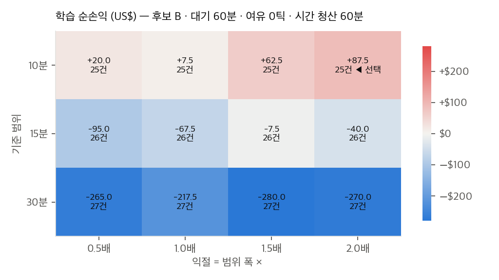
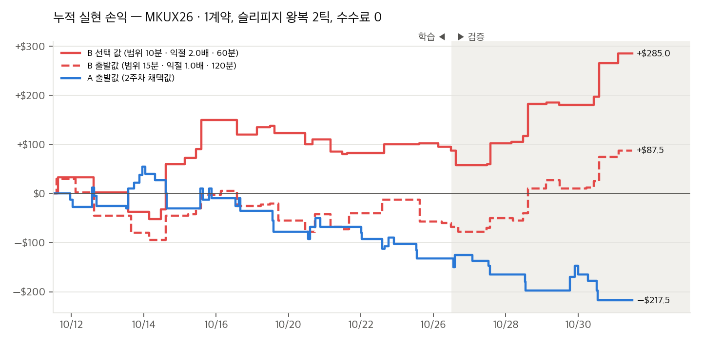
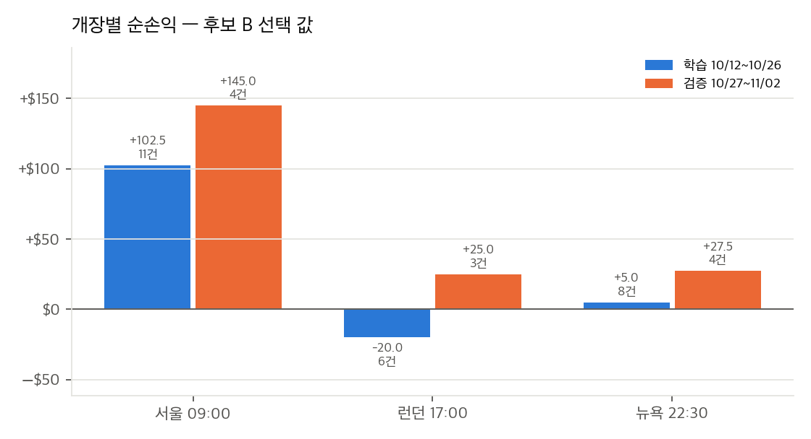
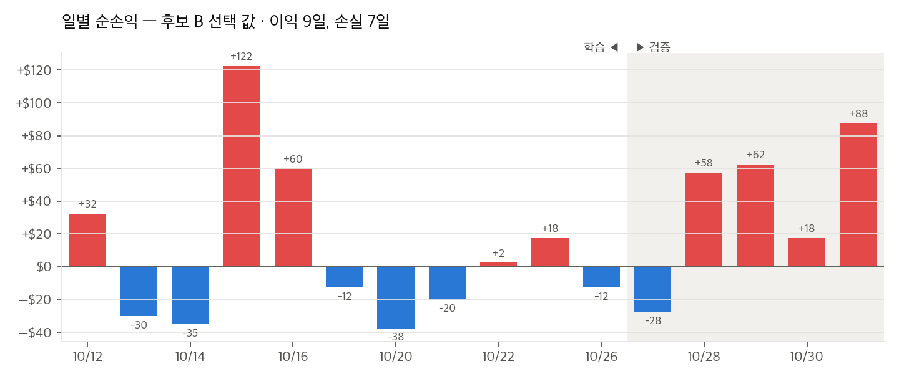
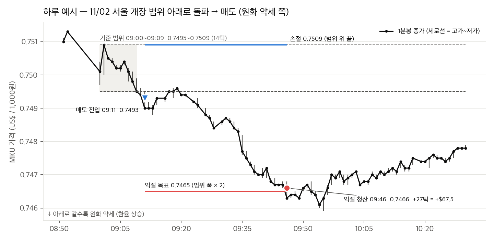
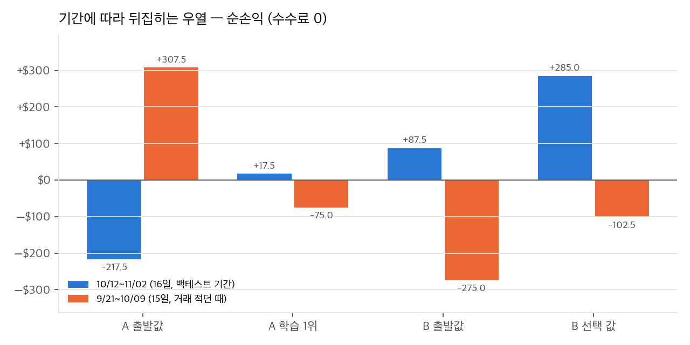

# 3주차 전략 설계: SGX 미니 원달러(MKU) — 볼린저+RSI vs 세션 개장 돌파

NFT 팀 3주차 전략 설계 문서입니다. 2026-11-03에 작성했습니다. 배정 주제는 통화(SGX MKU)이고, NH선물 **해외 모의계좌**로 실행합니다.

후보 두 개를 같은 상품, 같은 시간, 같은 체결 가정으로 비교했습니다.

- 후보 A: 2주차 볼린저+RSI 평균회귀를 MKU로 옮긴 것
- 후보 B: 원달러의 시간대 특성을 쓰는 세션 개장 돌파 (추세 추종)

**요약:** 11월물에 거래가 붙은 16거래일(10/12 ~ 11/02) 백테스트에서는 후보 B가 낫습니다(선택 값 +US$285, 후보 A 출발값 −US$217.5, 수수료 반영 전). 하지만 그 앞 15거래일(9/21 ~ 10/09, 거래가 적던 때)에서는 결과가 반대로 나와서, 이 결론은 아직 단단하지 않습니다(9절). 실행은 후보 B로 하고, 실행 결과로 다시 확인합니다.

- 코드: `common.py`(MKU 상품 정보, 매매 시간, ATR, 호가 계산), `strategy_bb.py`(후보 A), `strategy_orb.py`(후보 B), `nh_client.py`(해외 API, 키는 `~/.nh_futures/credentials_overseas.env`), `fetch_data.py`(데이터 받기), `backtest.py`(두 후보 백테스트와 최적화), `plot_backtest.py`(차트)
- 테스트: `test_strategy_bb.py`, `test_strategy_orb.py` (23개, 실행: `python3 -m unittest test_strategy_orb test_strategy_bb -v`)
- 결과: `results/data/`(1분봉과 원본 응답), `results/backtest_bb/`, `results/backtest_orb/`, 차트: `results/charts/`
- 다시 돌리기: `python3 fetch_data.py` → `python3 backtest.py --optimize` (15초) → `python3 plot_backtest.py`

## 1. 상품: SGX 미니 원달러 (MKU)

| 항목 | 값 | 근거 |
| --- | --- | --- |
| 거래소 / 품목 | SGX / `MKU` (Mini SGX KRW/USD FX Futures, "SGX 미니 원달러") | NH 품목별세부정보 |
| 종목코드 | 품목 + 월물 글자 + 연도 두 자리. 예: 2026년 11월물 `MKUX26`, 12월물 `MKUZ26` | 모의서버 조회 |
| 거래소코드 (시세·차트 요청) | `FSGX` | 모의서버 조회 |
| 사용 월물 | **`MKUX26`** (만기 2026-11-16, 현금결제). 11-03 거래량 16,082계약으로 12월물(3,006계약)의 5배 | 해외 만기일조회, 현재가 |
| 시세 형식 | `"0.74350"` 처럼 소수 다섯 자리 문자열 (마지막 자리는 늘 0) | 모의서버 현재가, 차트(분) |
| 계약 크기 | 25,000,000원 (계약단위 25,000) | NH 품목별세부정보 |
| 호가 | 원화 1,000원당 미국 달러 (KRW/USD) | SGX 규정 |
| 틱 | 0.0001 = **US$2.50** | NH 품목별세부정보 (tick_unt, tick_val) |
| 통화 | USD (손익, 수수료, 증거금 모두 달러) | NH 품목별세부정보 |
| 거래시간 (한국 시간) | 1차 08:25 ~ 20:35, 2차 20:50 ~ 익일 06:15, 정산가 20:35 | NH 장운영정보 |
| 분봉 시각 | 한국 시간 (응답 칸 이름은 `exch_tm` 이지만 값은 한국 시간) | NH 해외 차트(분) 응답 |

품목별세부정보와 장운영정보는 2026-09-09 실서버 응답 기록(NH-open-api-app 저장소의 `tests/fixtures/nh/`)과 2026-11-03 해외 모의서버 조회(`results/data/`)가 같았습니다.

### 1-1. 가격이 환율의 역수입니다

이 상품의 이름은 "미니 원달러"인데, 호가는 원달러 환율(USD/KRW)이 아니라 그 역수(KRW/USD)입니다.

| 원달러 환율 | MKU 가격 (= 1,000 ÷ 환율) |
| --- | --- |
| 1,345원 | 0.7435 (2026-11-03 20:15 MKUX26 현재가) |
| 1,355원 | 0.7380 |

- 환율이 오르면(원화 약세) MKU 가격은 내려갑니다.
- MKU를 **사면 원화 강세(환율 하락)** 에, **팔면 원화 약세(환율 상승)** 에 겁니다.
- 신호 로그에 MKU 방향과 함께 "원화 강세(환율 하락) 쪽" 같은 환율 방향을 같이 적어서 헷갈리지 않게 했습니다 (`common.won_view`).
- 환율 1,345원 근처에서 환율 1원은 MKU 약 0.00055, 약 **5.5틱 = US$14** 입니다.

### 1-2. 2주차 상품(국내 미국달러선물)과 비교

| | 국내 미국달러선물 (2주차) | SGX MKU (3주차) |
| --- | --- | --- |
| 호가 | 1달러당 원 (USD/KRW) | 1,000원당 달러 (KRW/USD) |
| 계약 크기 | US$10,000 | 25,000,000원 (약 US$18,600) |
| 1틱 | 0.1원 = 1,000원 | 0.0001 (환율 약 0.18원) = US$2.50 |
| 매매 시간 | 09:00 ~ 15:45 (주간) | 08:25 ~ 20:35, 20:50 ~ 익일 06:15 |
| 손익 통화 | 원 | 달러 |
| 거래가 없던 분 | 드묾 | 많음 (5절) |

MKU 1틱은 환율로 약 0.18원이라 국내 달러선물 1틱(0.1원)의 두 배쯤입니다. 2주차에 틱 수로 정한 값(최소 손절 3틱 등)을 그대로 쓰면 MKU에서는 환율 기준으로 두 배 넓어집니다.

## 2. 두 후보 공통 조건

| 항목 | 값 | 이유 |
| --- | --- | --- |
| 계좌 | NH선물 해외 모의계좌 | 과제 권장 |
| 매매 시간 | 08:25 ~ 20:35, 20:50 ~ 24:00 (한국 시간) | SGX가 열려 있고 해외 모의계좌가 운영되는(07:00 ~ 24:00) 시간 전체 |
| 휴장 15분 | 20:35 ~ 20:50 봉은 쓰지 않음. 들고 있던 포지션은 그대로 둠 | SGX 1차 마감과 2차 개장 사이 |
| 마감 정리 | 23:50 전량 청산, 날을 넘기지 않음 | 모의계좌가 24:00에 닫힘. 하루 단위로 손익을 끊어 봄 |
| 수량 | 1계약, 보유 중 추가 진입 없음 | 2주차와 같음 |
| 일일 한도 | 그날 손절이 2번 나오면 더 진입하지 않음 | 2주차와 같은 규칙. 두 후보가 같은 규칙을 써야 비교가 됨 |
| 날짜와 시각 | 한국 날짜, 한국 시간 | 분봉 응답이 한국 시간이고 23:50에 청산해서 날을 넘기지 않음 |

## 3. 후보 A: 볼린저 밴드 + RSI 평균회귀 (2주차 이식)

2주차 메인 전략([2주차 근거 문서](../week02/week02-전략-근거-볼린저RSI.md))을 판정 규칙은 그대로 두고 상품에 묶인 부분만 바꿨습니다. 같은 전략이 국내 달러선물과 해외 원달러에서 어떻게 다르게 나오는지 보는 것이 목적입니다.

| 구분 | 값 (출발값 = 2주차 채택값) |
| --- | --- |
| 판정 봉 | 5분봉 (08:25 기준으로 묶음, 휴장 뒤 첫 봉은 20:50 시작) |
| 밴드 | 판정 봉 종가 SMA(20) ± 1.5σ (모집단 표준편차) |
| 보조 지표 | RSI(14), Wilder 평활 |
| 진입 | 종가가 하단 밖이고 RSI ≤ 35이면 매수, 상단 밖이고 RSI ≥ 65이면 매도 (밴드를 벗어나면 바로 진입) |
| 익절 | 가격이 중심선에 닿으면 |
| 손절 | 진입가에서 ATR(14) × 1.5, 최소 3틱 |
| 시간 청산 | 진입 후 120분 |
| 진입 시간 | 08:25 ~ 23:30 |
| 기타 | 청산 후 1봉 대기, 중심선까지 3틱이 안 남으면 진입하지 않음, 지표는 날을 넘겨 이어서 계산 |

2주차에서 바꾼 부분:

| | 2주차 | 3주차 |
| --- | --- | --- |
| 호가 / 1틱 가치 | 0.1원 / 1,000원 | 0.0001 / US$2.50 |
| 세션 | 09:00 ~ 15:35 | 08:25 ~ 20:35, 20:50 ~ 24:00 |
| 진입 시간 | 09:30 ~ 15:00 | 08:25 ~ 23:30 |
| 마감 정리 | 15:30 | 23:50 |
| 손익 단위 | 원 | 달러 |

## 4. 후보 B: 세션 개장 돌파 (추세 추종)

### 4-1. 아이디어

원달러는 시장이 새로 열리는 순간에 크게 움직이는 경향이 있습니다. 하루 중 그런 순간이 세 번 있습니다.

- **서울 09:00:** 국내 외환시장이 열리면서 밤사이 해외 움직임이 한꺼번에 반영됩니다.
- **런던 17:00 전후:** 유럽 참가자가 들어옵니다.
- **뉴욕 22:30:** 미국 경제지표가 발표되는 시각입니다.

개장 직후 첫 몇 분의 고가와 저가로 기준 범위를 정하고, 가격이 그 범위를 벗어나면 벗어난 쪽으로 따라 들어갑니다. 과제 글의 "시장 시간대 특성 활용"에 해당합니다.

후보 A가 평균회귀(밴드 밖으로 나가면 되돌아온다)라면 후보 B는 추세 추종(범위를 벗어나면 그쪽으로 더 간다)입니다. 두 후보가 반대 가정이라서, 결과를 비교하면 MKU가 어느 쪽 성격에 가까운지도 볼 수 있습니다.

### 4-2. 규칙

| 구분 | 출발값 | 선택 값 (8절) |
| --- | --- | --- |
| 개장 시점 | 서울 09:00, 런던 17:00, 뉴욕 22:30 (한국 시간) | 같음 |
| 기준 범위 | 개장 시점부터 **15분** 동안 1분봉의 최고가와 최저가 | **10분** |
| 진입 | 범위가 정해진 뒤 60분 안에, 1분봉 종가가 범위 위로 1틱 이상 나가면 매수, 아래로 1틱 이상 나가면 매도. 다음 1분봉에 진입 | 같음 |
| 손절 | 범위 반대편 끝 가격 | 같음 |
| 익절 | 진입가에서 범위 폭 × **1.0** | **× 2.0** |
| 시간 청산 | 진입 후 **120분**, 다음 개장 시점, 23:50 중 먼저 오는 때 | **60분** |
| 개장당 진입 | 한 번 (같은 개장에서 손절 뒤 다시 들어가지 않음) | 같음 |
| 범위 필터 | 범위 폭 4틱(약 0.7원) 미만이면 잡음, 30틱(약 5.4원) 초과면 이미 움직임이 끝난 것으로 보고 진입하지 않음 | 같음 |
| 손절 폭 상한 | 40틱 (약 7.2원, US$100) | 같음 |
| 일일 한도 | 공통 조건과 같음 (손절 2회) | 같음 |

- 개장 시각은 11월 1일에 미국 서머타임이 끝난 기준입니다. 3월 둘째 주부터는 런던 16:00, 뉴욕 21:30으로 바꿔야 합니다 (`Params.windows`).
- 범위 필터와 손절 상한은 1-1절의 환산으로 정한 값이고 최적화하지 않았습니다. 5절의 범위 폭 분포를 보면 서울은 거의 걸리지 않고, 런던은 절반 가까이가 4틱 미만이라 걸립니다.
- `strategy_orb.Params` 기본값은 아직 출발값입니다. 실행할 때 선택 값으로 바꿉니다.

## 5. 데이터

- 해외 모의서버 차트(분) API로 `MKUX26` 1분봉 14,277개를 받았습니다 (`results/data/bars_1m_MKUX26.csv`, 2026-08-21 ~ 11-03).
- **거래가 없던 분은 봉이 없습니다.** 11월물이 최근월물이 된 10/12부터는 매매 시간(하루 약 920분) 안에 하루 350 ~ 590개, 그 전에는 하루 수십 ~ 340개입니다. 분당 거래량 중앙값은 10계약입니다.
- **백테스트 기간은 10/12 ~ 11/02 (16거래일)** 입니다. 학습 10/12 ~ 10/26 (11일), 검증 10/27 ~ 11/02 (5일). 11/03은 받을 때 장중이라 뺐습니다.
- 기간을 앞으로 늘리려고 했지만, 만기가 지난 월물(10월물 `MKUV26`, 9월물 `MKUU26` 등)은 모의서버가 "종목을 찾을 수 없습니다"로 거절하고, 12월물은 아직 하루 100개 안팎입니다. 9/21 ~ 10/09의 11월물(거래가 적던 때)은 9절에서 따로 확인용으로만 씁니다.

개장 범위 폭 (10/12 ~ 11/02, 16일, 단위 틱):

| 개장 | 첫 10분 중앙값 (25% ~ 75%) | 첫 15분 중앙값 (25% ~ 75%) | 첫 15분 안 1분봉 수 (중앙값) |
| --- | --- | --- | --- |
| 서울 09:00 | 12.5 (10 ~ 17) | 14.5 (12 ~ 21) | 15 |
| 런던 17:00 | 4 (2 ~ 5) | 4 (3 ~ 7) | 6.5 |
| 뉴욕 22:30 | 5 (4 ~ 7) | 5.5 (4 ~ 7) | 13 |

서울 개장 범위가 런던, 뉴욕의 2.5 ~ 3배입니다. 서울 개장 때 원달러가 가장 크게 움직인다는 4-1절의 가정과 맞습니다.

## 6. 백테스트 체결 가정 (`min1-mku-v1`)

2주차 `min1-v2`와 같은 방식에 MKU 사정(빈 분)을 더했습니다. 두 후보가 `backtest.py`의 같은 체결 코드를 씁니다.

- 신호가 나면 다음 1분봉 시가에 시장가로 진입하고, 불리한 쪽으로 슬리피지 1틱(US$2.50)을 줍니다. 빈 분이 있으면 "다음 1분봉"이 몇 분 뒤일 수 있는데, 시장가 주문이 다음 체결에 붙는 것과 같다고 봤습니다. 그 봉이 23:50 이후면 진입하지 않습니다.
- 보유 중에는 1분봉마다 손절과 익절을 확인합니다. 같은 1분봉에서 둘 다 닿으면 손절로 처리합니다.
- 후보 A의 익절가는 마지막으로 끝난 판정 봉의 중심선을 불리한 쪽 호가로 맞춘 값, 후보 B의 익절가는 진입가 ± 범위 폭 × 익절 배수, 손절가는 범위 반대편 끝 가격입니다.
- 시간 청산과 23:50 정리는 그 시각 이후 첫 1분봉 시가에 슬리피지 1틱을 줍니다.
- 수수료는 0입니다 (해외 모의계좌 수수료 확인 전). 8-3절에서 수수료 민감도를 따로 봤습니다. 1계약.
- 학습과 검증은 전체 기간을 이어서 돌린 뒤 거래를 진입일로 나눕니다(2주차 후보 A와 같은 이유: 밴드, RSI, ATR이 날을 넘겨 이어짐).
- 손계산 확인: 후보 B 첫 거래(10/12 서울)를 원자료로 계산했습니다. 범위 09:00 ~ 09:14 고가 0.7478 / 저가 0.7465, 09:24 종가 0.7479로 매수 신호, 09:25 시가 0.7480 + 1틱 = 0.7481 진입, 목표 0.7481 + 13틱 = 0.7494, 체결 0.7493 → +12틱 = +US$30. 백테스트 결과와 같습니다.

## 7. 결과: 후보 A (볼린저+RSI)

| | 학습 (11일) | 검증 (5일) | 전체 (16일) |
| --- | --- | --- | --- |
| 출발값 (2주차 채택값) | −$132.5 (36건, 승률 33%) | −$85.0 (13건, 승률 23%) | −$217.5 (49건, PF 0.61, 최대 낙폭 $272.5) |
| 학습 1위 (15분봉 · 2.5σ · RSI 35/65 · 바로 진입 · ATR×1.5 · 60분) | +$90.0 (15건) | −$72.5 (7건, PF 0.24) | +$17.5 (22건) |

6가지 값을 바꿔서 432개 조합을 학습 기간에 돌렸습니다(2주차와 같은 후보: 판정 봉 1·5·15분, 밴드 1.5·2.0·2.5σ, RSI 30/35/40/사용 안 함, 복귀 확인/바로 진입, 손절 ATR×1.5·2.0·3.0, 시간 청산 60·120분).

- 학습 거래 15건 이상인 393개 중 **학습 순손익이 플러스인 조합은 5개**뿐이고, 중앙값은 −$175입니다. 1분봉은 144개 모두 손실입니다.
- 이웃 평균(값 하나를 한 칸씩 바꾼 조합들의 평균)도 상위 5개가 모두 마이너스입니다.
- 학습 1위도 검증에서 손실이 났습니다.
- 출발값의 손실은 특정 시간대에 몰리지 않았습니다 (서울 장 33건 −$60, 개장 전 8건 −$52.5, 아시아 오후 5건 −$67.5, 런던 3건 −$37.5). 손절 32건, 익절 17건이고 평균 이익 $22.8, 평균 손실 −$16.5입니다.

2주차 국내 달러선물에서 통하던 평균회귀가 이 기간 MKU에서는 통하지 않았습니다. 그래서 후보 A의 값은 다시 정하지 않고, 비교 기준으로만 둡니다.

## 8. 결과: 후보 B (세션 개장 돌파)

### 8-1. 학습 기간에서 조합 찾기

5가지 값을 바꿔서 216개 조합을 돌렸습니다.

| 값 | 후보 | 학습 순손익 플러스 / 후보 수 | 해석 |
| --- | --- | --- | --- |
| 기준 범위 | 10, 15, 30분 | 10분 15/72, 15분 1/72, 30분 0/72 | 짧을수록 나음. 30분이면 움직임이 범위 안에서 끝남 |
| 돌파 대기 | 30, 60, 120분 | 4/72, 6/72, 6/72 | 차이 작음 |
| 돌파 여유 | 0, 2틱 | 16/108, 0/108 | 범위를 넘는 즉시 들어가야 함 |
| 익절 배수 | 0.5, 1.0, 1.5, 2.0 | 2/54, 2/54, 4/54, 8/54 | 멀리 둘수록 나음 |
| 시간 청산 | 60, 120, 240분 | 11/72, 2/72, 3/72 | 짧게 들고 나오는 게 나음 |

학습 순손익 1위와 이웃 평균 1위가 **같은 조합**입니다: 범위 10분 · 대기 60분 · 여유 0틱 · 익절 2.0배 · 시간 청산 60분 (학습 +$87.5, 25건, 이웃 평균 +$22.5). 한 점만 튀는 값이 아니어서 이 값을 선택했습니다(2주차와 같은 기준).

기준 범위가 짧을수록, 익절이 멀수록 나은 방향이 표 전체에서 일관되게 보입니다. 30분 범위는 익절 배수와 상관없이 모두 큰 손실입니다.

### 8-2. 결과

| | 학습 (11일) | 검증 (5일) | 전체 (16일) |
| --- | --- | --- | --- |
| 출발값 (범위 15분 · 익절 1.0배 · 120분) | −$67.5 (25건, 승률 44%) | +$155.0 (12건, 승률 75%) | +$87.5 (37건, PF 1.27, 최대 낙폭 $125) |
| **선택 값** (범위 10분 · 익절 2.0배 · 60분) | +$87.5 (25건, 승률 48%) | **+$197.5** (11건, 승률 82%, PF 6.64, 최대 낙폭 $30) | **+$285.0** (36건, PF 2.23, 최대 낙폭 $92.5) |

선택 값의 개장별 손익 (전체 16일):

| 개장 | 거래 | 손익 | 학습 / 검증 |
| --- | --- | --- | --- |
| 서울 | 15 | **+$247.5** | +$102.5 / +$145.0 |
| 뉴욕 | 12 | +$32.5 | +$5.0 / +$27.5 |
| 런던 | 9 | +$5.0 | −$20.0 / +$25.0 |

- 손익 대부분이 **서울 개장**에서 나왔습니다. 개장 범위가 가장 넓은 시간대(5절)이기도 합니다.
- 청산 이유: 시간 청산 18건, 익절 8건, 마감 정리 6건, 손절 4건. 범위 폭의 2배 목표까지 가는 경우는 적고, 돌파 뒤 1시간 동안 붙는 움직임을 가져가는 전략에 가깝습니다.
- 실제 손절 폭: 4 ~ 22틱, 중앙값 9.5틱 (US$24). 날별로는 이익 9일, 손실 7일, 가장 나쁜 날 −$37.5, 가장 좋은 날 +$122.5.

검증 기간 하루 예시입니다. 11/02 서울 개장 10분 범위(14틱)를 09:10 종가가 아래로 벗어나 09:11에 매도했고, 09:46에 범위 폭 2배 목표에 닿아 +27틱(+$67.5)으로 청산했습니다. MKU가 내려간 것은 원화 약세(환율 상승)입니다.

### 8-3. 수수료 민감도

해외 모의계좌 수수료를 아직 모릅니다. 왕복 수수료를 넣고 전체 16일을 다시 돌렸습니다.

| 왕복 수수료 | 선택 값 (36건) | 출발값 (37건) |
| --- | --- | --- |
| $0 | +$285.0 | +$87.5 |
| $2 | +$213.0 | +$13.5 |
| $5 | +$105.0 | −$97.5 |

거래 한 건의 평균 손익이 $8쯤이라 수수료가 결과를 크게 좌우합니다. 첫 모의 체결에서 수수료를 확인하고 다시 계산합니다.

## 9. 앞쪽 기간으로 다시 확인 (9/21 ~ 10/09)

백테스트 기간이 16일뿐이라, 11월물이 아직 원월물이던 앞쪽 15거래일에 같은 값을 그대로 돌려 봤습니다. 이 기간은 하루 1분봉이 114 ~ 340개로 거래가 적습니다.

| | 10/12 ~ 11/02 (16일, 백테스트 기간) | 9/21 ~ 10/09 (15일, 확인용) |
| --- | --- | --- |
| A 출발값 | −$217.5 (49건) | **+$307.5** (35건, 승률 46%) |
| A 학습 1위 | +$17.5 (22건) | −$75.0 (11건) |
| B 출발값 | +$87.5 (37건) | **−$275.0** (27건, 서울 −$175) |
| B 선택 값 | +$285.0 (36건) | **−$102.5** (19건, 승률 26%, 서울 −$75) |

**두 후보의 우열이 기간에 따라 뒤집힙니다.** 이 결과로 볼 때 "MKU에서는 추세 추종이 평균회귀보다 낫다"고 말할 수는 없습니다.

거래가 적은 기간이라 결과가 왜곡됐을 가능성은 있습니다. 체결이 드물면 가격이 매수호가와 매도호가 사이를 오가는 것만으로 평균회귀처럼 보여서 후보 A가 좋아 보일 수 있고, 개장 범위도 봉 3 ~ 6개로 정해집니다(서울 15분 범위 안 1분봉 수 중앙값 6개, 백테스트 기간은 15개). 다만 이것은 추정이고 확인하지 않았습니다.

## 10. 결론과 실행 계획

- **실행은 후보 B, 선택 값(범위 10분 · 대기 60분 · 익절 2.0배 · 시간 청산 60분)으로 합니다.** 거래가 충분한 최근 16일 기준으로는 두 후보 중 유일하게 학습과 검증이 모두 플러스였습니다.
- 후보 A는 실행하지 않고 백테스트 비교로만 둡니다. 최근 16일에서 432개 조합 중 5개만 플러스였습니다.
- 이 선택은 16일, 36건에 기댄 것이고 앞쪽 기간에서는 반대 결과가 나왔습니다(9절). 실행 결과를 백테스트와 나란히 놓고, 특히 서울 개장 거래가 백테스트처럼 나오는지 봅니다.
- 실행하면서 확인할 것: 실제 수수료(8-3절), 슬리피지 1틱 가정이 맞는지(11/03 현재가 조회 때 최우선 호가 잔량이 매수 11계약, 매도 15계약), 빈 분 때문에 진입이 늦어지는 경우.

## 11. 다음 단계

1. `strategy_orb.Params` 기본값을 선택 값으로 바꿉니다.
2. 해외 API 클라이언트(`nh_client.py`)에 주문과 잔고 함수를 붙입니다. 지금은 조회(현재가, 차트, 만기일, 품목 정보, 장운영정보)만 있습니다. 해외는 신규, 정정, 취소가 주문 API 하나(`qt_div_cd`)이고, 거부 사유가 `err_cd`, `err_msg`로 오는 등 국내와 다른 곳이 있어서 명세대로 씁니다.
3. 해외 모의계좌에서 후보 B를 실행하고 신호, 주문, 체결, 수수료, 손익을 기록합니다.
4. 실행하는 동안 `fetch_data.py`로 1분봉을 다시 받아 백테스트 기간을 늘립니다. 11월물 만기(11/16) 전까지 최근월물 데이터가 약 25일로 늘어납니다.
